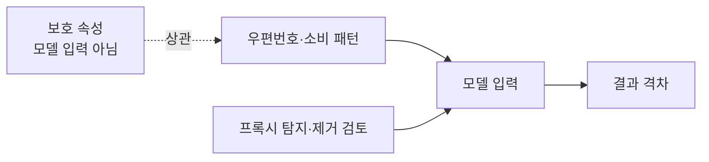

# 프록시 변수

> 보호 속성(인종·성별 등)을 직접 쓰지 않아도 그것과 강하게 연관되어 간접적으로 반영하는 변수. 우편번호가 대표적이다.

## 쉽게 말하면
"인종은 쓰지 않았어요"라고 해도 거주지 우편번호를 쓰면, 인종 구성이 다른 동네를 통해 사실상 인종 정보가 들어간다. 이름표를 떼도 지문이 남는 것과 같다.

## 자세히
- **원리**: 보호 속성과 상관이 큰 변수는 모델이 그 상관을 활용해 보호 속성을 간접 학습할 수 있다. 변수를 빼도 다른 변수 조합이 같은 정보를 담을 수 있다(여러 변수의 조합 프록시).
- **점검 방법(일반 실무)**: ① 각 변수와 보호 속성의 연관도 측정 ② 보호 속성을 다른 변수로 예측해 보는 모델(예측력이 높으면 프록시 정보가 있다는 신호) ③ 변수 제거 후 성능과 격차 변화 비교 ④ 사업 필요성 설명 가능한 변수만 유지.
- **법적 맥락**: 차별 영향 분석은 의도가 아닌 결과를 본다([신용 차별 영향 분석](#disparate-impact-credit)). 프록시 변수를 쓴 결과 격차가 크면 정당화와 [덜 차별적 대안](#less-discriminatory-alternative) 탐색이 쟁점이 된다. 현행 법리의 범위는 변하고 있으므로 확인이 필요하다.
- **주의**: 보호 속성 데이터가 없으면 점검이 어렵다. 추정 방식(예: 성·이름·지역 기반 추정)을 쓰면 추정 오차가 있다. 이 노드의 점검 방법은 출처 확인 없이 정리한 일반 설명이다.
- 프록시를 모두 제거하면 성능이 떨어질 수 있어 성능-공정성 균형을 문서화한다.

## 그림으로 보기

## 예시
- 자동차 보험 요율 모델이 우편번호와 직업군을 사용 → 보호 속성 예측 모델이 높은 정확도 → 변수 단위 제거·구간 병합으로 격차를 줄이고 사업 필요성 근거를 문서화.

## 헷갈리는 것과 비교
| 개념 | 차이 |
|---|---|
| 프록시 변수 | 보호 속성을 간접 반영 |
| 직접 사용 | 보호 속성 자체를 입력 |
| 상관 변수 | 일반적 상관, 프록시는 보호 속성과의 상관 |

## 더 읽을거리
- [The Legal Duty to Search for Less Discriminatory Algorithms](https://arxiv.org/html/2406.06817v1) — 모델 다중성과 대안 탐색(검색 결과로만 확인)
