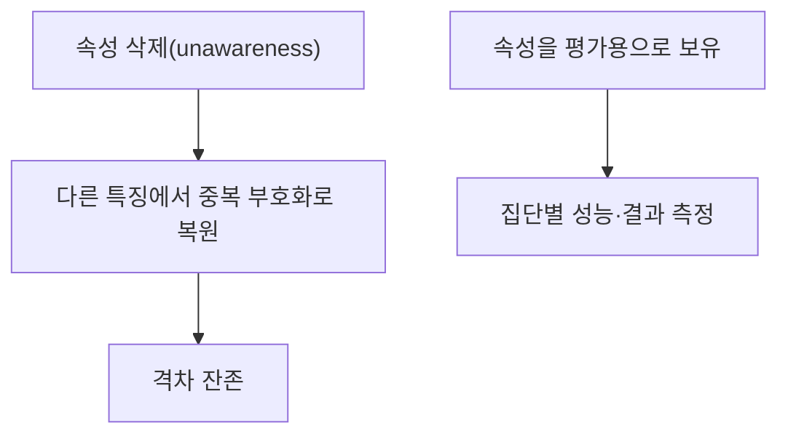

# 대리 변수

> 민감 속성(성별·인종 등)을 입력에서 지워도, 그 속성과 상관된 다른 특징들이 속성을 대신해(대리 변수) 모델이 같은 차별 패턴을 학습하는 문제다. "속성을 안 쓰면 공정하다"는 믿음이 틀리는 이유다.

## 쉽게 말하면
이름 칸을 가리고 심사해도 우편번호·출신 학교·취미가 이름만큼 많은 정보를 준다면 심사자는 여전히 사람을 알아본다. 모델도 가려진 속성을 다른 단서들의 조합에서 복원해 쓴다.

## 자세히
(『Fairness and Machine Learning』(fairmlbook.org)의 "No fairness through unawareness" 절을 직접 열어 확인하고, 시뮬레이션은 직접 실행.)
- **책의 주장**: 민감 속성을 제거하거나 무시해 공정성을 확보하려는 시도는 "**비효과적이고 때로는 해로울 수 있다**." 이유: ① 많은 특징이 민감 속성과 약하게 상관돼 있고, 합치면 높은 정확도로 속성을 분류할 수 있다(예: 미국에서 pinterest.com 방문이 여성과 약하게 상관) ② 속성을 쓰던 분류기는 속성을 제거해도 다른 특징에서 **중복 부호화(redundant encoding)** 를 찾아 사실상 같은 함수를 만든다 ③ 큰 특징 공간에서는 민감 속성이 다른 특징들이 주어지면 대체로 중복적이다 ④ 유전체의 예: DNA가 조상을 드러내고 조상은 일부 국가에서 소득과 상관되므로 모델이 지시 없이도 조상을 통해 소득을 예측. 망막 사진에서 성별을 높은 정확도로 예측할 수 있다는 예도 든다. 책은 "대리 변수(proxy)"라는 용어나 우편번호 예를 쓰지는 않고 중복 부호화로 설명한다.
- **반대 측면(책)**: 의약처럼 인종이 기저 인과 요인과 상관돼 처방이 정당하게 인종에 의존하는 경우도 있어, 무조건 상관을 끊는 것도 개인에게 해를 줄 수 있다.
- **직접 시뮬레이션(2만 명, 민감 집단 a 비율 30%, 우편번호형 대리 변수는 80%가 집단과 일치, 역사적 라벨은 집단 1에 불리하게 편향)**
  | 모델 입력 | 정확도(편향 라벨 기준) | 합격 예측률 집단0 | 집단1 |
  |---|---|---|---|
  | 능력 + 민감 속성 + 대리 변수 | 0.858 | 0.496 | 0.198 |
  | 능력 + 대리 변수(속성 제거) | 0.836 | 0.433 | **0.329** |
  | 능력만 | 0.823 | 0.405 | 0.406 |
  민감 속성을 지워도 대리 변수 때문에 집단 간 합격률 격차(0.433 대 0.329)가 남았다. 속성을 아예 안 쓰고 능력만 쓰면 격차가 거의 사라졌지만, **편향된 라벨 기준 정확도는 오히려 가장 낮다** — 편향된 정답을 따라가는 것이 정확하다고 측정되는 구조다. 가정으로 만든 장난감 설정이며 실제 격차는 데이터에 달렸다.
- **대응(제안)**: ① 제거만 하지 말고 **속성을 평가용으로 보유해 집단별 성능·결과를 측정**([Gender Shades](#gender-shades), [데이터 구성 표](#dataset-composition-table)) ② 대리 변수 후보(우편번호, 학교, 이름 형태)를 점검 ③ 편향된 라벨 자체를 의심([라벨 오류 탐지](#label-error-detection)) ④ 재가중·제약 학습 등 공정성 기법 검토([재가중·오버샘플링](#reweighting-oversampling)) ⑤ 법무·윤리 검토 병행.

## 그림으로 보기



## 예시
```python
# 대리 변수 점검: 민감 속성을 다른 특징으로 예측해 본다
from sklearn.linear_model import LogisticRegression
clf = LogisticRegression().fit(X_without_sensitive, sensitive)
print(clf.score(X_without_sensitive, sensitive))   # 높으면 대리 변수가 있다는 신호
```
- 채용·대출 모델: 성별 칸을 지워도 "경력 단절 기간", "출신 학교" 같은 특징이 대리 역할을 하는지 점검.

## 헷갈리는 것과 비교
| 개념 | 차이 |
|---|---|
| 대리 변수 | 민감 속성과 상관돼 대신 쓰이는 특징 |
| Fairness through unawareness | 속성을 입력에서 빼는 접근(비효과적일 수 있음) |
| [데이터 분포 편향](#data-distribution-bias) | 집단 대표성의 불균형 |
| 라벨 편향 | 정답 자체가 편향됨(위 시뮬레이션의 핵심) |

## 더 읽을거리
- [Fairness and Machine Learning — Classification (fairmlbook.org)](https://fairmlbook.org/classification.html) — No fairness through unawareness·중복 부호화(열어 확인).
