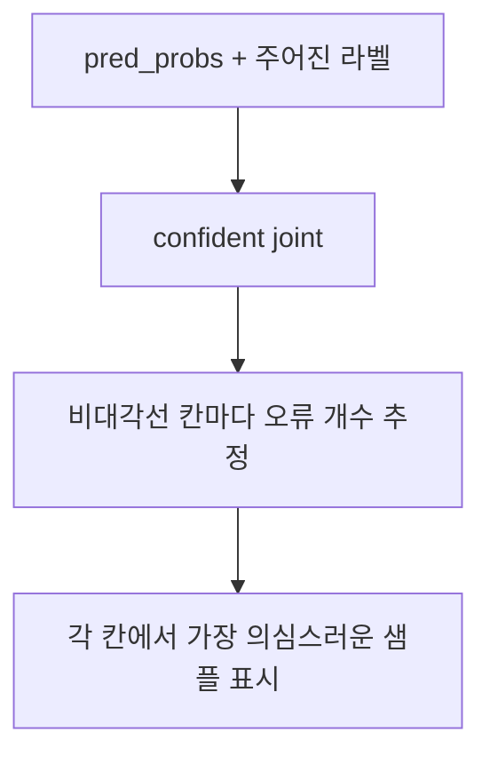
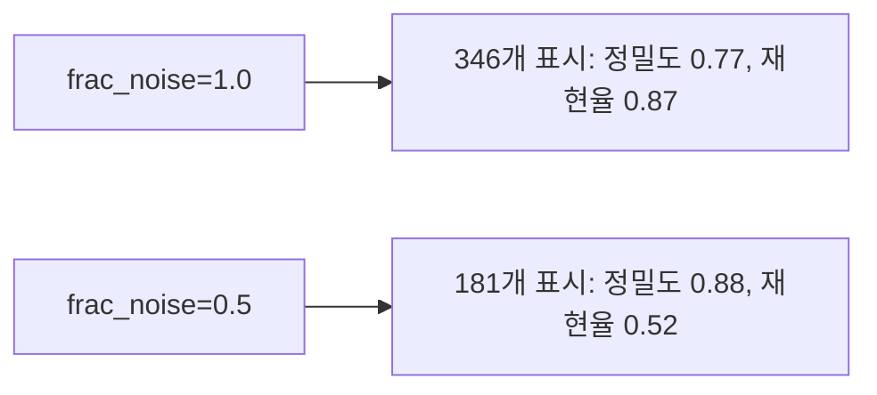

# prune_by_noise_rate

> `prune_by_noise_rate`는 cleanlab `find_label_issues`의 기본 `filter_by` 방식이다. confident joint의 비대각선 칸(주어진 라벨 ≠ 추정 참 라벨)마다 추정된 오류 개수만큼, 그 칸에서 오류 가능성이 가장 높은 샘플을 표시한다.

## 쉽게 말하면
"고양이라고 적혔지만 개 같은 사진이 대략 30장쯤 될 것"이라고 먼저 개수를 추정한 뒤, 그 30장을 가장 의심스러운 순서로 골라 표시하는 방식이다.

## 자세히
- **문서 설명(cleanlab filter 문서)**: `filter_by='prune_by_noise_rate'`(기본값)는 각 비대각선 칸의 likely mislabel을 표시한다. 다른 옵션은 `prune_by_class`(주어진 클래스일 확률이 가장 낮은 샘플), `both`(두 prune 방식에 모두 걸린 샘플만), `confident_learning`(confident joint 비대각선 샘플), `predicted_neq_given`(argmax 예측 ≠ 라벨), `low_normalized_margin`·`low_self_confidence`(점수 최저 샘플, 개수는 `count.num_label_issues`와 같음)다. `frac_noise`는 비대각선 개수를 비례해 줄여 추정 이슈의 일부만 돌려준다.
- **직접 실험(cleanlab 2.9.0, 가상 3클래스 2,000개, 라벨 15% 무작위 뒤집기 → 실제 오류 309개, 로지스틱 회귀 5-fold 표본 외 확률)**: `prune_by_noise_rate`는 346개를 표시해 정밀도 0.77, 재현율 0.87이었다. `frac_noise=0.5`를 주면 181개를 표시해 정밀도 0.88, 재현율 0.52였다. (한 번의 가상 실험이며 데이터에 따라 달라진다. 비교표는 [정리의 정밀도·재현율 균형](#precision-recall-tradeoff-cleaning).)
- **해석**: 이 방식은 "추정된 오류 개수"에 맞춰 후보 수를 정하므로, 점수 임계값을 직접 정하는 방식보다 후보 수 예측이 쉽다. 반대로 확률이 부정확하면 개수 추정도 틀어진다.
- **쓰는 때(해석)**: 특별한 이유가 없으면 기본값으로 시작하고, 검수 인력이 모자라면 `frac_noise`나 점수 순위로 줄인다([precision@k 검수 효율](#precision-at-k-review)).

## 그림으로 보기



## 예시
```python
from cleanlab.filter import find_label_issues
mask = find_label_issues(labels, pred_probs)                       # 기본: prune_by_noise_rate
mask_half = find_label_issues(labels, pred_probs, frac_noise=0.5)  # 절반만
```
- 교육 활용: confident joint 표를 3×3으로 손으로 그리고 비대각선 칸 수를 합해 후보 개수를 추정하게 한다.

## 헷갈리는 것과 비교
| 개념 | 차이 |
| --- | --- |
| prune_by_noise_rate | 칸별 추정 오류 수만큼 표시 |
| prune_by_class | 라벨 클래스일 확률이 낮은 순 |
| predicted_neq_given | 예측≠라벨이면 모두 표시(가장 넓음) |
| [filter_by 옵션 비교](#filter-by-options) | 옵션 전체 비교 |

## 더 읽을거리
- [cleanlab filter 문서](https://docs.cleanlab.ai/stable/cleanlab/filter.html) — filter_by 옵션과 frac_noise
- [Confident Learning (arXiv 1911.00068)](https://arxiv.org/abs/1911.00068) — confident joint와 가지치기 원리
