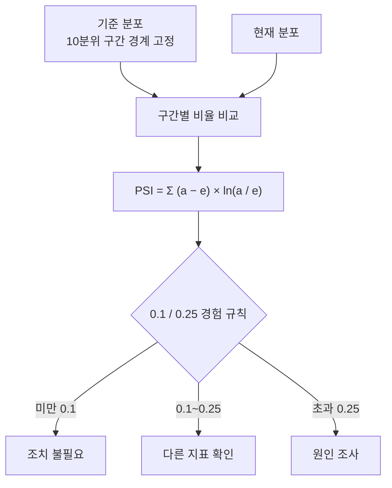

# PSI

> Population Stability Index(모집단 안정성 지수). 기준 기간(학습·개발 시점)과 현재 기간의 분포를 구간(bin)별 비율로 비교해 **얼마나 변했는지 한 숫자로 요약**하는 지표. 신용 스코어카드 모니터링에서 널리 쓰이며, 데이터 드리프트 감지에도 쓰인다.

## 쉽게 말하면
작년과 올해의 손님 연령 분포를 구간별로 비교해 "손님층이 얼마나 바뀌었나"를 하나의 점수로 만든 것이다. 점수가 클수록 달라졌다는 뜻이고, 그 변화가 모델에 문제를 일으킬지는 따로 조사해야 한다.

## 자세히
출처: 검색 요약(scorecard R 문서·블로그), du Pisanie 외 "A critical review of existing and new population stability testing procedures in credit risk scoring"(arXiv 2303.01227, 2023-03, 초록 열어서 읽음), 이 세션의 직접 계산.
- **공식(검색 요약)**: PSI = Σ (실제% − 기준%) × ln(실제% / 기준%), 구간별로 계산해 합산.
- **경험 규칙(검색 요약, 공식 검정이 아닌 휴리스틱)**: 0.1 미만은 변화가 미미해 조치 불필요, 0.1~0.25는 경미한 변화라 다른 모니터링 지표를 확인, 0.25 초과는 큰 변화라 깊이 조사. 한 실무 가이드는 이 기준이 스코어카드 모니터링에서 온 휴리스틱이며 도메인에 따라 과거 사고와 허용 가능한 오경보율로 조정하라고 권한다.
- **논문 초록**: 신용 평가 점수표는 개발 시점의 고객 속성 분포가 검토 시점에도 대표성을 가지는지, 즉 모집단 안정성을 정기적으로 검정한다. PSI는 가장 널리 쓰이는 검정이고, 저자들은 고전적 적합도 검정이 큰 표본에서 문제를 일으킴을 보이고 효과 크기 기반 검정과 "겹침 통계량"이라는 두 방법을 제안한다. PSI의 구체적 약점은 초록에 없어 본문을 열지 못했다.
- **비판(검색 요약, 논문 본문 미확인)**: 규칙이 표본 크기와 구간 수를 고려하지 않는다는 비판이 있고, 한 범주가 한쪽 집단에만 있으면 PSI가 무한대가 된다는 지적도 있다. 구간 경계는 기준·현재 모두 같게 고정하고 문서화하라는 조언이 있다.
- **직접 계산(합성 정규 분포, 10분위 구간, 기준 2만 건, 이 세션)**:
  - 같은 분포: 0.0017, 평균 +0.1: 0.009, 평균 +0.3: 0.0825, **평균 +0.5: 0.232**(표준편차 대비 반 표준편차 이동이 "경미" 구간 끝에 해당).
  - 같은 분포인데 현재 표본이 200건뿐이면 **0.0601**: 표본이 작으면 우연의 변동만으로도 값이 커진다. 한 번의 난수 시드 결과다.
- **해석**: PSI는 입력 분포 변화만 보고 정답 관계(개념 드리프트)나 성능 변화를 직접 알려 주지 않는다([데이터 드리프트](#data-drift), [개념 드리프트](#concept-drift)).

## 그림으로 보기


## 예시
```python
import numpy as np
def psi(exp, act, bins=10):
    edges = np.quantile(exp, np.linspace(0, 1, bins + 1)); edges[0], edges[-1] = -np.inf, np.inf
    e = np.clip(np.histogram(exp, edges)[0] / len(exp), 1e-6, None)
    a = np.clip(np.histogram(act, edges)[0] / len(act), 1e-6, None)
    return float(((a - e) * np.log(a / e)).sum())
```
- 점검: 구간 경계를 기준 데이터로 고정했는가, 표본 크기가 충분한가, 빈 구간 처리 규칙이 있는가.

## 헷갈리는 것과 비교
| 개념 | 차이 |
|---|---|
| PSI | 분포 변화를 한 숫자로 요약 |
| 통계 검정(KS 등) | p값 기반, 큰 표본에서 사소한 차이에 과민 |
| [데이터 드리프트](#data-drift) | 현상, PSI는 측정 도구 |
| [개념 드리프트](#concept-drift) | 입력-정답 관계 변화, PSI로는 직접 못 봄 |

## 더 읽을거리
- [A critical review of existing and new population stability testing procedures in credit risk scoring (arXiv 2303.01227)](https://arxiv.org/abs/2303.01227) — PSI와 대안 검정(초록 확인)
- [Data drift (Evidently AI)](https://www.evidentlyai.com/ml-in-production/data-drift) — 거리 지표로서의 PSI(앞서 열어서 확인)
