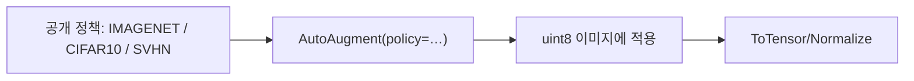
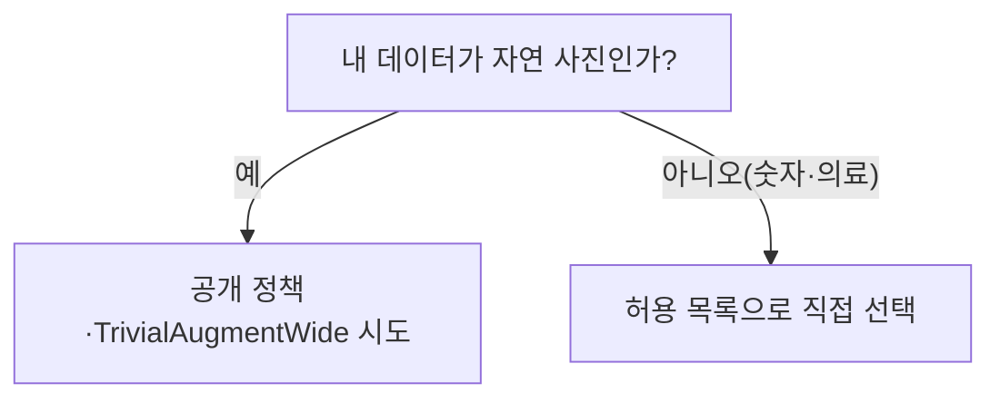

# 공개 증강 정책 쓰기

> AutoAugment처럼 **이미 학습·공개된 증강 정책을 라이브러리 클래스로 그대로 가져다 쓰는** 방법이다. 직접 정책을 탐색하지 않고도 검증된 조합(예: ImageNet 정책)을 한 줄로 적용한다.

## 쉽게 말하면
요리를 처음부터 연구하지 않고, 이미 검증된 "대표 레시피 모음집"에서 골라 쓰는 것이다. 레시피가 다른 가게(데이터)에서도 잘 먹히는지는 확인해야 한다.

## 자세히
- 근거(PyTorch torchvision 문서, 2026-11-27 열람 — 이번에는 설치·실행하지 않고 문서만 읽음):
  - `torchvision.transforms.v2`에는 자동 증강 클래스 네 가지가 있다: **AutoAugment**(데이터에서 학습한 정책), **RandAugment**(축소된 탐색 공간에서 무작위 선택), **TrivialAugmentWide**(데이터셋과 무관, 튜닝 불필요), **AugMix**(견고성·불확실성 개선).
  - 변환 문서는 AutoAugment 정책이 **ImageNet·CIFAR10·SVHN에서 학습**되었다고 쓰고, "ImageNet 정책이 다른 데이터셋에 적용해도 상당한 개선을 준다"고 적는다.
  - `AutoAugment` 클래스: `policy`(기본 `AutoAugmentPolicy.IMAGENET`), `interpolation`(기본 NEAREST, 텐서 입력은 NEAREST·BILINEAR만), `fill`(변환 밖 영역 채움값) 인자. 입력은 **`uint8` 텐서(`[..., 1 or 3, H, W]`) 또는 PIL 이미지(L·RGB)**여야 한다.
- 쓰는 순서(제안): ① 데이터가 자연 이미지면 먼저 `TrivialAugmentWide` 같은 튜닝 없는 기준선([TrivialAugment vs RandAugment](#trivialaugment-vs-randaugment)) ② 정책 기반을 쓰려면 비슷한 데이터셋의 정책(예: 사진류면 IMAGENET)을 선택 ③ 같은 설정으로 무증강·기준선과 비교([증강 기준선 관행](#augmentation-baseline-practice)).
- **순서 주의**: 문서는 성능 면에서 `uint8` 사용을 권하고 `Normalize` 앞에 `ToDtype(torch.float32, scale=True)`를 두라고 한다. AutoAugment는 `uint8` 입력을 요구하므로 **정규화·float 변환보다 앞**에 놓는다(문서 설명으로부터 연결한 해석).
- 위험: 공개 정책은 자연 사진 데이터셋에서 학습됐다. 위에서 본 것처럼 **대칭성이 다른 데이터(숫자·글자·의료 영상)**에는 정책 안의 뒤집기·회전·색 변환이 라벨을 깰 수 있다([대칭성에 의존하는 증강](#symmetry-dependent-augmentation)). 문서의 "다른 데이터셋에서도 개선" 문장은 일반 이미지 분류에 대한 것이고 모든 도메인을 보증하지 않는다(해석).
- 한계: 정책 안에 어떤 연산이 몇 % 확률로 들어 있는지는 이번에 열어 확인하지 못했다.

## 그림으로 보기



## 예시
```python
from torchvision.transforms import v2
tf = v2.Compose([v2.AutoAugment(v2.AutoAugmentPolicy.IMAGENET),
                 v2.ToDtype(torch.float32, scale=True), v2.Normalize(mean, std)])
```
- 교육: "남이 만든 정책을 쓰기 전 확인할 것"(데이터 성격·비교 기준선)을 체크리스트로 제시.

## 헷갈리는 것과 비교
| 개념 | 차이 |
|---|---|
| AutoAugment | 데이터에서 학습된 고정 정책(공개본 사용) |
| RandAugment | N·M 두 값으로 조절 |
| TrivialAugmentWide | 이미지마다 연산 1개·강도 무작위, 튜닝 없음 |
| AugMix | 여러 변환 체인을 섞어 견고성 개선 |

## 더 읽을거리
- [torchvision.transforms.v2 문서](https://docs.pytorch.org/vision/stable/transforms.html) — 자동 증강 클래스 목록과 성능 노트(읽음).
- [torchvision AutoAugment](https://docs.pytorch.org/vision/stable/generated/torchvision.transforms.AutoAugment.html) — 인자·입력 형식(읽음).
