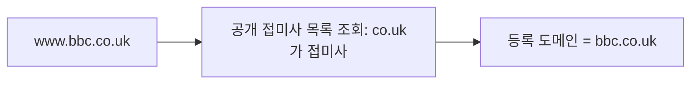
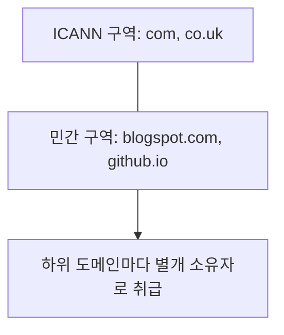

# 공개 접미사 목록

> 공개 접미사 목록(Public Suffix List, PSL)은 **`com`, `co.uk`, `github.io`처럼 "누구나 그 아래에 이름을 등록할 수 있는 도메인 접미사"를 모은 목록**이다. 이 목록이 있어야 URL에서 "한 주체가 소유한 등록 도메인"의 경계를 정확히 알 수 있다.

## 쉽게 말하면
아파트 단지의 "동 번호"까지가 건물 주소이고 그 아래 호수는 각 세대다. 도메인에서 `co.uk`는 단지 이름이고 `bbc`가 세대처럼 개별 주체다. 그 구분선이 어디인지 알려 주는 안내도가 PSL이다.

## 자세히
- 문제: 도메인의 마지막 두 라벨을 "사이트"로 보면 틀린다. `www.bbc.co.uk`의 마지막 두 라벨은 `co.uk`(영국 상업 도메인 전체)이고 사이트는 `bbc.co.uk`다. 앞의 [접두사 범위 조회](#prefix-range-query)에서 `uk,co,` 접두사에 서로 무관한 사이트 7개가 섞인 이유다.
- 직접 실행(파이썬 `tldextract` 5.4.0, 번들 스냅샷 사용, 2026-11-27): 
  | URL | ICANN 접미사만 인정 → 등록 도메인 | 민간(private) 접미사까지 인정 → 등록 도메인 |
  |---|---|---|
  | `www.bbc.co.uk` | `bbc.co.uk` | `bbc.co.uk` |
  | `carlberry.co.uk` | `carlberry.co.uk` | `carlberry.co.uk` |
  | `4thfrog.blogspot.com` | `blogspot.com` | **`4thfrog.blogspot.com`** |
  | `user.github.io` | `github.io` | **`user.github.io`** |
  | `foo.s3.amazonaws.com` | `amazonaws.com` | **`foo.s3.amazonaws.com`** |
  | `news.ycombinator.com` | `ycombinator.com` | `ycombinator.com` |
  | `example.com.au` | `example.com.au` | `example.com.au` |
  | `localhost`, `192.168.0.1` | (빈 값) | (빈 값) |
- 읽는 법: PSL에는 **ICANN 구역**(공식 TLD: `com`, `co.uk`)과 **민간 구역**(서비스가 사용자에게 하위 도메인을 나눠 주는 경우: `blogspot.com`, `github.io`, `s3.amazonaws.com`)이 있다. 민간 구역까지 쓰면 `4thfrog.blogspot.com`과 `8bithorse.blogspot.com`을 **서로 다른 소유자**로 구분한다.
- 내 WET 샘플(앞 2MB, URL 587개)로 비교: 서로 다른 등록 도메인 수가 **ICANN만 쓰면 476개, 민간 접미사까지 쓰면 503개**였다(블로그 서비스 하위 도메인이 개별 주체로 분리된 만큼 늘어남). 단순히 "마지막 두 라벨"로 자르면 458개(`com.cn` 같은 공용 접미사를 한 사이트처럼 합침). 목적에 따라 어느 정의가 맞는지 달라진다.
- 활용: ① 도메인 단위 샘플링·중복 제거의 단위 결정 ② robots·삭제 요청 같은 소유자 단위 처리 ③ 쿠키·보안 정책(브라우저가 `co.uk` 전체에 쿠키를 심지 못하게 하는 용도가 원래 목적). 
- 주의: 목록은 **계속 바뀐다**(새 TLD, 새 민간 서비스). 번들 스냅샷은 시간이 지나면 낡으므로 갱신 정책을 둔다([IP 대역 목록 갱신](#ip-range-list-refresh)과 같은 문제). `localhost`·IP는 등록 도메인이 없다.
- 한계: 이 실험은 라이브러리의 번들 스냅샷 기준이며, 목록 원문(publicsuffix.org)을 직접 열어 확인하지는 않았다.

## 그림으로 보기



## 예시
```python
import tldextract
priv = tldextract.TLDExtract(include_psl_private_domains=True)
priv("http://4thfrog.blogspot.com/2011").registered_domain   # '4thfrog.blogspot.com'
```
- 교육: 같은 URL 목록에서 "마지막 두 라벨" 방식과 PSL 방식의 사이트 수를 비교하는 실습.

## 헷갈리는 것과 비교
| 개념 | 차이 |
|---|---|
| TLD | 최상위 도메인(`com`, `uk`) |
| 공개 접미사 | 하위 이름 등록을 받는 접미사(`co.uk`, `github.io` 포함) |
| 등록 도메인 | 접미사 바로 한 단계 위(소유 단위) |

## 더 읽을거리
- [Public Suffix List](https://publicsuffix.org/) — 목록의 출처(링크만, 직접 열람하지 않음).
- [tldextract (PyPI)](https://pypi.org/project/tldextract/) — 실험에 쓴 도구.
- 직접 실행: tldextract 5.4.0, WET 샘플 URL 587개.
