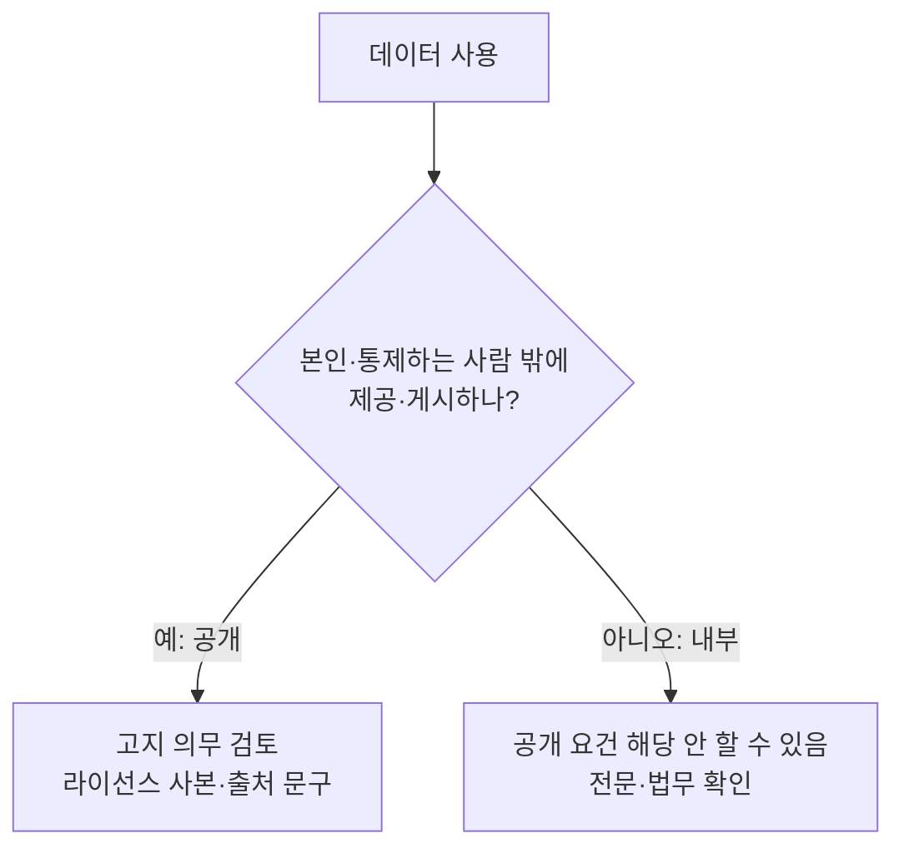
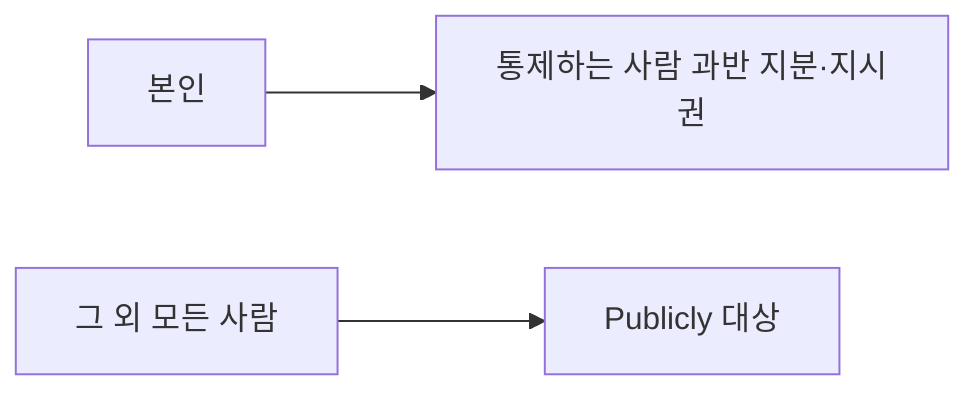

# "공개적으로"의 의미

> ODC-By 같은 데이터베이스 라이선스에서 **"Publicly(공개적으로)"는 본인과 본인이 통제하는 사람을 제외한 "다른 사람들"을 향한 행위**를 뜻한다. 내부에서만 쓰면 공개 사용에 해당하지 않을 수 있다는 점이 고지 의무의 범위를 정한다. (법률 자문이 아니며 전문 확인이 필요하다.)

## 쉽게 말하면
가족 모임에서 책의 한 구절을 읽는 것과 라디오에서 읽는 것은 다르다. "공개적으로"는 "내가 통제하는 범위 밖의 사람"에게 보이는 순간을 가리킨다.

## 자세히
(ODC-By 1.0 전문 페이지를 직접 읽음)
- **정의(1.0)**: Publicly는 **본인과, 본인이 과반 지분 소유나 활동을 지시할 권한으로 통제하는 사람들 외의 사람들**을 가리킨다. 예를 들어 같은 회사 안의 직원이라도 통제 범위를 벗어난 외부 협력사나 일반 이용자는 "다른 사람"이다.
- **고지 의무와의 연결(4.2·4.3)**: 데이터베이스나 파생 데이터베이스를 **공개 전달(Publicly Convey)**하면 라이선스 사본(또는 URI)을 포함하고 기존 고지를 유지해야 한다. 그 데이터베이스에서 만든 **산출물(Produced Work)**은 만드는 것 자체에는 고지가 필요 없지만 **공개 이용(Publicly Use)**하면 출처와 라이선스를 알리는 고지를 붙여야 한다([산출물 고지 규칙](#produced-work-notice-rule), [라이선스 요약과 전문](#license-summary-vs-legal-text)).
- **실무 해석(제안, 법적 판단 아님)**: 
  | 사용 | "공개" 해당 가능성 |
  |---|---|
  | 개인 노트북에서 분석 | 통제 범위 내라 해당 안 할 가능성(전문 확인) |
  | 같은 조직 구성원에게만 내부 공유 | 조직이 통제하는 사람들이면 해당 안 할 가능성 |
  | 고객·외부에 보고서·API로 제공 | 해당 가능성 높음 |
  | 블로그·논문·공개 모델 카드에 결과 게시 | 해당 |
- **경계가 모호한 경우**: 계열사·협력사·고객 데이터 공유, 클라우드 외주 업체의 처리, 소수 외부인 대상 클로즈드 데모 등은 "통제하는 사람"인지에 따라 달라질 수 있어 법무 검토가 필요하다.
- **AI 사례(제안)**: 내부 모델 학습만으로는 고지 의무가 없다고 보더라도, 모델·데이터셋을 외부에 공개하면 데이터 출처 표시가 필요할 수 있다([모델 카드의 데이터 출처 표시](#model-card-data-attribution)). 학습 모델이 산출물·파생물인지는 별도 쟁점이다([학습 모델은 파생물인가](#model-as-derivative-question)).
- 한계: 전문 정의를 읽었을 뿐 판례·관할별 해석은 확인하지 못했다.

## 그림으로 보기

## 예시
| 상황 | 점검 |
|---|---|
| 사내 분석 보고서 | 통제 범위 확인 |
| 고객사 제출 보고서에 차트 포함 | 산출물 공개 이용, 출처 고지 검토 |
| 공개 블로그 게시 | 출처·라이선스 고지 |
- 업무 장면: 교육 자료에 데이터셋 통계를 넣어 수강생(외부 기업 직원)에게 배포한다면 출처 문구를 달고, 조직 내부 시연용 자료는 법무 기준을 확인한다.

## 헷갈리는 것과 비교
| 개념 | 차이 |
|---|---|
| Publicly | 통제 범위 밖 사람 대상 |
| 내부 사용 | 통제하는 사람들 안에서의 사용 |
| [산출물 정의](#produced-work-definition) | 산출물이 무엇인지 |
| [산출물 고지 규칙](#produced-work-notice-rule) | 공개 이용 시 지켜야 할 고지 |

## 더 읽을거리
- [ODC-By 1.0 전문](https://opendatacommons.org/licenses/by/1-0/) — Publicly 정의와 4.2·4.3 고지(직접 읽음).
