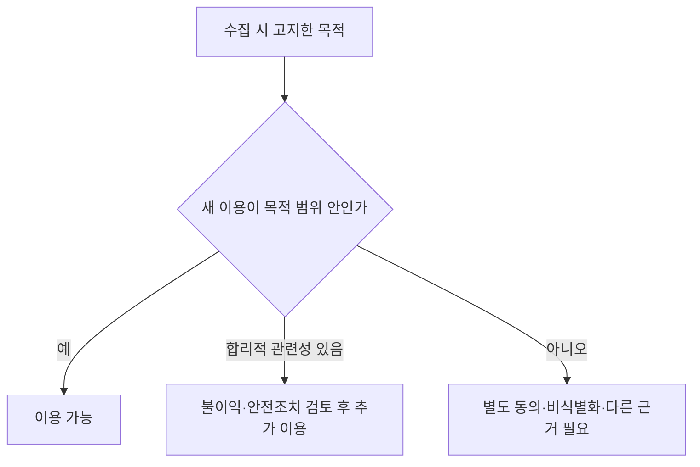

# 목적 제한

> 개인정보는 **수집할 때 알린 목적 범위 안에서만** 써야 한다는 원칙이다. 한 업무(예: 상담 이관)를 위해 받은 정보를 다른 목적(예: 범용 AI 어시스턴트 학습)에 돌려쓰려면 별도 근거가 필요하다.

## 쉽게 말하면
병원에 진료 목적으로 낸 주민번호를 병원 마케팅팀이 광고에 쓰면 안 된다. 같은 건물, 같은 회사여도 "왜 받았는지"가 다르면 쓸 수 없다는 것이 목적 제한이다. AI는 한 번 모아 두면 무엇에든 쓰고 싶어지므로 경계가 특히 중요하다.

## 자세히
(법률 사무소·언론 해설 기반, 조문 원문은 국가법령정보센터로 확인 필요.)
- **조문**: 개인정보 보호법 제15조(수집·이용)·제18조(목적 외 이용 제한). 제15조 제3항은 당초 수집 목적과 **합리적으로 관련된 범위**에서 정보주체의 불이익 여부, 암호화 등 안전조치 여부를 고려해 대통령령에 따라 동의 없이 이용할 수 있다고 한다(검색 결과의 법조문 인용). 제3조 원칙 조문은 이번에 원문을 확인하지 못했다.
- **AI 학습 적용(개인정보위 안내서 해설, 검색 결과 기준)**: 기존 수집 목적 범위면 기존 동의·계약·정당한 이익을 근거로 쓸 수 있고, 그 밖은 합리적 관련성 검토 후 추가적 이용, 비식별화, 별도 근거를 찾아야 한다. 2024년 7월 안내서는 공개된 개인정보를 "정당한 이익"으로 처리할 수 있다고 밝혔으나, "명백성" 요건이 엄격해 활용이 어렵다는 지적이 있다.
- **판결 사례(대륙아주 정리글 확인)**: 서울동부지방법원 2025. 6. 12. 선고 2021가합104007 판결 — 연애 분석 앱에서 모은 대화를 별도 AI 챗봇 학습에 쓴 것을 목적 범위를 넘은 이용으로 봤다. 처리방침의 "신규 서비스 개발" 문구만으로 AI 학습에 동의했다고 볼 수 없고, 일부만 암호화한 데이터는 가명처리 요건을 충족하지 못했으며, 민감정보는 별도 동의가 필요하다고 판단했다. 위자료는 10만·30만·40만 원으로 차등. (2차 정리이므로 판결문 확인 필요.)
- **AI 개발 목적 외 이용 특례**: 개정안이 논의됐다는 해설이 있으나 현재 시행 여부는 확인하지 못했다.
- **설계 함의**: 이관용 요약 패킷은 "그 문의 처리" 목적에만 쓰고, 범용 어시스턴트의 학습·검색 인덱스에 섞지 않는다(제안).

## 그림으로 보기

## 예시
- 챗봇 대화 로그를 상담 품질 점검에 쓰는 것은 고지 목적과 가까워도, 신규 모델 학습에 쓰는 것은 별도 검토 대상이다.
- 이관 요약을 저장하는 DB에 "이 문의 처리 후 N일 뒤 삭제" 태그를 붙여 다른 용도 조회를 막는다(제안).

## 헷갈리는 것과 비교
| 개념 | 차이 |
|---|---|
| 목적 제한 | 어떤 목적으로 쓰는가 |
| 데이터 최소화 | 얼마나 적게 가져가는가 |
| [이관 시 개인정보 최소화](#pii-minimization-handoff) | 최소화는 양, 목적 제한은 용도 |
| [PII 가림 방식](#pii-redaction-types) | 가명처리 기준을 충족해야 목적 외 활용 근거가 될 수 있음 |

## 더 읽을거리
- [대륙아주: AI 챗봇 학습 개인정보 판결 해설](https://www.daeryunlaw.com/trend/10305) — 서울동부지법 2025.6.12 판결 요약(직접 열어 확인).
- [머니투데이: AI시대 개인정보 활용과 보호](https://www.mt.co.kr/opinion/2025/04/11/2025040917091566139) — 개인정보 활용 논의(검색 결과 기준).
