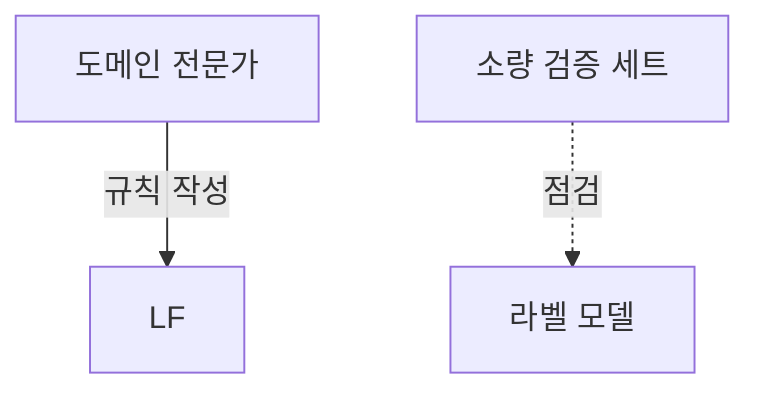

# PWS 파이프라인

> 프로그램형 약한 지도(Programmatic Weak Supervision) 전체 흐름: ① 사람이 라벨링 함수(LF) 같은 약한 신호를 작성 ② 라벨 모델이 노이즈를 걷어 확률 라벨로 합침 ③ 그 라벨로 최종 모델(end model)을 학습.

## 쉽게 말하면
손으로 한 장씩 채점하는 대신 "채점 규칙"을 여러 개 만들고, 규칙들의 의견을 합쳐 임시 정답을 만든 뒤, 그 임시 정답으로 진짜 학생(최종 모델)을 가르치는 생산 라인이다.

## 자세히
(Snorkel 논문 arXiv 1711.10160, Multi-Task Weak Supervision 논문 arXiv 1810.02840 초록과 Snorkel 튜토리얼을 직접 열어 확인.)
- **3단계**: ① **라벨 출처**(LF, 휴리스틱, 외부 모델, 원거리 지도, 크라우드) ② **라벨 모델**(데이터 프로그래밍으로 LF의 정확도·상관 추정, 정답 없이 일치·불일치만 사용) ③ **최종 모델**(확률 라벨로 분류기 학습, LF가 닿지 않은 데이터까지 일반화).
- **Snorkel(VLDB 2017) 보고 수치**: 사용자 연구에서 도메인 전문가가 7시간 손 라벨링 대비 모델을 **2.8배 빠르게** 만들고 예측 성능이 평균 **45.5% 높았음**. VA·FDA 협업과 4개 공개 데이터셋에서 이전 휴리스틱 방식보다 평균 **132%** 성능 향상, 대규모 손 라벨 모델의 **평균 3.60% 이내**. (논문 초록 보고 수치, 환경·과제별 결과.)
- **멀티태스크 확장(2018)**: 소스가 서로 다른 관련 하위 과제를 라벨하는 설정에서 행렬 완성식 문제로 소스 정확도를 추정. 세 개의 세밀 분류 과제에서 지도학습 대비 평균 **+20.2점**, 다수결 대비 **+6.8점**, 과제를 따로 모델링하는 이전 방법 대비 **+4.1점**(초록).
- **전제(제안)**: LF가 서로 다른 오류 패턴을 가질 것, 최소한의 개발·검증용 정답 소량은 필요.

## 그림으로 보기

## 예시
- 상담 문의 분류: 규칙 15개 + 기존 감성 모델 → 라벨 모델 → 소형 분류기로 배포.
- 교육 활용: "라벨링 대신 규칙 쓰기" 워크숍 — 비개발자도 규칙 아이디어를 낼 수 있다.

## 헷갈리는 것과 비교
| 개념 | 차이 |
|---|---|
| PWS 파이프라인 | 규칙→라벨 모델→최종 모델 |
| [Snorkel](#programmatic-labeling-snorkel) | 이 흐름을 구현한 도구 |
| 지도학습 | 사람이 전부 라벨링 |

## 더 읽을거리
- [Snorkel (arXiv 1711.10160)](https://arxiv.org/abs/1711.10160) — 시스템·사용자 연구·배포 결과.
- [Multi-Task Weak Supervision (arXiv 1810.02840)](https://arxiv.org/abs/1810.02840) — 멀티태스크 확장.
