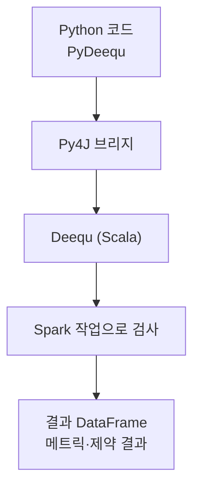
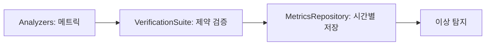

# PyDeequ

> PyDeequ는 아마존이 공개한 Spark 기반 데이터 품질 라이브러리 **Deequ의 Python 래퍼**다. 대용량 데이터프레임에 대해 "데이터용 단위 테스트"(완전성·유일성·범위 등)를 Python으로 정의하고 Spark 작업으로 실행한다.

## 쉽게 말하면
Great Expectations가 노트북 크기 데이터를 검수하는 검사원이라면, PyDeequ는 창고 한 동 분량(Spark 클러스터)을 한꺼번에 검수하는 대형 검사 시스템의 Python 리모컨이다. 실제 계산은 Scala로 쓴 Deequ가 Spark에서 한다.

## 자세히
(GitHub awslabs/python-deequ와 awslabs/deequ의 README를 직접 확인했다. **이번에 설치·실행은 하지 못했다**: Maven 중앙 저장소 접근이 이 환경에서 429로 응답했고 Spark·Deequ jar가 필요하기 때문이다.)
- **Deequ(Scala, README 확인)**: Spark DataFrame에 대한 "unit tests for data". 기능: ① 제약 검증(`VerificationSuite`·`Check`: 완전성·유일성·값 범위·URL 패턴 등) ② 메트릭 계산 ③ 시간에 따른 품질 지표 이상 탐지 ④ 제약 자동 제안 ⑤ 프로파일링, `MetricsRepository`, 증분 메트릭 계산, DQDL 규칙과 행 단위 결과. 논문: Schelter 외, "Automating large-scale data quality verification", PVLDB 11(12), 2018. 라이선스 Apache 2.0. Maven 좌표 `com.amazon.deequ:deequ`이며 버전 접미사가 Spark 버전과 맞아야 한다(예: `2.0.21-spark-3.5` — 문서 본문은 Spark 3.1.x와 짝지어 표기해 접미사를 직접 확인하라는 주의 필요). Deequ 2.1.0 이상은 Java 11 필요, 이전 2.0.x는 Java 8.
- **PyDeequ(README 확인)**: `pip install pydeequ`. import 전에 `SPARK_VERSION` 환경변수를 Spark 런타임과 맞춰 설정한다(문서 기준 `3.5` 또는 `4.1`). PyDeequ 1.7.0 이상이 Spark 3.5·4.1을 지원하고 Spark 3.1~3.4는 1.6.0이 필요하다(확인 시점).
- **핵심 구성요소**: `AnalysisRunner`(예: `Size()`, `Completeness("b")`) 메트릭 계산, `VerificationSuite`+`Check`로 제약 검증(결과는 DataFrame, 일부 제약은 행 단위 통과/실패도 가능), `ConstraintSuggestionRunner`(`DEFAULT()` 규칙으로 제약을 JSON으로 제안), `ColumnProfilerRunner`(컬럼 프로파일), 메트릭 저장소(예제는 파일시스템), AWS Glue의 DQDL 규칙.
- **상태**: 별 약 827개, 열린 이슈 57개, master 커밋 112개(확인 시점). 라이선스 Apache 2.0.
- **선택 기준(해석)**: 데이터가 Spark에 이미 있고 TB 규모라면 PyDeequ, 단일 머신 pandas 규모면 [Great Expectations](#great-expectations)가 설정이 가볍다.

## 그림으로 보기

## 예시
- 일별 주문 테이블(수억 행)에 `isComplete("order_id")`·`isUnique("order_id")`·값 범위 체크를 걸어 실패 제약만 알림.
- 교육 소재: 같은 규칙을 GX와 PyDeequ로 각각 표현해 보고 데이터 규모별 선택 기준을 토론.

## 헷갈리는 것과 비교
| 개념 | 차이 |
|---|---|
| Deequ | Scala/Spark 원본 라이브러리 |
| PyDeequ | Deequ의 Python API |
| [Great Expectations](#great-expectations) | pandas·Spark 등 다양한 백엔드, 규칙 중심 |
| [TFDV](#tfdv) | 통계·스키마·skew 중심(TF 생태계) |

## 더 읽을거리
- [awslabs/python-deequ](https://github.com/awslabs/python-deequ) — 설치·구성요소·상태(직접 확인).
- [awslabs/deequ](https://github.com/awslabs/deequ) — 기능·Maven·논문(직접 확인).
