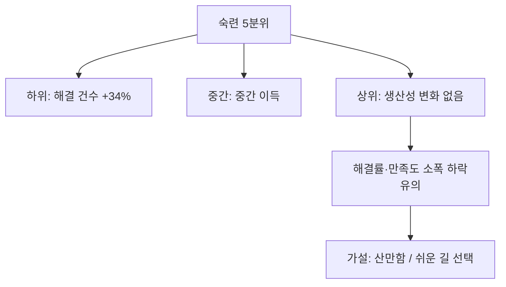
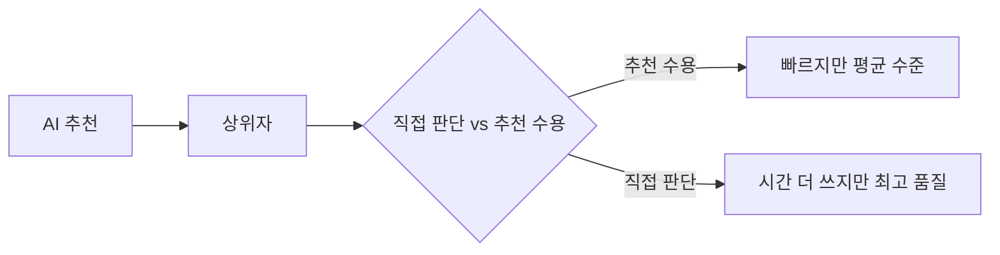

# 상위자 품질 하락

> AI 추천이 최상위 숙련자에게는 생산성을 올리지 못하고, 일부 품질 지표(해결률·고객 만족)를 오히려 소폭 떨어뜨린다는 관측. 고객지원 연구에서 통계적으로 유의했으나 크기는 작았다. 저자들은 AI 추천이 상위자를 "산만하게 하거나 쉬운 길을 택하게" 했을 가능성을 제시한다.

## 쉽게 말하면
요리 경연 우승자에게 "이 레시피가 제일 평균적으로 잘 팔려요"라고 계속 귀띔한다고 해 보자. 초보에게는 큰 도움이다. 하지만 이미 자기만의 비법이 있는 우승자는 귀띔을 따라가다 맛이 평범해질 수도 있다. 빠르긴 해도 자기 최고의 답을 직접 생각해 내는 시간을 잃는 것이다.

## 자세히
출처: NBER 31161 §4.2.1, §6(PDF 직접 읽음). 한 회사의 채팅 상담 환경 결과이며 일반 법칙이 아니다.
- **분류 방식**: AI 도입 직전 분기의 통화 효율·해결률·고객 만족도로 만든 숙련 지수로 상담사를 5분위로 나눔(회사-월 내 분위).
- **하위 vs 상위**: 최하위 분위는 시간당 해결 건수 로그 0.29(약 34%) 증가. 최상위 분위는 **생산성 증가 없음**.
- **다른 지표(Figure 6)**: 최상위 숙련자는 평균 처리 시간 변화 없음, 시간당 채팅 수 증가, 그리고 **해결률과 고객 만족의 작은 감소(통계적으로 유의)**. 가장 경험 많은 상담사(1년 이상)도 품질 지표에 작지만 유의한 음의 효과가 있었다.
- **저자 해석(가설)**: 하위 숙련자는 AI가 새 해법을 주지만 최고 성과자는 자기 모범 사례를 되돌려 받을 뿐이다. 음의 품질 효과는 AI 추천이 상위자를 산만하게 하거나, 직접 답을 궁리하기보다 **빠른 선택지(추천을 따르기)** 로 기울게 했을 수 있다는 것. 검증된 인과는 아니다.
- **고객 감정은 모두 개선**: 모든 숙련·경험 수준에서 고객의 대화 감정이 좋아졌고, 가장 숙련·경험 많은 상담사의 이득이 가장 작았다. 평균 고객 감정은 0.18점(표준편차의 절반) 상승.
- **관리자 연결 요청 감소**: 기준 약 6%에서 약 25% 줄었다. 하위·경험 적은 상담사에서 더 크게 줄었다.
- **이직**: 입사 6개월 미만에서 약 10%p, 기준 25% 대비 40% 감소. 숙련도별로는 모든 집단에서 감소하고 뚜렷한 기울기는 없다. 단 상담사 고정효과를 못 넣어 저자도 신중하게 보라고 한다.
- **운영상 함의(이 글의 제안)**: 숙련자에게는 AI 추천을 강제하지 말고 선택적 보조로 두고, 평균 처리 시간뿐 아니라 해결률·만족도 같은 품질 지표를 같이 감시한다. 하위·상위 대상 도구 설정을 다르게 할 수 있다.

## 그림으로 보기

## 예시
- 베테랑 상담사 팀에는 AI 추천을 기본 끄기로 두고 필요할 때만 호출하게 한다(제안). 효과는 해결률로 확인.
- 콘텐츠 에디터 팀: 초안은 AI로 빨리 만들되 시니어의 마감 검수는 AI 수정 제안을 보기 전에 먼저 본다(제안).

## 헷갈리는 것과 비교
| 개념 | 차이 |
|---|---|
| 상위자 품질 하락 | 최상위 숙련자의 일부 품질 지표 소폭 하락 |
| [숙련도 격차 축소](#skill-gap-compression) | 하위가 더 올라 격차가 줄어듦(전체 현상) |
| [숙련 편향적 기술 변화](#skill-biased-technical-change) | 기술이 고숙련에 유리하다는 기존 가설 |
| [근속별 생산성 곡선](#tenure-productivity-curve) | 근속 개월에 따른 성과 곡선 |

## 더 읽을거리
- [NBER Working Paper 31161](https://www.nber.org/system/files/working_papers/w31161/w31161.pdf) — §4.2.1 숙련별 효과, §6 고객·이직 영향(직접 읽음)
