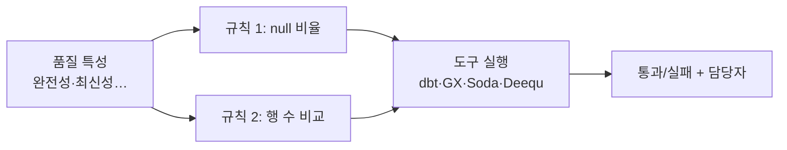
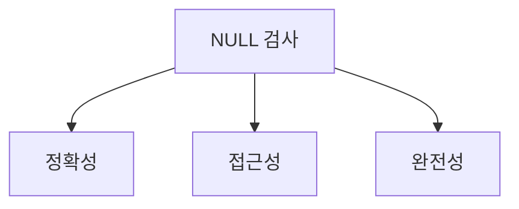

# 특성별 측정 규칙

> "정확성·완전성·최신성" 같은 품질 특성을 **실행 가능한 검사 규칙(쿼리·테스트)** 으로 바꾸는 작업이다. 특성 이름만으로는 합격·불합격을 가릴 수 없으므로 무엇을 세고 어떤 기준과 비교할지 정해야 한다.

## 쉽게 말하면
"건강하다"는 말만으로는 진단이 안 된다. 혈압 120/80 이하, 공복 혈당 100 미만처럼 재는 방법과 기준이 있어야 한다. 데이터 품질도 "완전해야 한다"가 아니라 "`customer_id`의 null 비율이 0%"처럼 검사로 써야 자동으로 확인된다.

## 자세히
(arXiv 2407.18649 "A survey of open-source data quality tools"의 HTML 본문을 직접 읽었다. 이 서베이는 ISO/IEC 25012의 내재적 특성으로 도구 기능을 정리한 학술 자료다.)
- **서베이의 틀**: ISO/IEC 25012의 15개 특성 중 내재적 6개(정확성·완전성·일관성·최신성·접근성·준수)에 도구의 저수준 기능을 대응시켰다. 대상 도구는 오픈소스 6종 — Deequ, dbt Core, MobyDQ, Great Expectations(GX), Soda Core, Apache Griffin. 약 32개 저수준 기능을 목록화했다.
- **핵심 발견: 다대다(many-to-many)**: 하나의 검사가 여러 특성에 걸치고, 하나의 특성이 여러 검사로 나뉜다. 예컨대 NULL 값 검사는 정확성·접근성·완전성에 모두 관련된다. 같은 기능이 도구마다 "conformance", "compliance", "validity"처럼 다른 이름을 갖는다.
- **기능 이름 예(서베이)**: Deequ `hasMin`·`hasMax`·`hasMean`·`hasUniqueValueRatio`·`isNewestPointNonAnomalous`, dbt Core `not_constant`·`sequential_values`·`mutually_exclusive_ranges`·`recency`, GX `expect_column_values_to_be_increasing`·`expect_table_row_count_to_equal`, Soda Core `row_count`·`reconciliation`, MobyDQ `freshness`·`latency`, Griffin `schema_conformance`.
- **커버리지**: 서베이가 대상 6개 특성만 다뤘으므로 나머지 9개는 분석하지 않았다. 최신성은 주로 dbt·MobyDQ·Soda의 recency/freshness 검사, 접근성은 소수 검사(NULL 처리, 스키마 검사 등)로 다뤄진다는 서술이 있다. 대부분의 오픈소스 도구가 스트리밍 데이터를 다루지 못한다는 한계도 언급한다.
- **규칙으로 바꾸는 요령(일반 원칙, 서베이의 주장 아님)**: 특성마다 ① 대상(테이블·열) ② 측정값(비율·건수·시간) ③ 합격선 ④ 실패 시 담당자를 정한다. 예: 완전성 → `customer_id` null 비율 = 0 / 최신성 → 마지막 적재 시각이 6시간 이내 / 유일성 → 주문 ID 중복 0.
- **주의**: 한 규칙 통과가 특성 충족의 증명은 아니다. 규칙은 특성의 일부 측면만 잰다.

## 그림으로 보기

## 예시
- 최신성: dbt의 recency 계열 검사로 `orders` 테이블 최신 행이 6시간 이내인지 확인(서베이에서 recency가 dbt Core 기능으로 언급).
- 교육 소재: 추상적인 "좋은 데이터" 정의를 검사 항목으로 번역하는 워크숍.

## 헷갈리는 것과 비교
| 개념 | 차이 |
|---|---|
| 특성별 측정 규칙 | 특성을 검사 가능한 규칙으로 번역 |
| [데이터 최신성](#data-currentness) | 번역 대상이 되는 특성 하나 |
| [정확성의 구문·의미 측면](#data-accuracy-syntactic-semantic) | 정확성을 둘로 나눈 하위 개념 |
| 데이터 품질 점검표 | 규칙을 표로 묶은 문서 형식 |

## 더 읽을거리
- [A survey of open-source data quality tools (arXiv 2407.18649)](https://arxiv.org/html/2407.18649v1) — ISO 25012 특성과 6개 도구 기능의 다대다 대응(직접 읽음).
