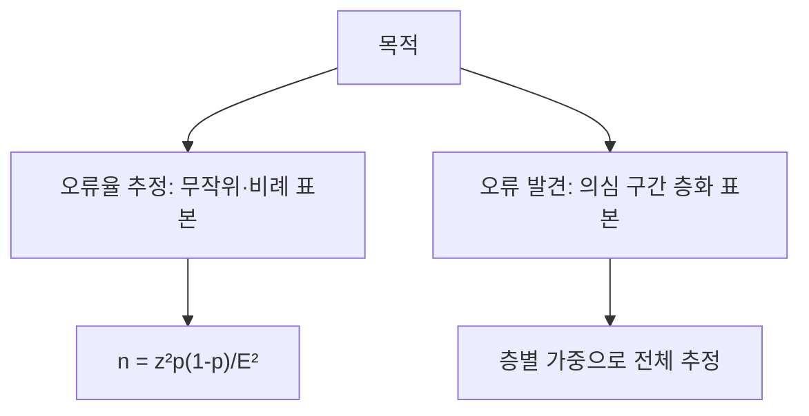
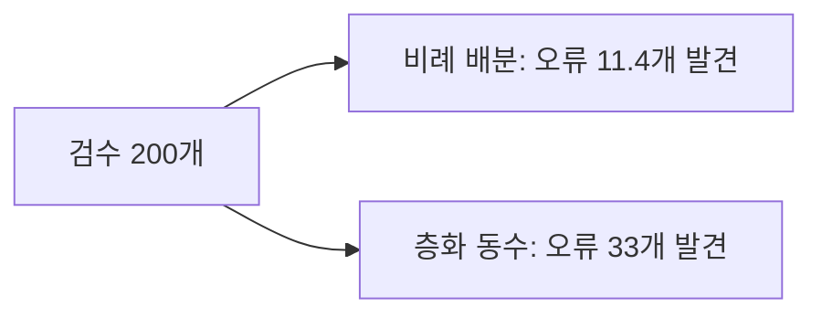

# 품질 표본 추출 계획

> 품질 표본 추출 계획은 전체를 다 검수하지 않고 일부만 뽑아 오류율을 추정하거나 오류를 찾아낼 때, 어떤 샘플을 몇 개 어떻게 뽑을지 정하는 설계다. 무작위 표본은 추정에, 모델 의심도로 층화한 표본은 오류 발견에 유리하다.

## 쉽게 말하면
공장에서 제품 1만 개를 전부 열어 볼 수 없으니 일부만 뽑아 불량률을 보는 것과 같다. 그냥 무작위로 뽑으면 전체 불량률을 알 수 있고, 불량이 많아 보이는 라인에서 더 뽑으면 불량을 더 많이 잡는다.

## 자세히
- **표본 크기 공식(Wikipedia)**: 비율을 추정할 때 n = z²·p(1−p)/E². 95% 신뢰는 z=1.96, E는 허용 오차. p를 모르면 최대 분산인 p=0.5로 둔다. 올림해서 쓴다. 층화 표본에서는 층마다 표본 크기를 정하고 합이 전체 n이 되게 하며 Neyman 최적 배분 같은 방식이 있다.
- **직접 계산한 필요 표본 수(95% 신뢰)**:

| 예상 오류율 p | 허용 오차 ±10%p | ±5%p | ±3%p | ±2%p |
| --- | --- | --- | --- | --- |
| 0.5(최악) | 97 | 385 | 1,068 | 2,401 |
| 0.10 | 35 | 139 | 385 | 865 |
| 0.05 | 19 | 73 | 203 | 457 |

  오류율이 5%쯤으로 예상되고 ±3%p면 약 203개를 검수하면 된다.
- **층화 표본 시뮬레이션(직접, 모집단 1만 개, 모델이 의심한 1,000개의 오류율 30%, 나머지 9,000개의 오류율 3%, 참 전체 오류율 5.7%, 검수 200개, 3,000번 반복)**:

| 배분 | 추정 오류율 평균 | 추정의 표준편차 | 검수에서 찾는 오류(기대) |
| --- | --- | --- | --- |
| 비례(의심 20 : 나머지 180) | 0.0567 | 0.0155 | 약 11.4 |
| 층화 동수(100 : 100) | 0.0575 | 0.0163 | 약 33 |

  두 방식 모두 참값(5.7%)을 잘 추정하고(층별 가중 평균), 추정의 흔들림은 비슷하다. 하지만 층화 동수는 같은 검수량에서 오류를 약 3배 많이 찾는다. 즉 "오류를 고치는 목적"이면 의심 구간을 더 뽑는 층화가 유리하고, 이때 전체 오류율은 층별 가중으로 계산해야 한다. 이 수치는 위 가정의 시뮬레이션이다.
- **계획 순서(해석)**: ① 목적 결정(오류율 추정 vs 오류 찾기) ② 허용 오차와 신뢰수준으로 n 결정 ③ 층화 기준(모델 의심 점수, 클래스, 주석자) ④ 시드 고정·표본 목록 기록 ⑤ 결과는 신뢰구간과 함께 보고.
- **연결**: 어떤 샘플을 이중 라벨할지는 이 계획이 정한다([표본 이중 라벨](#sampled-double-annotation)). 오류율의 신뢰구간은 시범 크기 논의와 같은 원리다([kappa용 시범 크기](#pilot-size-for-kappa)).

## 그림으로 보기

## 예시
- 라벨 1만 개의 오류율을 ±3%p, 예상 5%로 추정하려면 203개를 무작위로 검수한다.
- 교육 활용: 공식으로 필요한 표본 수 표를 직접 만들고 층화 효과를 시뮬레이션으로 확인한다.

## 헷갈리는 것과 비교
| 개념 | 차이 |
| --- | --- |
| 무작위 표본 | 전체 오류율 추정에 단순 |
| 층화 표본 | 의심 구간을 더 뽑아 오류 발견량↑ |
| [precision@k 검수 효율](#precision-at-k-review) | 점수 순으로 상위만 검수 |
| [표본 이중 라벨](#sampled-double-annotation) | 표본에 이중 라벨 적용 |

## 더 읽을거리
- [Sample size determination (Wikipedia)](https://en.wikipedia.org/wiki/Sample_size_determination) — 비율 추정 공식과 층화
