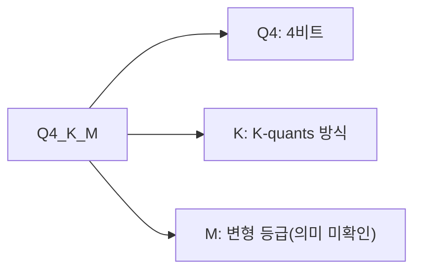
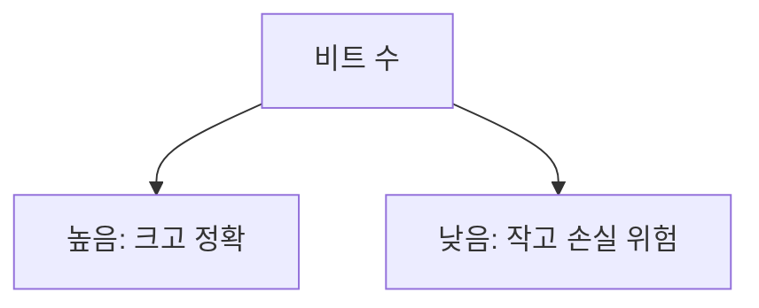

# Q4_K_M 이름 읽기

> GGUF 모델 파일명의 `Q4_K_M` 같은 표기는 **몇 비트로 양자화했는지(Q4), 어떤 블록 방식인지(K), 변형 등급(M)**을 뜻한다. 비트 수가 낮을수록 파일이 작고 품질 손실 위험이 커진다.

## 쉽게 말하면
사진의 JPEG 품질 슬라이더와 비슷하다. 숫자가 낮을수록 용량이 줄지만 화질(모델 품질)이 떨어질 수 있다. 이름은 그 설정 라벨이다.

## 자세히
(Hugging Face Hub의 GGUF 문서 표 열람 2026-11-28.)
- **Q + 숫자** = 가중치를 그 비트 수로 양자화(`q`). **K**는 "K-quants" 계열로 슈퍼블록 안에 블록별 스케일을 두는 방식. **IQ**는 중요도 행렬(importance matrix)을 쓰는 계열. **레거시**(Q4_0, Q4_1, Q5_0, Q8_0 등)는 블록당 32개 가중치를 단순 반올림하는 옛 방식으로 현재 널리 쓰이지 않는다고 표에 적혀 있다.
- 문서의 비트/가중치(bpw): **Q6_K 6.5625, Q5_K 5.5, Q4_K 4.5, Q3_K 3.4375, Q2_K 2.625**. 슈퍼블록 구성: Q4_K는 블록 8개×32가중치, 스케일·최솟값 각 6비트.
- **_S/_M/_L** 접미사(Small/Medium/Large)의 정확한 의미는 이번에 열람한 표에는 없다. 일반적으로 같은 비트 수 안에서 일부 텐서에 더 높은 정밀도를 배분하는 정도 차이로 알려져 있으나 확인한 출처는 아니다.
- 7B 파라미터 모델의 가중치 크기 추정(내 계산, 표의 bpw 사용, 오버헤드·메타데이터 제외): F16 약 14.0GB, Q6_K 약 5.7GB, Q5_K 약 4.8GB, Q4_K 약 3.9GB, Q3_K 약 3.0GB. 컨텍스트용 KV 캐시와 활성화 메모리는 별도로 필요하다([VRAM 예산](#vram-budgeting)).
- GGUF는 텐서와 표준 메타데이터를 함께 담는 형식으로 llama.cpp, LM Studio, Ollama 등에서 쓴다(문서).
- 품질 손실의 크기는 모델·과제별로 다르므로 이 출처로는 판단할 수 없다.

## 그림으로 보기

## 예시
- Q4_K 7B ≈ 3.9GB로 8GB급 GPU에서 가중치는 들어가지만 KV 캐시 여유는 따로 계산.
- 교육: 같은 모델의 Q8·Q4·Q2를 같은 질문 20개로 비교해 품질 차이를 체감.

## 헷갈리는 것과 비교
| 개념 | 차이 |
|---|---|
| GGUF | 로컬 추론용 단일 파일 형식 |
| [safetensors](#safetensors) | 텐서만 저장하는 안전한 형식 |
| 양자화 | 정밀도를 낮춰 용량을 줄이는 기법 |

## 더 읽을거리
- [Hugging Face: GGUF](https://huggingface.co/docs/hub/gguf) — 양자화 타입 표(읽음).
