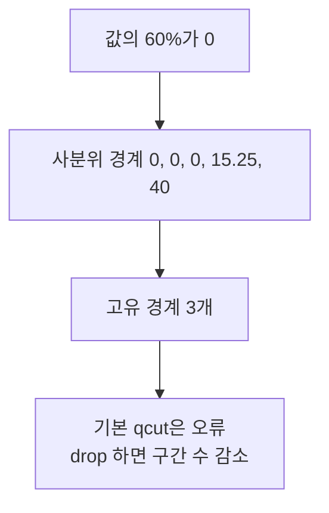

# 분위수 구간화

> 분위수 구간화는 연속값(청구 금액·점수 등)을 같은 개수씩 들어가도록 구간으로 나누는 방법이다. 회귀 문제에서 층화 분할을 하려고 목표값을 구간으로 바꿀 때 쓴다. 같은 값이 많으면 구간 경계가 겹치므로 주의가 필요하다.

## 쉽게 말하면
학생 100명을 키 순서로 세워 25명씩 끊어 네 모둠으로 나누는 것이다. 키의 범위가 아니라 인원수가 같도록 나눈다. 모두 같은 키 학생이 절반이라면 경계가 한 곳에 몰려 모둠이 네 개로 안 나뉜다.

## 자세히
- **`pandas.qcut`(pandas 문서, 열람)**: 변수를 (대략) 같은 크기의 구간으로 순위나 표본 분위수에 따라 나눈다. `q`가 정수면 그 개수의 같은 크기 분위수(10이면 십분위, 4면 사분위), 리스트면 직접 정한 분위수 경계다. `labels=False`면 구간 번호만 반환한다. 예: `pd.qcut(range(5), 4, labels=False)`는 `[0, 0, 1, 2, 3]`. `retbins=True`로 경계값을 받을 수 있다. 경계가 겹치면(같은 값이 많음) `duplicates='raise'`(기본)는 `ValueError`를, `'drop'`은 겹친 경계를 지운다.
- **`numpy.digitize`(NumPy 문서, 열람)**: 각 값이 속하는 구간의 번호를 돌려준다. `bins`는 1차원이고 단조여야 한다. `right=False`(기본)일 때 증가하는 경계에서 번호 i는 `bins[i-1] <= x < bins[i]`를 만족한다. 첫 경계보다 작은 값은 0, 마지막 경계 이상의 값은 `len(bins)`를 돌려주므로 `bins`로 인덱싱할 때는 1을 빼거나 범위를 확인해야 한다. 예: `bins=[0,5,10,15,20]`, `x=20`일 때 `right=False`는 5, `right=True`는 4다.
- **분위수 경계는 `np.quantile` 같은 함수로 구한다(해석)**: 경계 = 목표값 분위수. 이를 `digitize`에 넘기면 층화에 쓸 구간 번호가 나온다.
- **동점(ties) 문제(직접 계산, 순수 파이썬으로 numpy와 같은 선형 보간 분위수 구현)**: 값 100개 중 60개가 0(예: 청구가 없는 고객)이고 나머지가 1~40이라고 하자. 사분위 경계는 [0, 0, 0, 15.25, 40]이라 고유 경계가 3개뿐이고 구간 네 개가 나오지 않는다. 십분위 경계 11개 중 고유한 것은 6개다. 이때 `qcut`은 기본 설정에서 오류를 내고, `duplicates='drop'`이면 구간 수가 줄어든 채 진행한다. 0이라는 값을 별도 구간("0")으로 먼저 떼고 나머지만 분위수로 나누는 방법이 흔한 대응이다(해석).
- **층화 분할에 쓰기(해석)**: 구간 번호를 `StratifiedKFold`의 층화 기준(y)으로 넘기면 폴드마다 목표값 분포가 비슷해진다. 구간 번호는 층화용 보조 열이며 모델 학습의 정답은 원래 연속값이다.
- **한계**: 구간 수가 많으면 구간당 표본이 적고 경계가 불안정하다([구간 수 고르기](#bin-count-choice)).

## 그림으로 보기

## 예시
- 보험 청구액 예측 모델의 교차검증: 청구액을 5분위로 나눠 폴드마다 비슷한 청구액 분포를 갖게 하고, 0원 고객은 별도 구간으로 둔다.
- 교육 활용: 같은 데이터를 `cut`(값 범위 기준)과 `qcut`(개수 기준)으로 나눠 구간별 건수를 비교한다.

## 헷갈리는 것과 비교
| 개념 | 차이 |
| --- | --- |
| [회귀 목표 구간화 층화](#stratify-regression-binning) | 상위 주제. 분위수 구간화는 그 구간 만드는 방법 |
| `pd.cut` | 값의 범위로 나눔. 구간별 개수가 다를 수 있음 |
| `pd.qcut` | 개수가 비슷하게 나눔. 동점이 많으면 경계 중복 |
| `np.digitize` | 이미 정한 경계에 값을 배정 |

## 더 읽을거리
- [pandas.qcut](https://pandas.pydata.org/docs/reference/api/pandas.qcut.html) — 분위수 구간화와 `duplicates` 처리
- [numpy.digitize](https://numpy.org/doc/stable/reference/generated/numpy.digitize.html) — 구간 번호 배정과 경계 규칙
