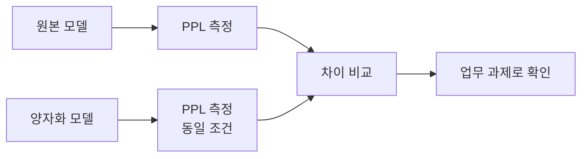
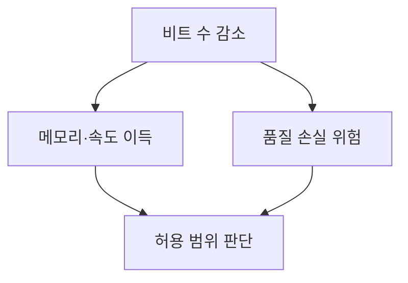

# 양자화 품질 점검

> 모델을 4·8비트로 줄이는 양자화는 정밀도를 일부 잃으므로, 전후를 같은 조건의 지표(퍼플렉서티 등)로 비교해 손실이 허용 범위인지 확인하는 절차다.

## 쉽게 말하면
고화질 사진을 용량을 줄여 저장하면 용량은 줄지만 화질이 조금 떨어진다. 원본과 나란히 놓고 "이 정도면 괜찮다"를 확인하는 것이 품질 점검이다.

## 자세히
- 핵심 방법은 **같은 데이터·같은 stride·같은 토크나이저**로 원본과 양자화 모델의 [퍼플렉서티](#perplexity)를 재는 것이다. HF 문서에 따르면 PPL은 토크나이저·창 설정에 민감하므로 조건이 다르면 비교가 무의미하다([슬라이딩 윈도 평가](#sliding-window-eval)).
- PPL이 거의 같아도 과제 성능(추론·코딩·한국어)이 달라질 수 있으므로 실제 쓰는 과제의 소규모 평가를 병행하는 것이 안전하다(일반적 권고; 이번에 열어 본 문서에는 양자화 수치가 없음).
- 점검 순서(일반 관행): ① 원본 PPL 기록 ② 양자화 후 같은 설정으로 PPL ③ 수치 차이 확인 ④ 실제 업무 질문 20~50개로 육안 비교 ⑤ 메모리·속도 이득과 저울질.
- 양자화 비트가 낮을수록 손실이 커지는 경향은 널리 알려져 있으나, 구체 수치는 모델·방식(GPTQ·AWQ·GGUF 등)에 따라 달라 직접 측정해야 한다.

## 그림으로 보기



## 예시
```python
# 같은 stride, 같은 데이터로 두 모델을 각각 측정
ppl_fp16 = eval_ppl(model_fp16, encodings, stride=512)
ppl_int4 = eval_ppl(model_int4, encodings, stride=512)
print(ppl_fp16, ppl_int4)
```
로컬 PC(8GB GPU)에 모델을 올리려고 4비트를 고를 때, 원본과 PPL이 얼마나 벌어지는지 먼저 본다.

## 헷갈리는 것과 비교
| 개념 | 차이 |
|---|---|
| 양자화 | 가중치 정밀도를 낮춰 경량화 |
| PPL 점검 | 언어 모델링 품질의 대리 지표 |
| 과제 평가 | 실제 업무 성능을 직접 확인 |
| [슬라이딩 윈도 평가](#sliding-window-eval) | PPL을 공정하게 재는 방법 |

## 더 읽을거리
- [HF Perplexity of fixed-length models](https://huggingface.co/docs/transformers/perplexity) — PPL 측정의 조건과 주의점.
