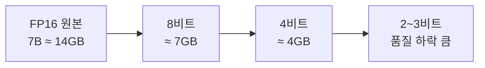

# 양자화

> 모델 가중치를 16비트 대신 8비트·4비트 같은 낮은 정밀도로 저장해 메모리를 줄이는 기법. 품질을 조금 내주고 크기·속도를 얻는다.

## 쉽게 말하면
사진을 JPEG로 압축하는 것과 비슷하다. 용량이 확 줄고 눈에 띄는 손상은 적지만, 너무 줄이면 화질이 깨진다. 모델도 4비트까지는 대체로 쓸 만하고 그 아래로 가면 품질이 눈에 띄게 떨어진다.

## 자세히
- 크기 = 파라미터 수 × 비트 ÷ 8. 7B 모델: FP16 약 14GB → 8비트 약 7GB → 4비트 약 4GB (근사치, [GPU와 VRAM](#gpu-basics) 참고).
- **GGUF**: llama.cpp 계열이 쓰는 파일 형식. `Q4_K_M`처럼 이름에 비트 수와 방식이 들어간다. K-양자화는 블록별 보정값 때문에 이름의 비트보다 약간 더 크다.
- 보통 Q8은 원본과 거의 같고, Q4 계열은 속도·크기 대비 균형점으로 쓰인다(일반 통념, 모델마다 다름).
- 가중치 외에 **KV 캐시**도 8비트·4비트로 줄일 수 있다.
- 양자화 모델은 원본과 정확히 같지 않으므로 중요한 용도는 [평가셋](#eval-set)으로 직접 점수를 비교한다.

## 그림으로 보기

## 예시
- 8GB GPU에서 Ollama로 `Q4` 계열 8B 모델을 돌린다.
- 같은 모델의 Q4 / Q8을 내 질문 30개로 비교해 차이가 없으면 Q4를 쓴다.

## 헷갈리는 것과 비교
| 개념 | 차이 |
| --- | --- |
| 양자화 | 정밀도를 낮춤, 같은 모델 |
| 증류 | 큰 모델이 작은 모델을 가르침, 다른 모델 |
| 가지치기 | 불필요한 연결 제거 |

## 더 읽을거리
- [LLM VRAM 요구량 가이드](https://techsy.io/en/blog/llm-vram-requirements-guide) — 양자화별 바이트 수
- [GGUF LLM VRAM calculator](https://github.com/dlsniper/gguf-llm-vram-calculator) — 직접 계산해 보기
