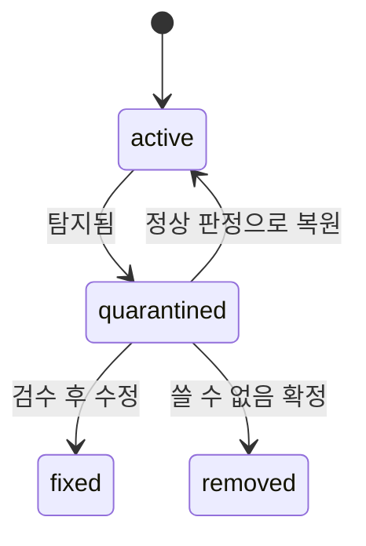
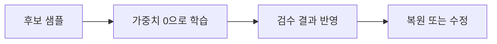

# 삭제 대신 보류

> 삭제 대신 보류는 의심 샘플을 데이터에서 지우지 않고 "보류" 표시를 달아 학습에서만 제외(또는 가중치 0)하는 방식이다. 나중에 검수 결과에 따라 되살리거나 수정할 수 있어 되돌릴 수 있다.

## 쉽게 말하면
서랍 속 의심스러운 서류를 쓰레기통에 버리지 않고 "확인 필요" 상자에 따로 옮겨 두는 일이다. 나중에 쓸모 있는 서류로 판명되면 다시 꺼내 쓸 수 있다.

## 자세히
- **도구 방식(cleanlab 문서)**: `CleanLearning`은 라벨 이슈로 표시된 샘플에 0의 샘플 가중치를 주고 학습한다. 데이터 자체는 그대로다. 이미 계산한 `label_issues`를 `fit()`에 넘기면 탐지를 건너뛰어 더 빠르다. 이 기능 덕에 "지우지 않고 학습에서만 뺀다"가 구현 수준에서 가능하다.
- **보류의 이점(해석)**: ① 되돌릴 수 있다 ② 검수 결과(수정·복원·삭제)에 따라 상태를 기록할 수 있다 ③ 드문 샘플이 영구 손실되는 [하드 샘플 제거 부작용](#hard-sample-removal)을 피한다 ④ 오탐([라벨 오류 오탐](#false-positive-label-issues))이어도 피해가 작다.
- **상태 설계(해석)**: 샘플별 상태 열을 둔다 — `active`(정상) / `quarantined`(보류) / `fixed`(수정됨) / `removed`(최종 삭제). 상태 변경 사유·검수자·날짜를 함께 남긴다. 삭제는 검수에서 "쓸 수 없음"으로 확정된 경우에만 한다.
- **주의(해석)**: 보류 샘플을 평가용 테스트셋에 섞어 쓰지 않는다. 보류 비율이 높으면(예: 10% 이상) 정리 전략 자체를 점검한다. 임계값 10%는 예시 값이다.

## 그림으로 보기

## 예시
- 데이터 테이블에 `status` 열을 추가해 후보 300건을 `quarantined`로 두고 학습 시 `status == active`만 쓴다. 검수가 끝나면 상태를 바꾼다.
- 교육 활용: 삭제와 보류의 차이를 "휴지통 vs 임시 보관함"으로 설명하고 상태 전이도를 직접 그리게 한다.

## 헷갈리는 것과 비교
| 개념 | 차이 |
| --- | --- |
| 보류 | 데이터는 남기고 학습에서만 제외, 복원 가능 |
| 삭제 | 데이터 제거, 되돌리기 어려움 |
| 샘플 가중치 0 | 보류를 구현하는 방법의 하나 |
| [하드 샘플 제거 부작용](#hard-sample-removal) | 삭제 시 생기는 문제 |

## 더 읽을거리
- [cleanlab in-depth tutorial](https://docs.cleanlab.ai/stable/tutorials/indepth_overview.html) — CleanLearning의 가중치 0 학습, label_issues 재사용
