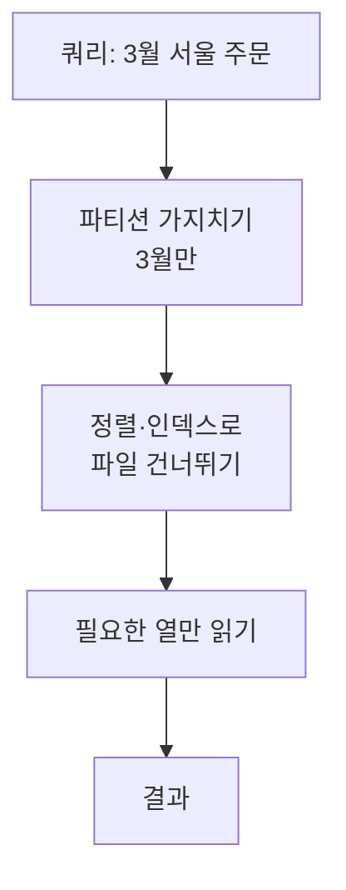

# 질의 가속

> 큰 데이터에서 필요한 부분만 빠르게 읽어 오도록 저장 방식과 조회 방식을 손보는 기법 모음이다. 파티셔닝·정렬(클러스터링)·인덱스·캐시·구체화 뷰가 대표적이다.

## 쉽게 말하면
도서관에서 책 한 권을 찾을 때, 서가를 전부 뒤지지 않고 분야별 서가(파티션)로 가서, 알파벳순(정렬)으로 찾고, 색인 카드(인덱스)를 보고, 자주 찾는 책은 카운터에 올려 두는(캐시) 것과 같다. 핵심은 "덜 읽는 것"이다.

## 자세히
(Onehouse의 레이크하우스 테이블 설계 글을 직접 열어 확인한 내용 + 검색 결과 요약. 벤더 자료라 수치 주장은 검증되지 않음.)
- **파일 크기**: Parquet 기본 파일을 약 120MB로 맞추라고 권한다. 작은 파일이 많으면 I/O 오버헤드가 커진다.
- **파티셔닝**: 날짜 같은 **굵은** 기준으로 나누고, 그 안에서 시간 등으로 **세밀하게 정렬**한다. 너무 작은 파티션과 심한 쏠림(skew)은 피한다.
- **클러스터링(정렬)**: 자주 필터링하는 컬럼 순으로 정렬하면 엔진이 필요 없는 파일을 건너뛴다. 여러 컬럼을 동시에 필터하면 Z-order·Hilbert 곡선을 쓴다.
- **열 기반 포맷과 pushdown**: Parquet은 필요한 열만 읽고, 파일·행 그룹 단위로 조건을 미리 적용해 읽을 데이터를 줄인다(검색 결과 요약).
- **인덱스**: 읽기·쓰기 패턴에 맞춰 고른다(예: Apache Hudi의 레코드 수준 인덱스는 단건 조회를 빠르게).
- **캐시·구체화 뷰**: 자주 쓰는 결과를 미리 계산해 둔다. 갱신 비용과 오래된 값 위험이 따른다(트레이드오프는 이번 자료에서 다뤄지지 않아 확인 필요).
- **쿼리 쪽 요령**: 파티션·정렬 컬럼으로 필터, 날짜는 문자열 대신 TIMESTAMP, 컬럼이 아닌 리터럴을 형 변환.
- **AI와의 연결**: 학습 데이터 조회, 피처 서빙, 벡터 검색([벡터 DB](#vector-db))도 같은 원리(덜 읽기)로 빨라진다.

## 그림으로 보기

## 예시
- 일별 로그 테이블을 날짜로 파티션하고 사용자 ID로 정렬해 두면, "어제 특정 사용자" 조회가 전체 스캔 대신 파일 몇 개만 읽는다.
- 매일 같은 대시보드 집계를 구체화 뷰로 만들어 아침 조회 시간을 줄인다.

## 헷갈리는 것과 비교
| 개념 | 차이 |
|---|---|
| 파티셔닝 | 데이터를 폴더·구획으로 나눠 통째로 건너뜀 |
| 인덱스 | 값→위치 색인으로 점 조회 가속 |
| 캐시 | 최근 읽은 것을 메모리에 보관 |
| 구체화 뷰 | 계산 결과를 미리 저장 |
| [KV 캐시](#kv-cache) | LLM 내부 어텐션 계산 재사용(이름만 비슷) |

## 더 읽을거리
- [Onehouse: Designing your data lakehouse tables for fast queries](https://www.onehouse.ai/blog/designing-your-data-lakehouse-tables-for-fast-queries) — 파일 크기·클러스터링·파티셔닝 조언(열어 확인, 벤더 글).
- [StarRocks: 구체화 뷰로 데이터 레이크 가속](https://docs.starrocks.io/docs/using_starrocks/async_mv/use_cases/data_lake_query_acceleration_with_materialized_views.md) — 검색 결과로 확인, 직접 열지 않음.
