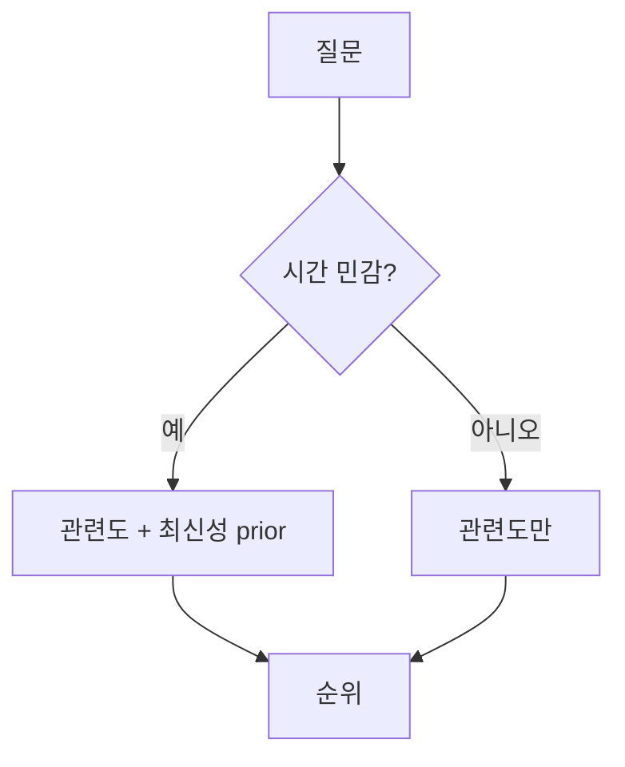
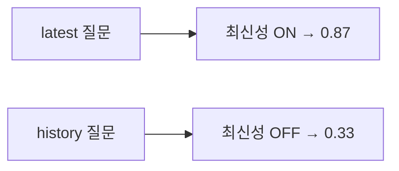

# 질의 인식 최신성 게이트

> RAG 검색에서 **"이 질문은 최신 문서를 우대해야 하는가?"를 질문마다 판단**해, 필요할 때만 최신성 가중치를 켜는 장치다. 모든 질문에 최신성을 곱하면 "역사" 질문이 망가지고, 아예 안 곱하면 "최신" 질문이 망가진다.

## 쉽게 말하면
뉴스 앱이 "오늘의 주요 뉴스"를 물으면 가장 최신 기사를 위로 올리지만, "2019년 사건의 배경"을 물으면 최신 기사가 위로 오면 곤란하다. 게이트는 질문을 보고 "최신순 스위치"를 켤지 끌지 정하는 문지기다.

## 자세히
(출처: arXiv 초록 2건을 WebFetch로 직접 확인하고, 이 세션에서 numpy로 **장난감 시뮬레이션**을 직접 실행했다. 두 논문의 본문 수식·세부는 확인하지 못했다.)
- **Re3 (arXiv 2509.01306, 초록 확인)**: 시간 정보 검색이 ① 질의의 **명시적 시간 요구에 맞는 관련성**, ② **여러 버전 중 가장 최신** 선택, 두 과제를 모두 요구한다고 정리하고, 기존 방법은 이를 따로 다루거나 취약한 휴리스틱에 의존한다고 주장한다. **질의 인식 게이트**로 의미 신호와 시간 신호를 동적으로 균형시킨다고 소개한다. ⚠️ 이 논문은 **철회(withdrawn)** 상태다(v2 2026-01-06, 저자들이 문제 설정·방법·프레이밍을 바꿔 실질적으로 수정한 원고를 준비 중이라고 밝힘). 게이트의 입력·구조는 초록에 없어 확인하지 못했고, 주장은 철회 전 원고 기준이므로 참고용이다.
- **Grofsky (arXiv 2509.19376, 2025-09-20 제출, v2 2026-06-26, 초록 확인)**: **반감기 기반 최신성 prior**를 쓰는 접근. 사이버보안 시험에서 코사인 유사도만 쓰는 기준이 0.00인 곳에서 최신 항목을 찾았고, 더 어려운 NVD CVE 시험에서 Latest@10이 0.60(의미 검색 후 최신순 기준은 0.20)이었다. 초록은 이 결과가 "부분적이며 파라미터에 민감하다"고 말한다. 수식·반감기 값은 초록에 없다.
- **장난감 시뮬레이션(직접 실행)**: 질문 3종 — "latest"(정답이 매우 최근 문서), "history"(정답이 오래된 문서), "neutral"(나이 무관) — 각 3,000번. 점수 = 관련도 + 게이트 × 0.4 × 반감기(60일) 최신성. 게이트는 질문에 `latest/newest/current/recent/now`가 있으면 1, 아니면 0인 **단순 키워드 규칙**이다.
  | 정책 | latest | history | neutral | 평균 |
  |---|---|---|---|---|
  | 관련도만 | 0.328 | 0.341 | 0.339 | 0.336 |
  | **항상 최신성** | **0.854** | **0.163** | 0.245 | 0.421 |
  | **질의 인식 게이트** | **0.868** | 0.332 | 0.328 | **0.509** |
  → 항상 최신성을 켜면 "latest"는 크게 좋아지지만 **"history"는 0.341 → 0.163으로 악화**됐다. 게이트는 둘 다 지켜 평균이 가장 높았다. (정답 위치·분포를 내가 설계한 장난감이며 실제 성능을 뜻하지 않는다.)
- **현실의 어려움(해석)**: 암시적 시간 의도("애플 최신 실적")를 키워드 없이 잡는 분류가 필요하다. 이를 위해 학습된 시간 의도 분류기·검색 후 재순위 방식이 연구되고 있다(검색 결과 요약, 직접 확인 안 함). 게이트가 틀리면 반대 방향 오류가 난다. → [as-of 날짜 필터](#as-of-date-filter)

## 그림으로 보기

## 예시
- "현재 환불 정책은?" → 게이트 ON(최신 버전 우대). "2022년 환불 정책은?" → 날짜 필터. "환불이란?" → 게이트 OFF.
- 교육 활동: 질문 10개를 "최신 필요 / 과거 필요 / 무관"으로 분류하고 규칙이 틀리는 사례를 찾아보기.

## 헷갈리는 것과 비교
| 개념 | 차이 |
|---|---|
| 질의 인식 게이트 | 질문마다 최신성 적용 여부 결정 |
| 항상 시간 감쇠 | 모든 질문에 최신 우대 |
| [as-of 날짜 필터](#as-of-date-filter) | 지정한 시점 이전 문서만 사용 |
| [신선도 메타데이터](#freshness-metadata) | 게이트가 쓰는 시간 정보 |

## 더 읽을거리
- [Re3 (arXiv 2509.01306)](https://arxiv.org/abs/2509.01306) — 질의 인식 게이트 아이디어(초록 확인, 철회된 논문).
- [Grofsky (arXiv 2509.19376)](https://arxiv.org/abs/2509.19376) — 반감기 최신성 prior와 한계(초록 확인).
