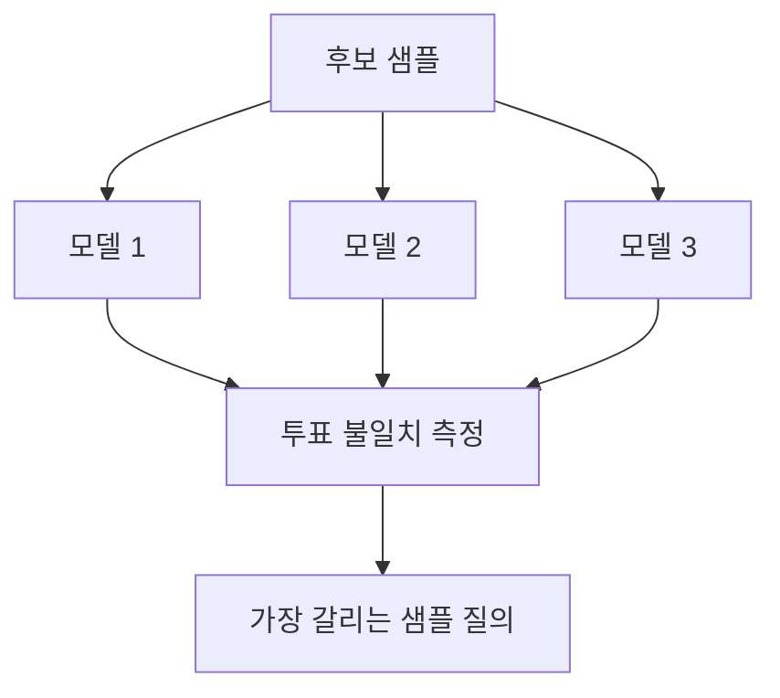

# 위원회 질의(query-by-committee)

> **서로 다른 가설을 대표하는 여러 모델(위원회)이 가장 의견이 갈리는 샘플**을 사람에게 질의하는 능동 학습 방식이다(Seung 외, 1992).

## 쉽게 말하면
의사 여러 명이 같은 X-ray를 보고 진단이 가장 갈리는 사례를 전문의에게 보내는 것이다. 모두 같은 진단이면 굳이 물을 필요가 없다.

## 자세히
(Settles 2009 문헌 조사를 직접 읽었다.)
- **구성(문헌)**: 현재 라벨 집합 L로 학습한 모델 위원회 C = {θ(1)…θ(C)}가 서로 경쟁하는 가설을 나타내고, 각 위원이 후보에 **투표**한다. 가장 정보가 많은 질의는 의견이 가장 갈리는 샘플.
- **이론(문헌)**: **version space**(현재 라벨과 모순되지 않는 가설 집합)를 가능한 한 **줄이는** 것이 목표. 논쟁적인 영역에서 질의한다.
- **위원회 만들기(문헌)**: Seung 외는 L과 일치하는 무작위 가설 2개를 표본. 나이브 베이즈는 Dirichlet 분포, HMM은 정규분포에서 표본(McCallum & Nigam, Dagan & Engelson). 비확률 모델은 **query-by-bagging/boosting**(Abe & Mamitsuka). 위원회 크기에 합의는 없으나 **2~3개의 작은 위원회도 잘 작동**했다.
- **불일치 측정(문헌)**: **vote entropy**(투표 분포의 엔트로피) 또는 **평균 KL 발산**(각 위원 분포와 평균 분포의 KL 평균).
- **연결(문헌)**: vote entropy는 엔트로피 기반 불확실성 샘플링의 QBC 일반화로 볼 수 있다([불확실성 샘플링](#uncertainty-sampling)).

## 그림으로 보기

## 예시
- 서로 다른 시드로 학습한 분류기 3개가 서로 다른 라벨을 내는 문서부터 라벨링(제안).

## 헷갈리는 것과 비교
| 방식 | 불확실성의 원천 |
|---|---|
| [불확실성 샘플링](#uncertainty-sampling) | 한 모델의 확률 |
| 위원회 질의 | 여러 모델의 불일치 |

## 더 읽을거리
- [Settles (2009)](https://burrsettles.com/pub/settles.activelearning.pdf) — 직접 읽음.
