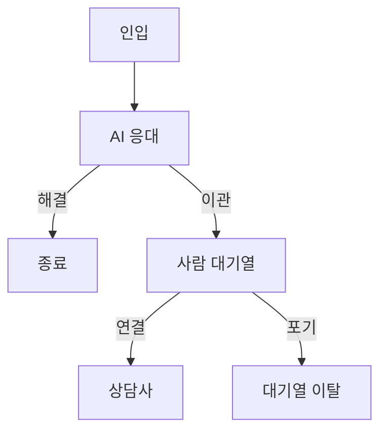
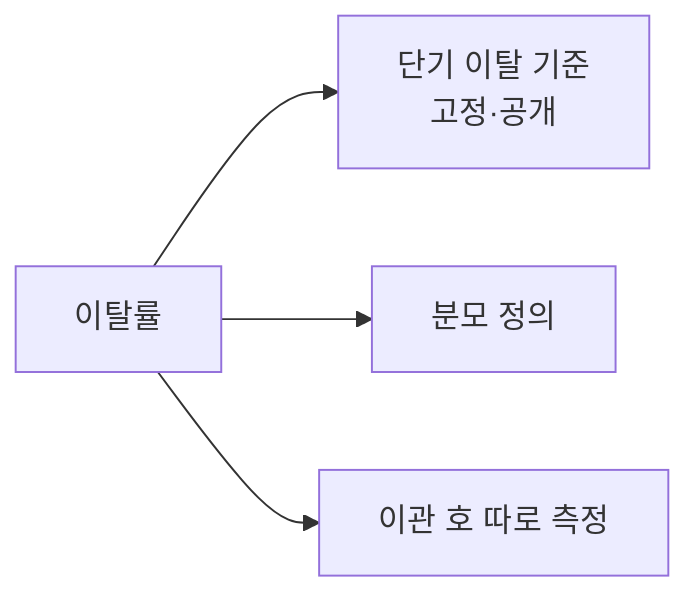

# 대기열 이탈률

> 사람 상담사 연결을 기다리다 포기하고 떠난 고객의 비율. AI가 먼저 응대한 뒤 넘어온 고객은 이미 인내심을 쓴 상태라 더 빨리 떠나므로 따로 측정해야 한다.

## 쉽게 말하면
놀이공원 줄에서 중도에 빠져나가는 사람의 비율이다. 이미 다른 줄에서 한참 기다린 사람이 새 줄에 서면 훨씬 빨리 포기한다.

## 자세히
- **식**: 이탈 콜 ÷ 전체 인입 콜 × 100(Fini). 예: 540 ÷ 12,000 = 4.5%, 같은 540을 6,000으로 나누면 9%. 분모가 결과를 바꾼다.
- **단기 이탈 제외**: 몇 초 안에 끊은 호는 제외하는 경우가 많다. TechTarget은 5~20초를 예로 들며 표준은 없다고 쓴다. 변형식은 (전체 − 응답 − 5초 내 종료) ÷ (전체 − 5초 내 종료). 예: 108콜, 5초 내 종료 8, 응답 95 → 5/100 = 5%. 기준값은 고정하고 공개한다. 바꾸면 고객 경험은 그대로인데 숫자만 바뀐다.
- **벤치마크는 불일치**: "많은 산업이 5~8% 목표"(TechTarget), 그 밖의 벤더 글은 다른 수치를 내놓는다. 이동 가능한 기준은 없고 자기 이력과 큐별·구간별 비교가 유용하다는 것이 공통 취지다.
- **AI 이관과의 관계(Fini)**: AI 음성 에이전트가 즉시 받아 해결한 호는 큐에 들어가지 않는다. 풀리지 않은 호는 사람 큐로 가며, 이미 인내심을 쓴 상태라 더 빨리 포기하는 경향이 있다는 설명. 이관 호의 이탈률은 정면 인입과 따로 본다.
- **분해 방법**: 30분 같은 짧은 구간으로 보고(일 평균은 피크 손실을 가림), IVR 이탈과 큐 이탈 분리, 재다이얼을 새 수요로 세지 않기.
- **원인**: 특정 시간대 인력 부족, 의도와 안 맞는 큐 라우팅, 큐 위치·콜백 안내 부재, 긴 IVR.
- 이 글의 근거는 대부분 음성 콜센터 자료다. 채팅·메시징 이관에는 같은 원리를 옮긴 것이다.

## 그림으로 보기

## 예시
- 이관 큐 이탈이 오후 2~3시에만 치솟음 → 인력 배치·콜백 안내 개선.
- 교육 실습: 같은 데이터로 단기 이탈 기준을 5초/20초로 바꿨을 때 이탈률이 어떻게 달라지는지 계산.

## 헷갈리는 것과 비교
| 개념 | 차이 |
|---|---|
| 대기열 이탈 | 사람 연결을 기다리다 포기 |
| [봉쇄율의 함정](#containment-rate-trap) | 봇 안에서의 이탈이 성공으로 보이는 문제 |
| [이관 대기 시간](#handoff-wait-time) | 이탈의 주요 원인 |
| [이관 성공률](#transfer-success-rate) | 연결된 건의 질 |

## 더 읽을거리
- [Fini: Call abandon rate](https://www.usefini.com/glossary/what-is-call-abandon-rate) — 식·분해·AI 이관 관련(벤더)
- [TechTarget: How to calculate abandoned call rate](https://www.techtarget.com/enterprise-software/answer/How-to-calculate-abandoned-call-rate-for-a-contact-center) — 단기 이탈 처리와 예시
