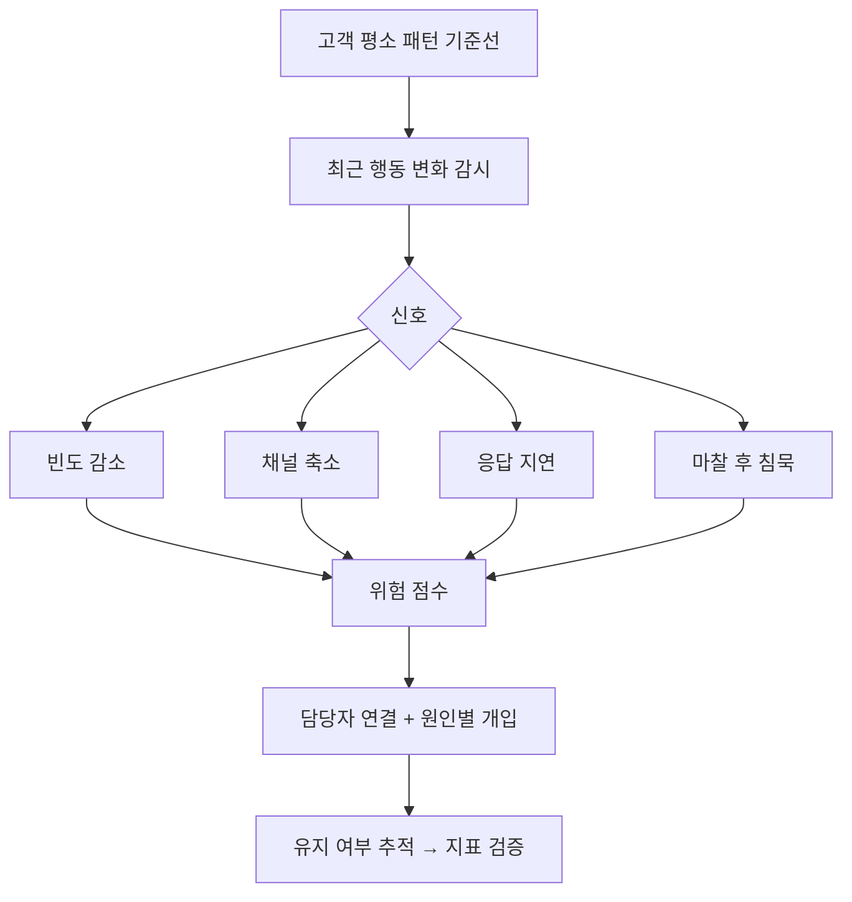

# 조용한 이탈 신호 (Silent Churn)

> 불만을 말하지 않고 **사용 빈도·채널·반응 속도가 조용히 줄다가 떠나는 고객**의 행동 신호. 감정 분석이나 불만 접수량만 보면 놓치기 쉬우므로, 고객 **자신의 평소 패턴 대비 변화**를 본다.

## 쉽게 말하면
병원이 호출 벨을 누르는 환자만 살피면, 아파도 조용히 누워 있는 환자를 놓친다. 벨이 울리지 않는 것 자체가 정상의 증거가 아니다. 평소 활동하던 사람이 조용해졌다면 그것이 신호다.

## 자세히
출처: Renascence 저널 글과 Supportbench 글(둘 다 본문 확인, 2026-11-18). **둘 다 벤더·컨설팅 글이고 수치 다수가 출처 없음 또는 2차 인용이라 증거 수준이 낮다.** 학술 연구는 이번 조사에서 확인하지 못했다.
- **행동 신호(Renascence)**: 빈도 감소(로그인·방문·거래·앱 실행이 연속 기간 줄어듦, 지출 감소보다 앞서기도 함), 혜택 사용 중단, 채널 축소, 응답 지연(서비스 메시지·갱신 안내에 늦게 응답), **문제를 겪고도 불만 없이 사용 방식만 바꾸는 "마찰 후 침묵"**, 추천·후기 감소. 세션 단축과 갱신 안내 무시도 언급.
- **사례(일화)**: 걸프 지역 이름 미공개 통신사가 불만량·콜센터 감정·NPS 비추천으로 만든 이탈 예측 모델이 8개월간 불만이 없던 고객을 놓쳤다. 고객은 앱을 열지 않고 포인트를 쓰지 않다가 약 3주 뒤 번호 이동했다. 글에는 이탈률·정확도 같은 수치가 없고 검증되지 않은 일화다.
- **탐지 접근(제안, Renascence)**: ①고객 자신의 이력을 기준선으로 ②이탈 고객의 30·60·90일 전 행동에서 선행 지표 2~3개 찾기 ③단일 트리거가 아닌 감소 임계값 ④신호를 행동할 사람에게 연결 ⑤원인에 맞는 개입 ⑥아직 이유가 있을 때 개입 ⑦개입 후 유지 여부 추적.
- **Supportbench의 임계값 예(출처 불명확)**: 로그인 평소 대비 약 50% 감소 지속, 일간 활성 30% 이상 감소, 14일 무로그인, 한 계정에서 지원 건수 3배, 30일 내 3회 이상 재연락, 정기 연락 6주 이상 침묵. 글 자체가 대부분 인용이 없거나 2차 블로그를 가리킨다고 분석된다.
- **상담 AI와의 연결(해석)**: AI가 고객 감정이 공손하다고 판단해도 재문의가 늘거나 응답이 느려지면 위험 신호다([빈정거림 탐지](#sarcasm-detection), [감정 트리거](#sentiment-trigger)). 감정 점수를 행동 신호와 결합한다.
- **한계**: 임계값은 제품·고객군마다 다르고, 위 수치는 검증 없이 쓰면 안 된다. 선행 지표는 자사 이탈 이력으로 검증해야 한다.

## 그림으로 보기

## 예시
- 주 3회 상담 채널을 쓰던 고객이 3주 연속 0회, 보내 준 갱신 안내에도 반응이 없다 → 자사 이력으로 검증한 선행 지표라면 담당자 연락.
- 교육 활용: "불만이 없다 = 만족한다"는 가정을 깨는 사례로 쓰고, 자사 이탈 고객의 90일 전 행동을 직접 되짚는 실습.

## 헷갈리는 것과 비교
| 개념 | 차이 |
|---|---|
| 조용한 이탈 | 불만 표현 없이 행동이 줄다 떠남 |
| 불만 기반 이탈 | 불만·NPS·감정 점수로 예측 |
| [빈정거림 탐지](#sarcasm-detection) | 말투 속 반대 의도 탐지 |
| [감정 임계값 보정](#sentiment-threshold-calibration) | 감정 점수로 이관 기준 정하기 |

## 더 읽을거리
- [Renascence: Silent churn 신호](https://www.renascence.io/journal/reducing-churn-how-to-catch-the-silent-signals-early) — 행동 신호 목록과 탐지 절차(컨설팅 글)
- [Supportbench: Silent churn 플레이북](https://www.supportbench.com/?p=25378) — 임계값 예와 한계(벤더 글, 출처 불명확 수치 다수)
