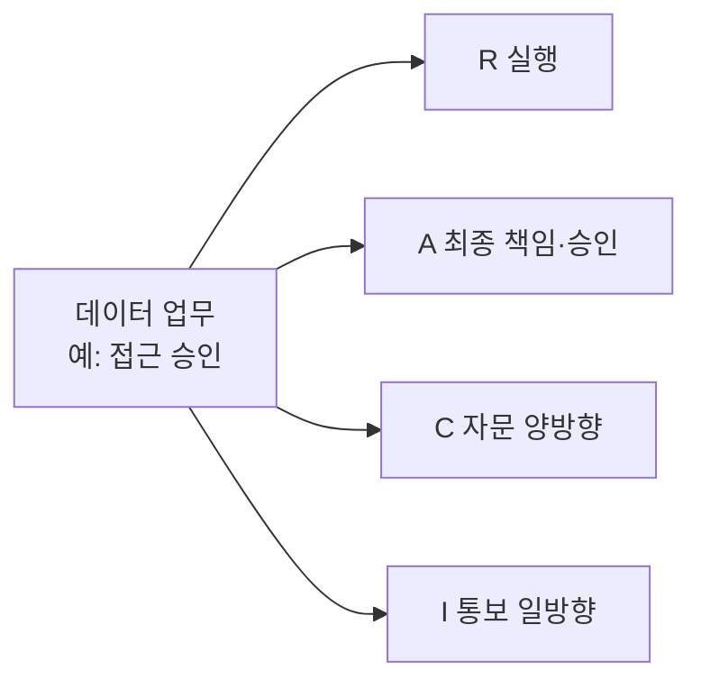

# 데이터 책임 RACI

> 데이터 업무마다 **누가 하고(R), 누가 최종 책임지고(A), 누구에게 묻고(C), 누구에게 알릴지(I)**를 표 한 장으로 정해 두는 방법이다.

## 쉽게 말하면
회식 장소를 정할 때 "내가 예약할게(R), 팀장님이 최종 결정(A), 알레르기 있는 사람에게 물어보기(C), 나머지에겐 결과 공지(I)"를 미리 나눠 두면 "그건 누가 하기로 했죠?"가 사라진다. 데이터는 여러 부서를 가로지르므로 이 말다툼이 특히 잦다.

## 자세히
(Wikipedia "Responsibility assignment matrix"를 직접 읽었다. 데이터 거버넌스 적용 부분은 검색 결과 요약만 봤고 해당 문서 본문은 열지 못했다.)
- **R(Responsible)**: 실제로 일을 하는 사람. 최소 1명, 다른 사람에게 위임해 도움을 받을 수 있다.
- **A(Accountable)**: 승인자. 결과의 정확한 완료에 끝까지 답할 사람이며 서명한다. 일부 프로젝트 관리론은 **업무마다 A는 한 명만** 두라고 권한다(보편 규칙은 아님).
- **C(Consulted)**: 의견을 구하는 전문가. **양방향** 소통.
- **I(Informed)**: 진행·완료를 알려 주는 대상. **일방향** 소통.
- **변형(문서)**: DACI, PARIS, RACI+F(스크럼용 진행 지원 추가), RASCI(지원 Support 추가), CAIRO/RACIO(Omitted), RACIQ(품질 검토), RACI-VSL(검증자·서명자).
- **데이터에서의 활용(검색 요약, 주장 수준)**: Gartner가 데이터·분석 거버넌스 역할용 RACI 템플릿과 데이터 품질 프로그램용 RASCI를 낸다고 소개된다. 정보 거버넌스는 여러 부서에 걸쳐 소유자가 불분명해지기 쉬워, RACI가 그 공백을 메우는 용도다.
- 행은 업무(예: 품질 규칙 정의, 접근 권한 승인, 삭제 실행), 열은 [오너·스튜어드](#data-owner-steward)·[생성자](#data-creator-role)·[보관 책임자](#data-custodian) 같은 역할로 짠다.

## 그림으로 보기

## 예시
| 업무 | 오너 | 스튜어드 | 생성자 | 보관 책임자 |
|---|---|---|---|---|
| 품질 규칙 정의 | A | R | C | I |
| 입력 표준 준수 | I | C | R | – |
| 백업·삭제 실행 | A | C | – | R |
- 점검: 행마다 A가 정확히 하나인가, R이 비어 있지 않은가.

## 헷갈리는 것과 비교
| 개념 | 차이 |
|---|---|
| R vs A | R은 실행, A는 결과 책임·승인(한 사람이 둘 다일 수 있음) |
| C vs I | C는 양방향 의견, I는 일방향 통보 |
| RACI vs RASCI | RASCI는 지원(S) 역할을 추가 |

## 더 읽을거리
- [Responsibility assignment matrix (Wikipedia)](https://en.wikipedia.org/wiki/Responsibility_assignment_matrix) — 정의·변형(직접 읽음).
- [Gartner RACI 템플릿 초록](https://www.gartner.com/en/documents/6970366) — 검색 결과만 확인, 본문은 유료·미열람.
