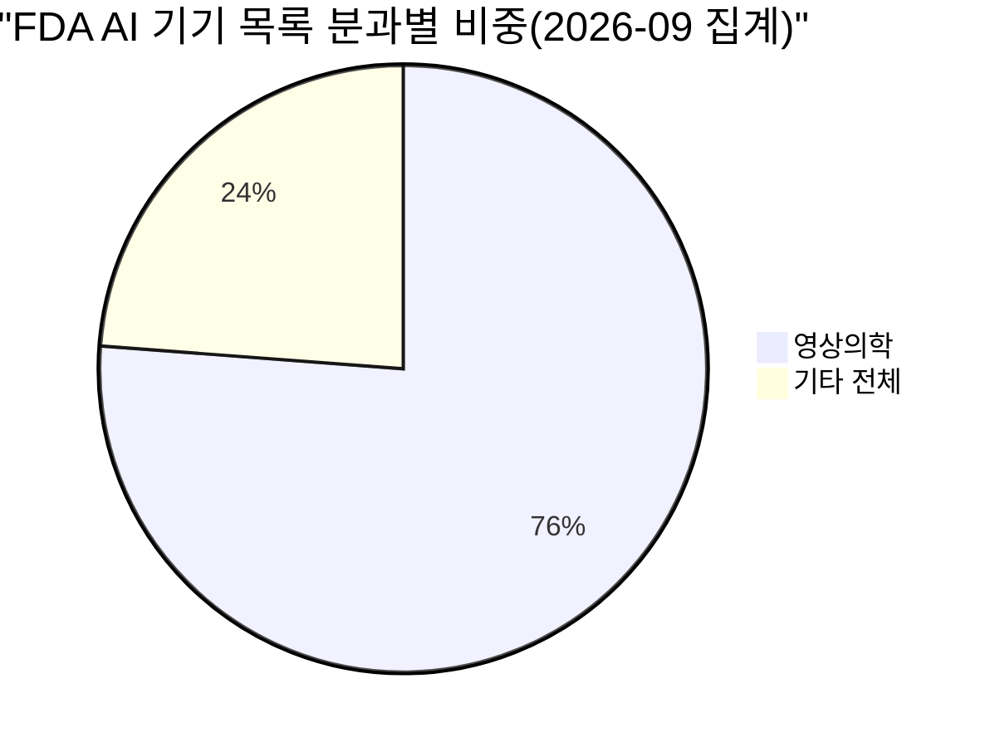
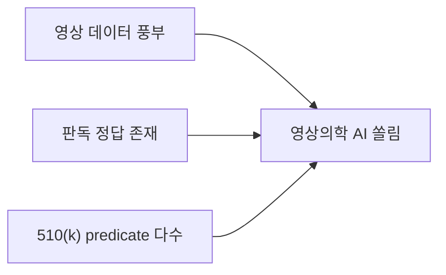

# 영상의학 AI 쏠림

> FDA의 AI 의료기기 목록에서 영상의학(radiology) 패널이 약 4분의 3을 차지해, AI 의료기기 시장이 영상 판독에 쏠려 있다는 사실.

## 쉽게 말하면
학교 동아리 신청이 한 반에 몰린 것과 같다. 의료 AI도 여러 분야로 갈 수 있는데 이미 데이터(영상)가 모여 있고 허가 경로도 익숙한 영상의학에 가장 많이 몰렸다.

## 자세히
- 2026년 9월 기준 한 집계: 1,614개 중 1,230개(76.2%)가 영상의학. 다른 집계에서도 대략 73~80%대(스냅샷·방법에 따라 다름).
- 2025년 한 해만 보면 295개 중 211개(71.5%), 두 번째 심혈관이 8.8%.
- 한 분석 주장: 영상의학 비중이 2020~2022년 85.5% → 2023~2025년 77.5%로 줄었다(다른 집계는 정체라고 함).
- 거의 모든 기기가 510(k) 경로(약 96%라는 분석)이다.
- 왜 쏠렸나: 자료는 원인을 직접 설명하지 않았다. 추론으로는 디지털 영상 데이터가 풍부하고 정답(판독문)이 있어 학습이 쉬우며, 기존 predicate가 많아 [510(k)](#fda-510k-de-novo-pma)를 쓰기 쉽다는 점이 있다(검증된 사실 아님).
- 주의: FDA 목록은 전체 AI 기기를 포괄한다고 FDA가 보증하지 않으므로 비율은 제3자 집계다.

## 그림으로 보기

## 예시
- 병원 AI 도입 검토 시 "허가된 AI가 많다"는 말은 영상 분야에 한정된 이야기일 수 있다. 문서·진료 기록 분야는 허가 목록 밖인 경우가 많다.
- 교육 사례: 도입 후보가 영상의학이 아니면 허가 근거 사례가 적어 별도 검증이 필요.

## 헷갈리는 것과 비교
| 개념 | 차이 |
| --- | --- |
| 영상의학 쏠림 | 허가 건수 편중 |
| [허가와 임상 검증](#clinical-validation-vs-clearance) | 건수 많음 ≠ 효과 입증 |
| [SaMD](#samd) | 이 기기들의 분류 |

## 더 읽을거리
- [FDA: List of AI-Enabled Medical Devices](https://www.fda.gov/medical-devices/artificial-intelligence-enabled-medical-devices/list-artificial-intelligence-enabled-medical-devices) — 원 목록
- [Kent Applied: Radiology 76.2%](https://www.kentapplied.com/facts/fda-ai-devices-radiology-panel-76-percent/) — 집계(검색 요약 확인)
- [Sequenex: 96% used 510(k)](https://sequenex.com/fda-ai-medical-device-authorizations-analysis/) — 경로 분석(블로그)
