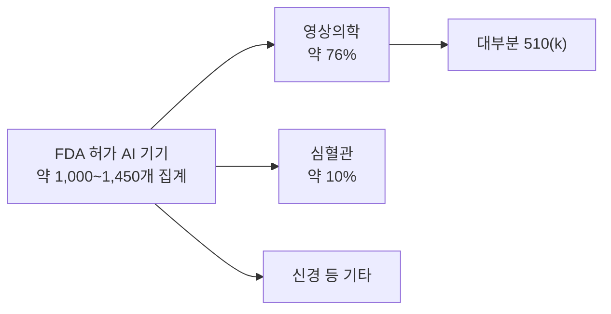

# 영상의학 AI 비중

> FDA가 허가한 AI 의료기기 중 영상의학(radiology) 분야가 차지하는 비율. 여러 분석에서 대략 4분의 3(약 75~77%)이며, 심혈관·신경 분야가 그다음이다. 집계 시점과 방법에 따라 수치가 달라진다.

## 쉽게 말하면
AI 의료기기 시장 지도를 그리면 영상의학이 거의 대륙 하나만큼 크다. 영상은 데이터가 디지털이고 판독이 반복적이어서 AI가 먼저 자리 잡았다는 설명이 흔하다(해설, 이번 출처로 확인한 인과는 아님).

## 자세히
출처: JMAI 논문(2026-02-27, 열어서 읽음), 검색 요약(JMIR 2026, AuntMinnie 등은 본문 열지 못함).
- **JMAI 리뷰(Loganathan 외, Journal of Medical AI vol. 9, 2026-02-27)**: FDA 허가 AI/ML 기기 **1,016개**, 영상의학 **76.1%**(772개), 심혈관 **9.8%**(100개), **510(k) 경로 96.5%**, 2023-01 이후 허가가 38.8%. 단 초록은 2025-05까지, 결과는 2024-12 기준이라고 써서 기준일이 논문 안에서 어긋난다.
- **JMIR 종단 연구(검색 요약, 본문 못 엶)**: 기기 1,430개에서 영상의학 1,094개(76.5%), 상위 3개 분야(영상의학·심혈관·신경)가 90.6%, 2025년 한 해에만 331건이라고 한다. 확인되지 않은 수치다.
- **추적 사이트(검색 요약)**: 2025년 영상의학 75%, 2024년 73%, 2023년 80%라는 주장이 있으나 총수(1,451)가 학술 분석과 달라 2차 자료로만 본다.
- **같은 목록이라도 숫자가 다른 이유**: 목록 다운로드 날짜, 분류 기준(패널 지정), 포함 범위가 다르다. FDA 목록 자체도 요약문의 AI 용어에 의존해 포괄적이지 않다고 밝힌다([FDA AI 기기 목록](#fda-ai-enabled-device-list)).
- **논문의 결론(JMAI)**: 대부분 510(k)라 predicate 비교에 의존하고 임상 시험 증거는 적다. 알고리즘 세부를 공개한 기기는 55.8%, AI 관련 정보를 전혀 안 밝힌 기기 15.6%, 전향적 검증을 언급한 기기는 5분의 1 미만. 510(k) 틀이 시간이 지나며 변하는 적응형·생성형 AI에 맞지 않을 수 있다고 지적.

## 그림으로 보기

## 예시
- 교육 자료: "AI 의료기기의 4분의 3이 영상의학"이라는 숫자를 쓸 때 출처·집계일을 함께 적어 두고, 논문과 추적 사이트 수치를 구분해 표시.
- 시장 조사: 목록 CSV를 내려받아 panel 열로 직접 집계하면 본인 기준일의 수치를 얻는다.

## 헷갈리는 것과 비교
| 개념 | 차이 |
|---|---|
| [FDA AI 기기 목록](#fda-ai-enabled-device-list) | 원자료, 포괄적이지 않음 |
| 분야(panel) | FDA가 심사한 심사 패널 기준, 임상 진료과와 다를 수 있음 |
| [predicate 사슬 문제](#predicate-creep) | 510(k) 비중이 높아서 생기는 우려 |
| [FDA 기기 데이터베이스](#fda-device-database) | 개별 기록 조회 |

## 더 읽을거리
- [Current state of FDA-approved AI/ML medical devices (JMAI, 2026)](https://jmai.amegroups.org/article/view/10846/html) — 1,016개 기기 분석(열어서 확인)
- [Radiology dominates thirty years of FDA AI device approvals (AuntMinnie)](https://www.auntminnie.com/imaging-informatics/artificial-intelligence/article/15830219/radiology-dominates-thirty-years-of-fda-ai-device-approvals) — 검색 결과로만 확인, 본문 접근 실패
