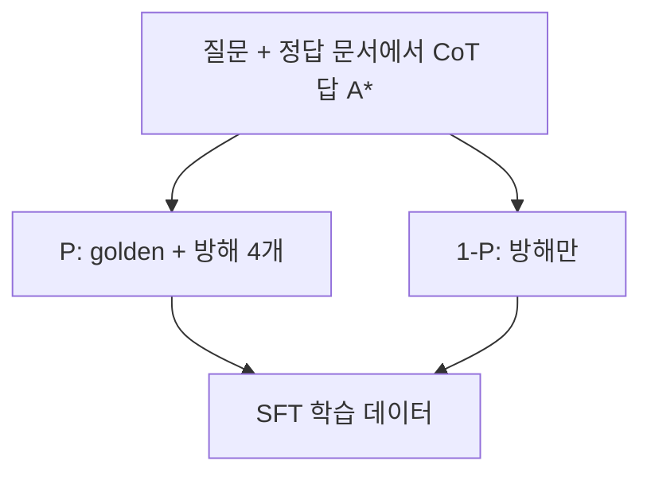

# RAFT 학습 데이터 구성

> RAFT 미세조정 데이터는 **질문 + 문서 묶음(정답 문서와 방해 문서) + 인용을 포함한 사고 연쇄 답**으로 만들며, 일부 질문에서는 정답 문서를 뺀다.

## 쉽게 말하면
연습 문제집을 만들 때 "정답이 든 책이 섞인 문제"와 "정답 책이 없는 문제"를 일정 비율로 섞는 것이다. 정답 책이 없을 때도 풀어 봐야 방해에 강해진다.

## 자세히
(RAFT 논문 PDF를 직접 읽었다.)
- **한 데이터 포인트**: 질문 Q, 문서 집합 Dk, 한 문서에서 도출한 CoT 스타일 답 A*.
- **P 비율 규칙**: P 비율의 질문 = **golden + 방해 문서**, (1−P) 비율 = **방해 문서만**(golden 없음). 학습 실험에서는 golden 1개 + 방해 4개.
- **P의 효과**: P=100%가 낫다는 직관과 달리 **P=80%**가 도움이 되는 사례. 최적 P는 데이터셋별 **40·60·100%**로 다양.
- **답 생성**: 컨텍스트 인용(##begin_quote##)을 포함한 추론 답을 **GPT-4-1106**으로 생성. Gorilla APIBench는 이미 추론이 포함.
- **학습**: 표준 지도 미세조정(SFT). 논문 평가는 Llama2-7B 기반.
- **테스트 시**: 질문과 retriever top-k 문서를 제공. RAFT는 retriever와 독립.
- **방해 문서 수(논문 §5)**: golden만으로 학습하면 방해에 약해지고, 방해 문서가 더 많은 설정에서 NQ 성능이 더 낫다는 보고(그림 6; 세부 수치는 확인하지 못함).

## 그림으로 보기

## 예시
- 질문 1,000개 중 800개는 정답 조항 + 방해 조항 4개, 200개는 방해 조항만(P=80%) 구성(제안, 논문 사례 참고).

## 헷갈리는 것과 비교
| 개념 | 차이 |
|---|---|
| RAFT 데이터 | 문서+질문+인용 CoT |
| [DSF](#dsf-domain-specific-finetuning) | 질문→답만 |
| [정답 문서](#oracle-document) | 데이터 구성요소 |

## 더 읽을거리
- [RAFT 논문](https://arxiv.org/abs/2403.10131) — 직접 읽음.
