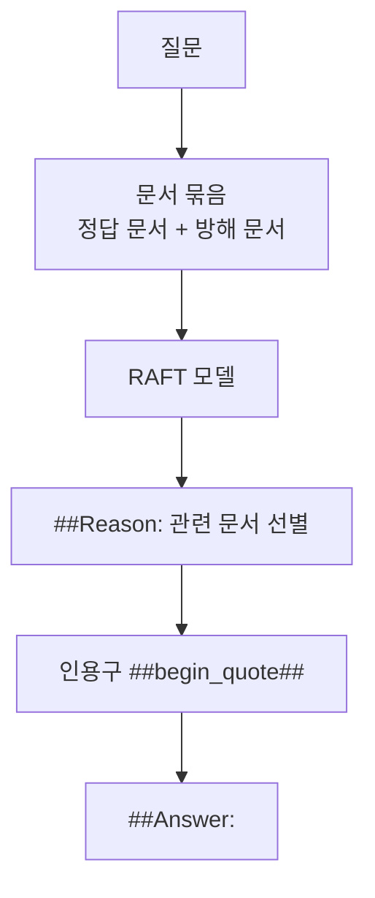
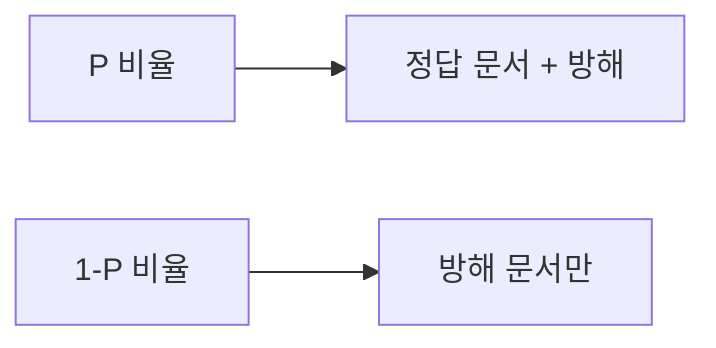

# RAFT

> Retrieval Augmented FineTuning. RAG에 쓸 모델을, 방해 문서가 섞인 검색 결과 속에서 관련 문서만 골라 근거 구절을 인용하며 답하도록 미세조정하는 방법. 정해진 도메인의 "오픈북 시험" 대비법이다.

## 쉽게 말하면
시험장에 참고서 여러 권을 들고 가되 그중 일부는 엉뚱한 책일 때, 맞는 책만 찾아 해당 줄을 인용하며 풀도록 미리 연습시키는 것이다.

## 자세히
- **출처**: RAFT 논문(arXiv 2403.10131, 초록 열람)과 Berkeley Gorilla 블로그(열람).
- **세 요소**: (1) 질문에 도움이 안 되는 방해 문서(distractor)를 무시하도록 학습, (2) 관련 문서에서 근거 구절을 그대로 인용, (3) 사고 연쇄(CoT) 형태의 답변.
- **학습 데이터 구성(블로그)**: 예시마다 질문 Q, 문서 묶음, 정답 문서(oracle)에서 나온 CoT 답 A\*. 일부 비율(P)은 oracle 문서와 방해 문서를 함께, 나머지(1-P)는 oracle을 빼고 방해 문서만 준다. 블로그는 P 값을 제시하지 않는다. 답은 `##Reason:`과 `##Answer:` 형식이고 문맥에서 그대로 가져온 문장은 `##begin_quote##`/`##end_quote##`로 감싼다(환각 감소 목적). 학습 데이터 생성에는 GPT-4를 썼다.
- **학습 설정**: Llama2-7B를 표준 지도 미세조정, 4×A100-40G로 학습하고 단일 GPU에서 서빙했다고 인용된다.
- **결과(저자 보고)**: PubMed QA, HotpotQA, Gorilla APIBench에서 Llama2 0-shot, Llama2+RAG, 도메인 미세조정(DSF), DSF+RAG를 일관되게 앞섰다고 한다. 블로그에는 정확한 점수가 없고 그림에만 있다. 작은 미세조정 모델이 더 큰 범용 모델과 비슷할 수 있다는 주장도 있다.
- **쓸 곳**: 추론 전에 도메인이 정해진 오픈북 QA(사내 문서, 최근 뉴스, 조직 코드 저장소). 검색 문서 개수 변화와 방해 문서에 더 튼튼해진다. 도메인을 미리 모르는 일반 RAG에는 덜 맞는다.
- 주의: 위 성능은 저자 실험 조건의 것이고 우리 데이터에서는 직접 시험해야 한다.

## 그림으로 보기

## 예시
- 사내 규정 챗봇: 규정 문서 한 건과 비슷한 다른 규정 3건을 섞어 학습 데이터를 만들고, 모델이 해당 조항을 인용해 답하도록 미세조정.
- 교육 실습: 질문 하나에 정답 문서와 방해 문서를 섞어 사람이 "어느 문서에서 어느 줄을 인용할지" 적어 본다.

## 헷갈리는 것과 비교
| 개념 | 차이 |
|---|---|
| RAFT | 방해 문서 포함 RAG 형식으로 미세조정 |
| 일반 RAG | 미세조정 없이 검색 문서를 프롬프트에 넣음 |
| 도메인 미세조정(DSF) | 문서 지식만 주입, 검색 사용 방식은 안 가르침 |
| [방해 문서](#distractor-documents) | RAFT가 무시하도록 가르치는 대상 |

## 더 읽을거리
- [RAFT (arXiv 2403.10131)](https://arxiv.org/abs/2403.10131) — 원 논문(초록 열람)
- [Berkeley Gorilla: RAFT 블로그](https://gorilla.cs.berkeley.edu/blogs/9_raft.html) — 데이터 구성과 사용처(열람)
