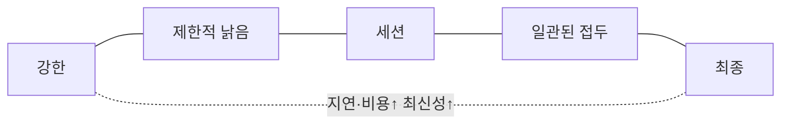
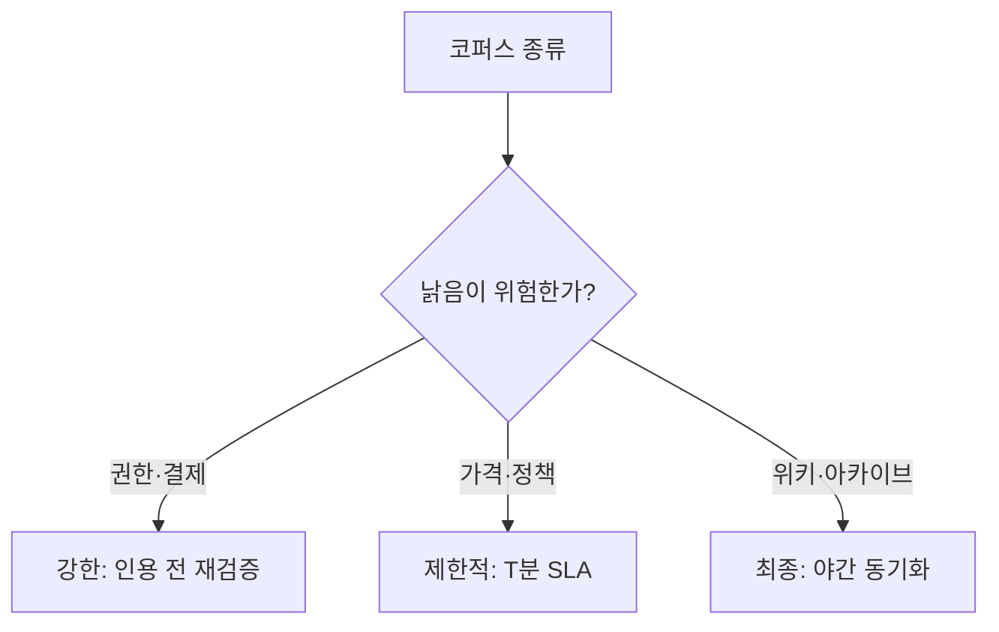

# RAG 일관성 수준

> 분산 데이터베이스가 쓰는 **일관성 수준(강한·제한적 낡음·세션·일관된 접두·최종)**의 어휘를 RAG의 "원본 문서 ↔ 벡터 색인" 관계에 빌려 와, **검색 결과가 얼마나 최신이어야 하는지를 명시적으로 고르는 틀**이다. 비유이며 RAG 전용 표준은 아니다.

## 쉽게 말하면
은행 앱은 방금 입금한 돈이 즉시 보여야(강한 일관성) 하지만, SNS 좋아요 수는 몇 초 늦어도 괜찮다(최종 일관성). RAG도 문서 종류마다 "얼마나 늦어도 되는지"가 다르다. 그 수준을 미리 정해 두면 설계·경보 기준이 생긴다.

## 자세히
(정의는 Microsoft Learn 「Consistency level choices - Azure Cosmos DB」(문서 갱신 2026-04-27)를 WebFetch로 직접 확인. RAG에의 대응은 **이 노드의 해석**이며, RAG 논의의 출처는 tianpan.co 「The RAG Read-After-Write Race」(글은 일관성 모델을 이름으로 풀어 설명하지 않는다고 확인).)
- **다섯 수준(Cosmos DB 문서)**
  1. **Strong**: 선형화 가능. 읽기는 항상 가장 최근 커밋 버전. 쓰기 지연이 커지고 장애 시 가용성이 떨어짐.
  2. **Bounded staleness**: 지역 간 지연이 **K 버전 또는 T 시간 중 먼저 닿는 값**을 넘지 않음. 단일 리전 계정의 최소 K·T는 10건 또는 5초, 다중 리전은 100,000건 또는 300초(Cosmos DB 설정 한계).
  3. **Session**: 한 클라이언트 세션 안에서 read-your-writes·write-follows-reads 보장. 문서는 가장 널리 쓰이는 수준이라 한다.
  4. **Consistent prefix**: 읽기가 쓰기 순서를 거스르지 않음(트랜잭션 단위 쓰기는 함께 보임).
  5. **Eventual**: 가장 약함. 이전에 읽은 것보다 낡은 값을 읽을 수도 있음. 좋아요 수 같은 곳에 적합.
- **트레이드오프(문서)**: 강할수록 읽기 처리량이 줄고(강함·제한적 낡음은 두 복제본을 읽어 같은 RU에서 읽기 처리량이 절반), 약할수록 가용성·성능이 좋아진다.
- **RAG에 빌려 쓰기(해석)**
  | 수준 | RAG에서의 의미 | 어울리는 코퍼스 |
  |---|---|---|
  | 강한 | 검색 직전 원본 확인(재검증) | 권한·결제·법무 |
  | 제한적 낡음 | 반영 지연 상한(T분)을 SLA로 명시 | 가격표·정책 |
  | 세션(자기 쓰기) | 방금 올린 문서는 내 질문에 즉시 검색 | 개인 업로드 |
  | 일관된 접두 | 같은 문서의 여러 청크가 같은 버전으로만 검색 | 긴 문서 |
  | 최종 | 언젠가 반영, 지연 미보장 | 위키·아카이브 |
- **주의(해석)**: 벡터 색인에는 Cosmos DB가 하는 만큼의 보증이 기본으로 없다. 글이 말하듯 read-your-writes·스냅샷 격리 등은 **강제되지 않으므로** 인용 전 재검증 같은 패턴을 직접 둬야 한다. → [불일치 창](#inconsistency-window)

## 그림으로 보기

## 예시
- 가격 문서는 "수정 후 5분 안에 검색 반영(제한적 낡음)", 위키는 "하루 안(최종)", 권한 메타는 "인용 직전 확인(강한)"으로 정한다.
- 교육 활동: 우리 서비스 데이터 5종을 다섯 수준 중 어디에 둘지 이유와 함께 고르기.

## 헷갈리는 것과 비교
| 개념 | 차이 |
|---|---|
| 일관성 수준 | 읽기가 얼마나 최신·순서 보장인지 |
| 데이터 신선도 | 데이터가 얼마나 최근인지(결과) |
| [불일치 창](#inconsistency-window) | 실제로 측정되는 지연 시간 |
| [RAG 신선도 SLA](#rag-freshness-sla) | 허용 지연의 운영 목표 |

## 더 읽을거리
- [Consistency level choices - Azure Cosmos DB (Microsoft Learn)](https://learn.microsoft.com/en-us/azure/cosmos-db/consistency-levels) — 다섯 수준의 정의·지연·처리량·RPO(직접 확인).
- [The RAG Read-After-Write Race (tianpan.co)](https://tianpan.co/blog/2026/04/27/rag-read-after-write-race) — RAG에서 보장되지 않는 일관성(직접 확인).
