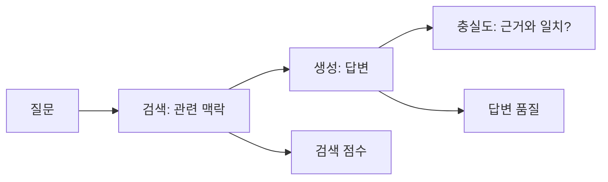
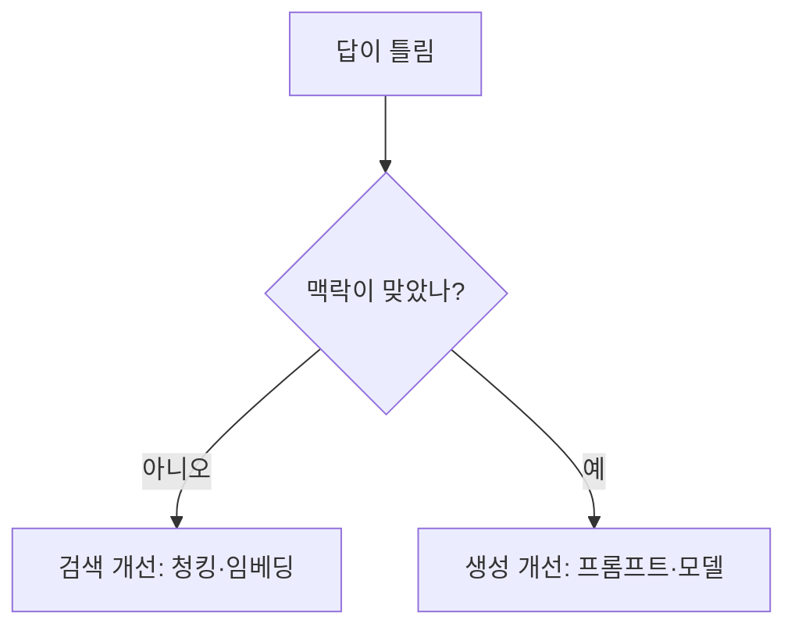

# RAG 평가

> **RAG 평가**는 검색 품질과 답변 품질을 **따로** 재는 일이다. Ragas는 정답 라벨 없이(reference-free) **검색·충실도·생성 품질** 세 차원으로 평가하는 틀을 제안했다.

## 쉽게 말하면
시험 답안이 틀렸을 때 "자료를 잘못 찾아서"인지 "자료는 맞는데 잘못 읽어서"인지 구분해야 고칠 곳을 안다. 그래서 검색 단계와 생성 단계를 나눠서 점수를 매긴다.

## 자세히
(Es 외, Ragas, arXiv 2309.15217 초록 확인)
- **참조 불필요**: 사람이 단 정답 주석 없이 RAG 파이프라인을 평가하는 프레임워크.
- **세 차원**: ① **검색**: 검색기가 관련 있고 **집중된** 맥락 구절을 찾는가 ② **충실도(faithfulness)**: LLM이 그 구절을 **정확히** 사용하는가 ③ **생성 품질**: 생성된 출력 자체의 품질.
- 이 차원에 대한 지표 모음으로 평가 주기를 빠르게 한다. 초록에는 구체 지표명이 없다(지표 이름은 공식 문서 확인 필요).
- 권고(일반 지식): ① 소규모 골든 질문 세트(질문·정답 문서)를 만들어 검색 재현율을 따로 측정 ② 답변이 근거에서 벗어나지 않는지(충실도) 점검 ③ LLM 심판을 쓰면 편향을 점검([독립 리뷰어](#independent-reviewer)) ④ 모델·청킹·임베딩을 바꿀 때마다 같은 세트로 회귀 테스트.

## 그림으로 보기

## 예시
- 사내 규정 챗봇 질문 50개와 정답 문서를 정해, 모델을 바꿀 때마다 검색 적중률과 충실도를 같이 기록.

## 헷갈리는 것과 비교
| 개념 | 차이 |
|---|---|
| 검색 평가 | 맞는 문서를 가져왔나 |
| 충실도 | 가져온 근거대로 답했나 |
| 일반 LLM 벤치마크 | 모델 범용 능력 |
| [MTEB](#mteb) | 임베딩 모델 비교 벤치마크 |

## 더 읽을거리
- [Ragas: Automated Evaluation of Retrieval Augmented Generation](https://arxiv.org/abs/2309.15217)
