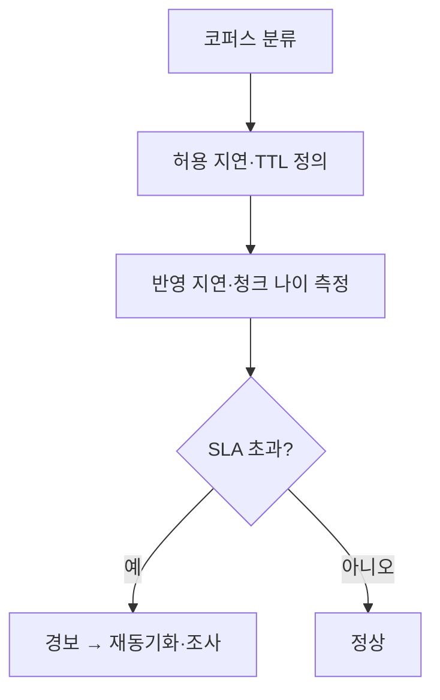
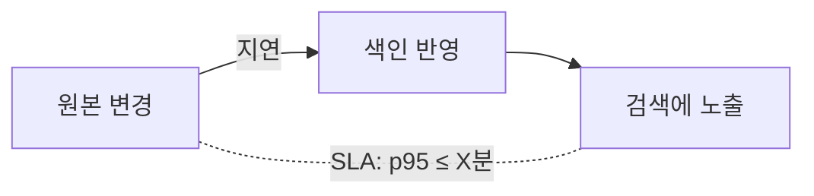

# RAG 신선도 SLA

> RAG 시스템에서 **"문서가 바뀐 뒤 검색에 반영되기까지 최대 얼마나 걸려도 되는가"를 코퍼스 종류별로 약속(SLA/SLO)으로 정하고, 이를 넘으면 경보**를 보내는 운영 방식이다. "가끔 낡은 답이 나온다"를 측정 가능한 목표로 바꾼다.

## 쉽게 말하면
택배는 "일반 배송 2일, 당일 배송 24시간"처럼 종류별 약속 시간이 있다. RAG도 "가격표는 5분 안에, 위키는 하루 안에 검색에 반영"처럼 문서 종류마다 약속을 두고 어기면 알려야 관리가 된다.

## 자세히
(근거: tianpan.co 블로그 「Stale retrieval and RAG data quality」(2026-04-15)와 「The RAG Read-After-Write Race」(2026-04-27)를 WebFetch로 직접 확인. 두 글은 **정식 SLA 정의를 제시하지 않는다**고 확인했다 — 아래 SLA 표는 글의 TTL 예시·권고를 바탕으로 이 노드가 정리한 **제안**이다. 개인 블로그 글이므로 수치는 예시값이다.)
- **글의 관련 권고**
  - **TTL(유효 기간) 예시**: 가격 약 7일, API 레퍼런스 약 2주, 규정 정책 약 6개월, 보관 콘텐츠는 만료 없음. TTL은 제품 결정. 재조정 빈도는 가격·보안 공지·규정·제품 문서 같은 고위험 범주에서 더 촘촘히.
  - **임베딩 지연을 SLO로**: 두 번째 글은 임베딩 지연(embedding lag)을 **SLO로 두고 경보**를 걸라고 권한다. 지연을 분 단위에서 초 단위로 줄이는 CDC는 "더 최종적으로 일관되게" 만드는 것이지 해결이 아니라고 한다.
  - **경보 예**: 검색된 청크 중 **180일보다 오래된 것이 제공 결과의 20%를 넘으면** 경보. 검색 청크 나이의 25·50·75 백분위 추적. **오래된 인용 비율·뒤집힌 인용 비율·권한 유출 비율**을 지표로.
- **SLA 설계 틀(제안)**
  | 코퍼스 | 허용 지연(예시) | 동기화 방식 | 측정·경보 |
  |---|---|---|---|
  | 권한·접근 | 분 단위 또는 인용 전 재검증 | 이벤트/재검증 | 권한 유출 비율 |
  | 가격·정책 | 수 분~수 시간 | CDC·웹훅 | 반영 지연 p95 |
  | API 문서 | 수 시간~1일 | 일 배치 | 청크 나이 분포 |
  | 위키·아카이브 | 1일 이상 | 야간 배치 | TTL 초과 비율 |
  (표의 값은 설계 예시이며 글이 제시한 SLA가 아니다.)
- **측정 방법(글 + 제안)**: `source_last_modified`와 `indexed_at`의 차로 **반영 지연**을 계산해 백분위로 추적하고, 삭제 문서 표본이 검색에 나오는지 감사한다. → [신선도 메타데이터](#freshness-metadata), [삭제 감사 표본](#deletion-audit-sampling)
- **한계**: 글이 SLA 형식을 정의하지 않았고 수치는 사례 수준이다. 어떤 SLA가 적절한지는 업무 위험(오답 비용)에 따라 정해야 한다. → [불일치 창](#inconsistency-window)

## 그림으로 보기

## 예시
- "가격표는 변경 후 10분 이내 반영, p95 기준", "위키는 24시간 이내". 위반 시 담당 채널로 알림.
- 교육 활동: 우리 서비스 문서 5종의 허용 지연을 정하고 이유를 한 줄씩 적기.

## 헷갈리는 것과 비교
| 개념 | 차이 |
|---|---|
| 신선도 SLA | 반영 지연의 목표와 경보 |
| [신선도 메타데이터](#freshness-metadata) | SLA를 측정하는 데이터 필드 |
| [불일치 창](#inconsistency-window) | 실제 지연 시간(측정 대상) |
| [RAG 일관성 수준](#rag-consistency-models) | 보장 수준의 어휘 |

## 더 읽을거리
- [Stale retrieval and RAG data quality (tianpan.co)](https://tianpan.co/blog/2026/04/15/stale-retrieval-rag-data-quality) — TTL 예시, 청크 나이 경보(직접 확인, 개인 블로그).
- [The RAG Read-After-Write Race (tianpan.co)](https://tianpan.co/blog/2026/04/27/rag-read-after-write-race) — 임베딩 지연 SLO, 인용 지표(직접 확인, 개인 블로그).
