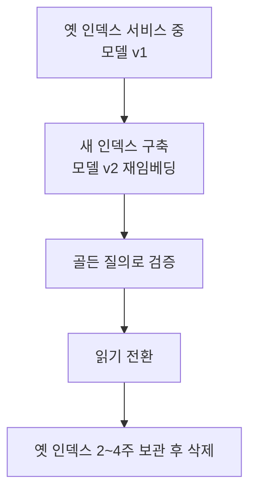
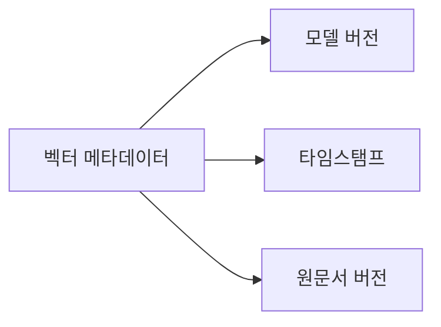

# RAG 인덱스 버전

> RAG(검색 증강 생성)의 벡터 인덱스가 **어떤 문서 시점·어떤 임베딩 모델·어떤 청킹 규칙으로 만들어졌는지 기록하고 관리**하는 일이다. 임베딩 모델이 바뀌면 기존 벡터와 새 벡터는 섞을 수 없어 인덱스를 통째로 다시 만들어야 한다.

## 쉽게 말하면
도서관 청구기호 체계를 중간에 바꿨는데 옛 책은 옛 번호, 새 책은 새 번호로 섞어 꽂으면 찾을 수가 없다. 어느 번호 체계로 꽂았는지(모델 버전)를 책마다 적어 두고, 새 서가를 따로 만들어 옮긴 뒤 한꺼번에 전환해야 한다.

## 자세히
(아래 내용은 벤더 블로그·실무자 글이다. 표준이 아니라 실무 권고로 읽는다.)
- **섞을 수 없는 이유(Zilliz FAQ, 직접 확인)**: 임베딩 모델마다 자기만의 벡터 공간·차원·이웃 구조가 있어 v1 벡터와 v2 벡터의 코사인 유사도는 의미가 없다. 한 ANN 인덱스(HNSW·IVF)에 섞으면 엉뚱한 영역의 이웃이 반환된다. 변환으로 옛 벡터를 새 모델용으로 만들 수 없으므로 코퍼스를 다시 임베딩해야 한다.
- **조용한 무효화(tianpan.co 글, 직접 확인)**: 제공자가 엔드포인트 뒤의 모델을 바꾸면 배포 없이도 검색 품질이 오류 없이 나빠질 수 있다. 차원이 같으면 DB가 새 쿼리 벡터를 그대로 받아 "보이지 않는 쓰레기" 결과가 나온다. 대응: 벡터마다 **모델 버전·타임스탬프·원문서 버전**을 저장하고 API 응답의 모델 버전을 로그로 남긴다.
- **회귀 감지**: 정답 문서를 아는 **50~200개 골든 질의**를 주 1회 돌려 MRR·NDCG를 추적한다. 배포가 없는데 떨어지면 임베딩 층을 의심한다. 기준 문서를 주기적으로 다시 임베딩해 저장된 참조 벡터와 비교하는 방법도 제안된다(해당 글의 AUC 0.5/0.7 기준은 한 블로그의 휴리스틱).
- **무중단 이전(블루-그린, Zilliz·tianpan 공통)**: ① 새 벡터 컬럼/인덱스 추가 ② 옛 인덱스를 서비스하는 동안 백그라운드로 재임베딩, 새 수집은 양쪽에 기록 ③ 보류 질의 세트(트래픽 5~10% 섀도잉 제안)로 검증 ④ 읽기를 전환한 뒤 옛 것 삭제. 제자리 덮어쓰기는 공간이 섞이고 롤백이 불가능해 피한다. 전환 후 2~4주 옛 인덱스를 보관하라는 권고도 있다(tianpan). 작업은 체크포인트·멱등으로.
- **청킹·모델 변경 구분(검색 요약)**: 메타데이터만 바뀌면 재임베딩 없이 upsert 가능하지만, 청킹이나 모델이 바뀌면 전체 재색인이 필요하다는 의견이 있다. 일부는 큰 코퍼스에서 영향 큰 문서부터 점진 재색인을 권하지만 혼합 모델 상태의 위험을 경고하는 의견도 있어 합의되지 않았다.
- **한계**: Microsoft 벡터 드리프트 글은 페이지 본문이 안 읽혀 확인하지 못했다.

## 그림으로 보기

## 예시
- 임베딩 모델을 교체하려는 사내 문서 검색: 새 컬럼에 백그라운드 재임베딩, 골든 질의 100개의 MRR이 기준 이상일 때만 전환.
- 교육 소재: "AI 검색이 어제와 다른 답을 하는 이유"를 인덱스 버전 관점에서 설명.

## 헷갈리는 것과 비교
| 개념 | 차이 |
|---|---|
| 인덱스 버전 | 어떤 모델·시점으로 만들었는지 |
| 문서 갱신(upsert) | 내용만 바뀐 문서 반영 |
| [DVC](#dvc) | 데이터 파일 버전 관리 |
| [실험 재현성](#experiment-reproducibility) | 실험 전체 기록 |

## 더 읽을거리
- [Zilliz: Change embedding model without re-indexing](https://zilliz.com/ai-faq/change-embedding-model-without-reindexing) — 섞을 수 없는 이유·블루-그린(직접 확인, 벤더).
- [Embedding Model Churn (tianpan.co)](https://tianpan.co/blog/2026/05/07/embedding-model-churn-vector-index-invalidation) — 조용한 무효화·골든 질의·이전 절차(직접 확인, 개인 블로그).
