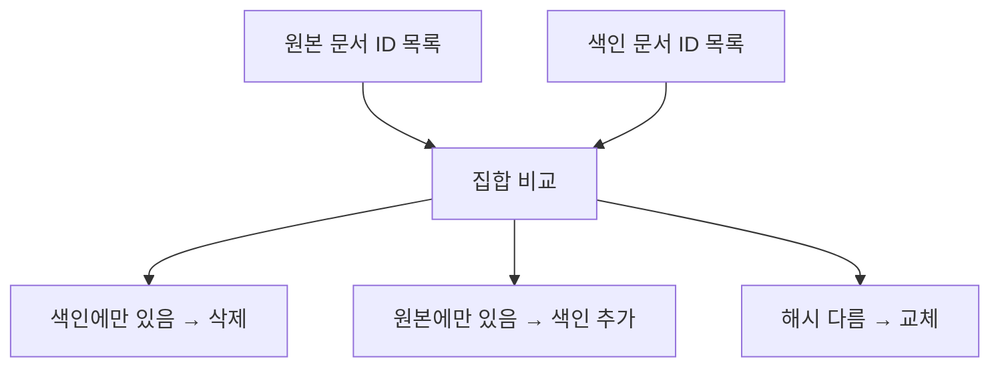
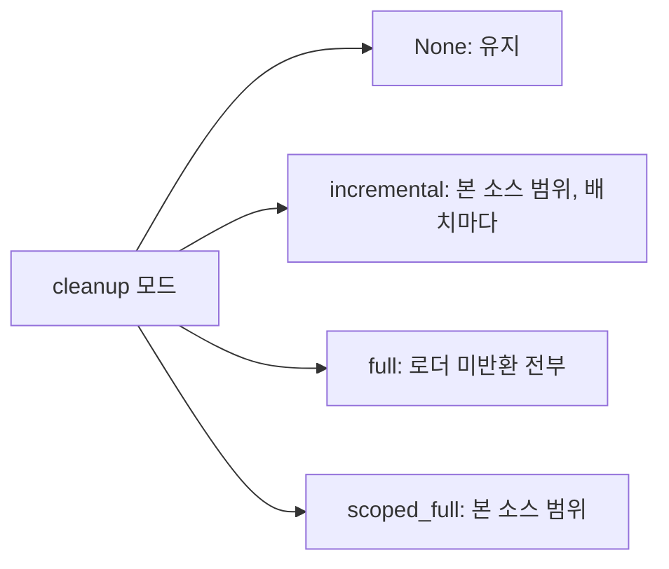

# RAG 대조 작업

> 원본 저장소의 문서 목록과 **벡터 색인의 문서·청크 ID를 주기적으로 비교해**, 원본에서 사라졌거나 바뀐 것을 색인에서 정리하는 작업이다. 삭제·수정 이벤트가 누락돼도 결국 맞추는 안전망 역할을 한다.

## 쉽게 말하면
창고 재고 장부(색인)와 실제 창고(원본)를 정기적으로 대조하는 재고 실사다. 입출고 때마다 기록해도 누락은 생기므로, 주기적으로 맞춰 보고 없는 물건은 장부에서 지운다.

## 자세히
- **LangChain 인덱싱 API의 정리 모드(소스 코드 docstring 직접 확인, 확인 시점 master)**: `index()`는 **레코드 매니저**로 문서 해시·소스 ID를 기록하고 `cleanup` 모드에 따라 오래된 문서를 지운다.
  - `None`: 삭제 없음, 오래된 문서가 벡터 저장소에 남는다.
  - `incremental`: 이번 실행에서 갱신되지 않았고 **이번에 본 소스 ID에 속한** 문서를 배치마다 지속 삭제. 사용자가 중복을 보는 구간이 짧다.
  - `full`: 로더가 이번에 돌려주지 않은 모든 문서를 삭제하며 정리는 색인 후에 실행되어 색인 중 중복이 보일 수 있다. **로더가 전체 데이터를 반환하지 않으면 유효한 문서가 삭제된다.**
  - `scoped_full`: full과 같지만 이번에 본 소스 ID 범위로 한정되어 다른 소스의 변하지 않은 문서는 지우지 않는다. 소스 ID를 메모리에 추적하므로 1,000만 건 이상은 병렬 색인이 필요할 수 있다.
  - `source_id_key`(메타데이터 키 또는 함수)는 incremental·scoped_full에서 필수이며 없으면 ValueError. 기본 `key_encoder` sha1은 충돌 방지가 아니라 경고가 나고, 바꾸면 중복을 피하려 색인도 바꿔야 한다.
- **대조 절차(제안, 블로그 권고 종합)**: ① 원본 ID 목록과 색인의 문서 ID 목록을 집합 비교 ② 색인에만 있는 ID는 좀비 후보 → 청크 ID 매핑으로 삭제([좀비 문서](#zombie-documents)) ③ 같은 소스 ID에 해시가 다른 청크가 여러 개면 옛 버전 정리([조용한 버전 드리프트](#silent-version-drift)) ④ 삭제 표본 감사로 검증. 이 절차 자체는 검색 요약에서 일관되게 제안되지만 표준 도구는 이번에 확인하지 못했다. 대조 주기는 코퍼스의 변경 빈도와 낡음 비용으로 정한다.
- **주의**: 원본 목록 조회가 실패했을 때 빈 목록으로 대조하면 전부 삭제된다. 실패 시 삭제하지 않고 경보를 보내는 가드가 필요하다(일반 원칙, 해석).

## 그림으로 보기

## 예시
- 매일 새벽 위키 페이지 ID 목록과 색인을 대조해 삭제된 페이지의 청크를 제거하고 삭제 건수를 대시보드에 기록.
- 교육 소재: `full` 모드 로더가 일부만 반환하면 문서가 지워지는 위험을 장난감 데이터로 재현.

## 헷갈리는 것과 비교
| 개념 | 차이 |
|---|---|
| 대조 작업 | 주기적 전체·범위 비교 |
| 이벤트 기반 동기화(CDC) | 변경 즉시 반영 |
| [좀비 문서](#zombie-documents) | 대조가 찾는 대상 |
| [RAG 인덱스 버전](#rag-index-versioning) | 색인 생성 조건 기록 |

## 더 읽을거리
- [LangChain core indexing API 소스](https://github.com/langchain-ai/langchain/blob/master/libs/core/langchain_core/indexing/api.py) — cleanup 모드 docstring(raw 파일로 직접 확인).
