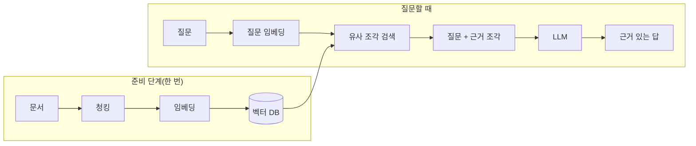
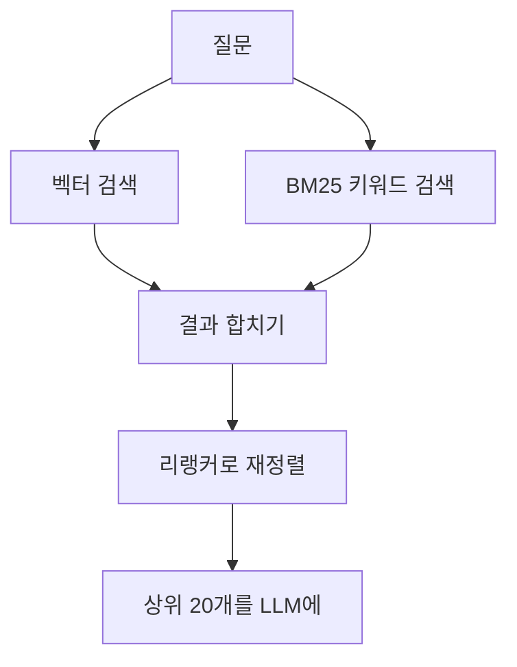

# RAG(검색 증강 생성)

> 질문이 들어오면 먼저 관련 문서를 검색해 프롬프트에 붙여 주고, 모델이 그 근거를 보며 답하게 하는 구조. Retrieval-Augmented Generation.

## 쉽게 말하면
LLM은 외운 지식으로만 시험을 보는 학생이다. 최신 내용이나 우리 회사 내부 규정은 외운 적이 없어서 그럴듯하게 지어내기 쉽다. RAG는 "오픈북 시험"이다. 질문이 오면 사서가 서가에서 관련 페이지를 찾아 책상에 펴 주고, 학생은 그 페이지를 보고 답한다. 모델을 다시 학습시키지 않고도 새 정보를 반영할 수 있다.

## 자세히
- 원조: Lewis 등의 논문 "Retrieval-Augmented Generation for Knowledge-Intensive NLP Tasks"(2020, arXiv 2005.11401). 모델 파라미터 속 지식(파라메트릭 메모리)과 Wikipedia 벡터 인덱스(비파라메트릭 메모리)를 합쳐 오픈 도메인 QA에서 당시 최고 성능을 냈다.
- 기본 파이프라인(Anthropic Contextual Retrieval 글, 확인 2026-10-30):
  1. **청킹**: 문서를 수백 토큰 이하 조각으로 자른다.
  2. **임베딩**: 조각을 의미 벡터로 바꿔 벡터 DB에 저장한다.
  3. **검색**: 질문도 벡터로 바꿔 가까운 조각 상위 K개를 찾아 프롬프트에 넣는다.
- **BM25**(키워드 일치 점수)는 "TS-999" 같은 오류 코드처럼 정확한 문자열에 강하다. 임베딩과 BM25 결과를 합치는 하이브리드 검색이 흔하다.
- 약점: 청킹하면 문맥이 사라진다("매출이 3% 성장" — 어느 회사·분기인지 모름). 해결로 **Contextual Retrieval**은 조각마다 50~100토큰 설명을 앞에 붙인다. Anthropic 측정(top-20 검색 실패율): 기준 5.7% → 맥락 임베딩 3.7%(-35%) → +맥락 BM25 2.9%(-49%) → +리랭킹 1.9%(-67%). 주장이 아니라 Anthropic 자체 데이터셋 결과라는 점에 유의.
- **리랭킹**: 먼저 150개쯤 넉넉히 뽑고, 별도 모델로 점수를 다시 매겨 상위 20개만 모델에 준다.
- 문서가 아주 작으면(컨텍스트 윈도우에 통째로 들어갈 정도) RAG 없이 전부 넣는 편이 간단하다. 이 경우 [컨텍스트 윈도우](#context-window)와 캐싱이 대안이다.

## 그림으로 보기

## 예시
- 사내 챗봇: 인사 규정 PDF를 쪼개 색인해 두고, "연차 이월 규정?"이라 물으면 해당 조항 조각을 붙여 답하게 한다. 프롬프트에 "근거 조각에 없으면 모른다고 답해"를 넣으면 [환각](#hallucination)이 줄어든다.
- 프롬프트 골격: `다음 문서만 근거로 답하라.\n<docs>...검색 조각...</docs>\n질문: ...`

## 헷갈리는 것과 비교
| 개념 | 차이 |
| --- | --- |
| RAG | 질문 때마다 외부 문서를 찾아 붙임. 모델은 그대로 |
| 파인튜닝 | 모델 가중치를 바꿈. 말투·형식 학습에 적합, 최신 사실 갱신엔 비효율 |
| 긴 컨텍스트에 통째 입력 | 검색 단계 없이 단순하지만 매번 토큰 비용과 윈도우 한계 |
| [도구 사용](#tool-use) | 검색도 도구로 노출 가능(에이전트가 필요할 때 스스로 검색) |

## 더 읽을거리
- [Retrieval-Augmented Generation for Knowledge-Intensive NLP Tasks](https://arxiv.org/abs/2005.11401) — RAG 원조 논문(2020)
- [Introducing Contextual Retrieval](https://www.anthropic.com/news/contextual-retrieval) — 청킹·BM25·리랭킹과 수치
