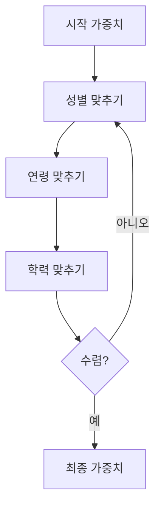
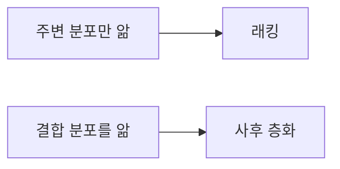

# 래킹(반복 비례 적합)

> 모집단의 **변수별 주변(marginal) 분포만 알 때**, 표본 가중치를 변수 하나씩 번갈아 맞추며 수렴할 때까지 반복해 표본 구성을 모집단과 비슷하게 만드는 가중 방법이다. IPF(Iterative Proportional Fitting)라고도 한다.

## 쉽게 말하면
두 개의 서랍(성별 서랍, 학력 서랍)을 번갈아 정리하는 일이다. 성별 서랍을 맞추면 학력 서랍이 흐트러지고, 학력을 맞추면 다시 성별이 어긋난다. 그래서 두 서랍이 모두 목표에 맞을 때까지 왔다 갔다 한다.

## 자세히
(Meta의 `balance` 논문 arXiv 2307.06024 3.3.2절과 Pew Research의 가중 방법 설명을 직접 읽었다.)
- **언제 쓰나(논문)**: 모집단의 변수별 주변 분포는 알지만 결합 분포는 모를 때가 많다. 래킹은 주변 분포만으로 표본을 모집단에 맞춘다. 결합 분포를 재현하지 않으므로 일종의 **정규화된 모델**로 볼 수 있어, [사후 층화](#post-stratification-weights)처럼 작은 칸에 과적합하는 것을 피한다.
- **절차(논문)**: 사후 층화를 모든 변수에 걸쳐 순차적으로 적용한다. 예: 성별 분포를 맞춘 가중치를 입력으로 연령을 맞추고, 그 가중치로 학력을 맞춘 뒤 다시 성별, 연령… 순서로 반복한다. 표본의 설계 가중치가 있으면 출발점으로 쓴다.
- **멈춤 조건 3가지(논문)**: ① 정해 둔 반복 횟수 도달 ② 어느 변수에서든 표본과 목표 주변 분포의 최대 비율 차이가 설정한 수렴률보다 작음 ③ 반복 사이 가중치 변화가 허용 오차보다 작음.
- **Pew의 예(직접 읽음)**: 목표가 남 48%·여 52%, 학력 고졸 이하 40%·대학 일부 31%·대졸 29%라면, 학력을 맞추면 성별 비율이 흐트러져 다시 가중치를 조정한다. 성별·연령·학력·인종·지역을 각각 맞출 수 있고 "중서부 백인 남성 대졸 18~34세" 같은 모든 조합의 비율은 몰라도 된다. Pew는 래킹을 표준 가중 방법으로 쓴다고 알려졌다(검색 요약).
- **한계(논문)**: ① 결과 가중 표본의 결합 분포가 모집단의 결합 분포와 같다고 가정할 수 없다. 그래서 청년층만 같은 **하위 집단** 추론에는 덜 권장되며, 결합 분포를 아는 경우 그것을 쓰는 방법이 낫다 ② 쓸 수 있는 변수 수가 제한된다(각 주변 칸에 응답자가 충분해야 함) ③ 변수를 맞추는 **순서에 민감**해 일부 변수가 덜 보정될 수 있다.
- **후처리**: 가중치가 들쭉날쭉하면 [Kish 설계 효과](#kish-design-effect)로 분산 손실을 확인하고 [트리밍](#weight-trimming)을 고려한다.

## 그림으로 보기

## 예시
- 온라인 설문 응답자의 성별·연령·학력 비율을 인구 통계에 맞춰 보정하고, 보정 후 가중치 분포와 유효 표본 크기를 확인한다.
- 교육 소재: 서랍 두 개를 번갈아 정리하는 활동으로 반복 보정을 설명.

## 헷갈리는 것과 비교
| 개념 | 차이 |
|---|---|
| 래킹 | 주변 분포만으로 반복 보정 |
| [사후 층화 가중](#post-stratification-weights) | 결합 분포(칸별 비율)가 필요 |
| [역성향점수 가중(IPW)](#inverse-propensity-score-weighting) | 응답 확률 모델로 가중 |
| [Kish 설계 효과](#kish-design-effect) | 가중 후 분산 손실을 측정 |

## 더 읽을거리
- [balance (arXiv 2307.06024)](https://arxiv.org/pdf/2307.06024) — 래킹 절차·정지 조건·한계(PDF 직접 읽음).
- [How different weighting methods work (Pew Research)](https://www.pewresearch.org/methods/2018/01/26/how-different-weighting-methods-work/) — 래킹 예(직접 읽음).
