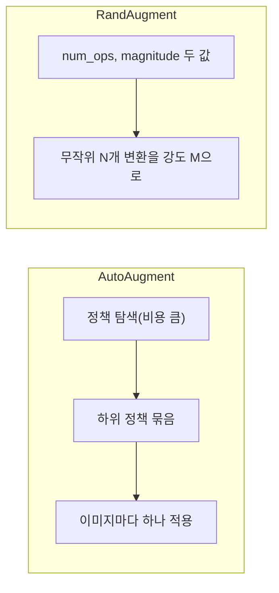
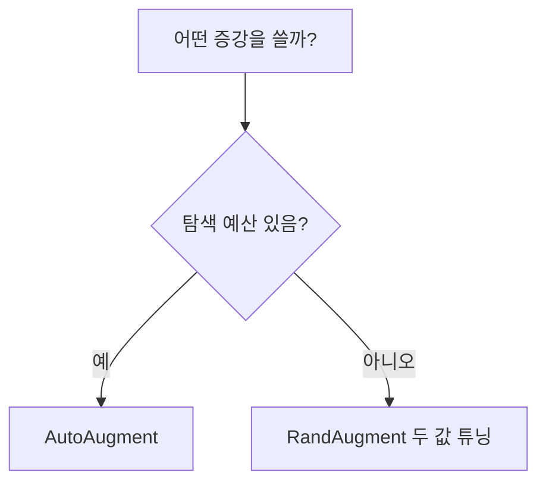

# RandAugment·AutoAugment

> 이미지 증강에서 어떤 변환을 얼마나 세게 쓸지를 사람이 정하지 않고, AutoAugment는 탐색으로 학습해 정하고 RandAugment는 단 몇 개의 값만 정해 무작위로 적용하는 방법이다.

## 쉽게 말하면
운동 코치가 선수마다 맞는 훈련 메뉴를 시험해 보며 짜 주는 것이 AutoAugment(비싸지만 맞춤형)이고, "메뉴 두 개를 무작위로 뽑아 강도 9로 하세요"라고 단순한 규칙만 주는 것이 RandAugment(싸고 간단)다.

## 자세히
(arXiv 초록 2건과 torchvision 문서를 직접 열어 확인.)
- **AutoAugment(arXiv 1805.09501)**: 사람이 설계한 증강 대신 **탐색 절차로 증강 정책**을 찾는다. 정책은 여러 하위 정책을 담고, 미니배치의 이미지마다 하나를 무작위로 골라 적용한다. 하위 정책은 회전·전단 같은 변환 두 개를 정해진 확률·강도로 적용. 대상 데이터의 검증 정확도가 가장 높은 정책을 선호한다. 결과: CIFAR-10 오류 1.5%(이전 최고 대비 약 0.6%p 개선), ImageNet top-1 83.5%(이전 83.1%, 추가 데이터 없이), CIFAR-100·SVHN에서도 최고. ImageNet에서 학습한 정책이 Oxford Flowers·Caltech-101·Pets·FGVC Aircraft·Stanford Cars 등으로 전이됐다.
- **RandAugment(arXiv 1909.13719)**: **탐색 공간을 크게 줄여** 별도 대리 과제 없이 목표 과제에서 바로 학습할 수 있다. 해석 가능한 하이퍼파라미터로 모델·데이터 크기에 맞춰 정규화 강도를 조절한다. 결과: ImageNet **85.0%**(이전 최고 대비 +0.6%p, 기본 증강 대비 +1.0%p), COCO 탐지에서 AutoAugment와 mAP 0.3 이내.
- **torchvision 구현**: `RandAugment(num_ops=2, magnitude=9, num_magnitude_bins=31, interpolation=NEAREST, fill=None)` — `num_ops`는 순서대로 적용할 변환 수(기본 2), `magnitude`는 모든 변환의 강도(기본 9). 즉 조절할 값이 사실상 "몇 개를, 얼마나 세게" 두 개(초록에는 개수 명시가 없고 문서 기본값으로 확인).
- **차이의 핵심**: AutoAugment는 정책 탐색 비용이 크고 데이터셋별 정책을 새로 찾아야 한다. RandAugment는 탐색이 필요 없고 두 값만 튜닝한다.
- 사용 팁(제안): 증강은 학습 세트에만, 라벨이 변하지 않는 변환인지 점검([라벨 보존 변환](#label-preserving-transform)), 박스·마스크 과제는 동시에 변환([탐지용 증강](#augmentation-for-detection)).

## 그림으로 보기



## 예시
```python
from torchvision import transforms as T
train_tf = T.Compose([
    T.RandomResizedCrop(224),
    T.RandAugment(num_ops=2, magnitude=9),
    T.ToTensor(),
])
```
- 불량 사진 2,000장 분류에서 과적합을 줄이기 위해 학습 세트에만 RandAugment를 적용하고 `magnitude`를 5·9·13으로 바꿔 검증 점수 비교.

## 헷갈리는 것과 비교
| 개념 | 차이 |
|---|---|
| AutoAugment | 탐색으로 정책 학습 |
| RandAugment | 무작위 변환, 값 2개만 조절 |
| [MixUp·CutMix](#mixup-cutmix) | 샘플·라벨을 섞음 |
| 수동 증강(flip·crop) | 사람이 고정 설계 |

## 더 읽을거리
- [AutoAugment (arXiv 1805.09501)](https://arxiv.org/abs/1805.09501) — 정책 탐색·CIFAR-10 1.5%(초록 확인).
- [RandAugment (arXiv 1909.13719)](https://arxiv.org/abs/1909.13719) — ImageNet 85.0%(초록 확인).
- [torchvision RandAugment 문서](https://docs.pytorch.org/vision/stable/generated/torchvision.transforms.RandAugment.html) — 인자와 기본값(열어 확인).
