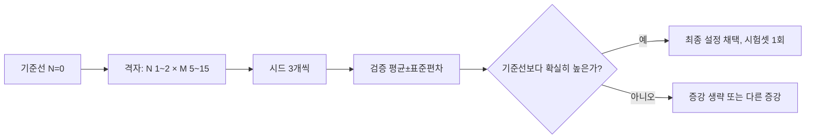
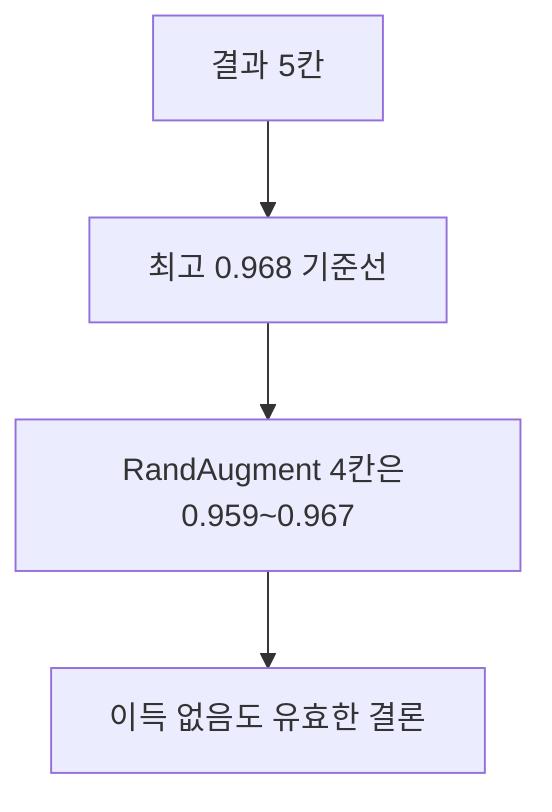

# RandAugment 격자 탐색

> RandAugment의 조절값은 연산 개수 N과 강도 M 두 개뿐이라, **N·M 후보 몇 개를 격자로 놓고 검증 정확도를 비교**하는 것으로 충분하다. 반드시 "증강 없음"을 기준선으로 함께 돌리고, 시드를 여러 개 써서 차이가 잡음인지 확인한다.

## 쉽게 말하면
요리 간을 맞출 때 소금의 양과 후추의 양, 두 가지만 바꿔 가며 맛보는 것과 같다. 후보 몇 개만 맛봐도 되지만 "아무것도 안 넣은 맛"을 기준으로 맛보지 않으면 조미가 필요했는지도 알 수 없다.

## 자세히
- **논문 입장**(RandAugment, arXiv 1909.13719 초록 확인): 탐색 공간이 작아 별도의 대리 과제 없이 목표 과제에서 바로 조절할 수 있다. 조절값이 적을수록 격자 탐색이 현실적이다([torchvision 사용법](#torchvision-randaugment)).
- **절차(제안)**: ① 기준선(N=0, 증강 없음) ② N∈{1,2,3}, M∈{5,10,15…}에서 후보 3~6개 ③ 후보마다 시드 3개 이상 ④ **같은 검증셋**에서 평균±표준편차 비교 ⑤ 기준선과 후보의 차이가 표준편차보다 큰지 확인 ⑥ 최종 후보를 시험셋에서 한 번만 평가.
- **직접 실행**(digits 8×8을 16×16 uint8로 확대, 학습 718장·시험 1,079장, 작은 CNN, 30 에폭, 시드 3개 평균±표준편차):

| 설정 | 시험 정확도 |
|---|---|
| N=0(증강 없음) | **0.968** ± 0.003 |
| N=1, M=5 | 0.959 ± 0.014 |
| N=1, M=15 | 0.963 ± 0.012 |
| N=2, M=5 | 0.967 ± 0.006 |
| N=2, M=15 | 0.962 ± 0.005 |

- 해석: **어떤 RandAugment 설정도 기준선(0.968)을 넘지 못했다.** 차이는 대부분 표준편차 안이고 N=1, M=5는 오히려 0.959로 낮았다. 숫자 손글씨는 회전·이동·왜곡 같은 증강이 숫자의 의미를 바꿀 수 있고 데이터가 쉬워서 이득이 없다는 해석이 가능하지만 원인은 확인하지 않았다. 교훈은 ① 증강이 항상 도움이 되지 않으므로 기준선이 필수 ② 시드 3개로 보면 N=1 설정의 표준편차(0.012~0.014)가 커서 순위가 불안정 ③ 격자 결과를 보고 "이득 없음"을 결론으로 삼는 것도 정당한 결과이다.
- **비용**: 후보 5개×시드 3개 = 15번 학습(이 실험은 합 58초). 큰 모델에서는 후보 수를 줄이거나 짧은 학습으로 거르는 방식을 쓰되, 짧은 학습에서 찾은 설정이 긴 학습에 맞지 않을 수 있다([대리 과제 함정](#proxy-task-pitfall)).
- 한계: 작은 합성 규모의 단일 실험이다. ImageNet 같은 큰 데이터에서는 논문처럼 이득이 나올 수 있다.

## 그림으로 보기

## 예시
- 사내 제품 이미지 분류: N∈{1,2}, M∈{5,10}에 기준선을 더한 5개 설정을 3시드로 비교.
- 교육: 결과 표에서 "이 차이는 잡음인가?"를 표준편차로 판단하는 훈련.

## 헷갈리는 것과 비교
| 개념 | 차이 |
|---|---|
| 격자 탐색 | 후보 값을 격자로 놓고 모두 시험 |
| 무작위 탐색 | 범위에서 무작위로 뽑아 시험 |
| [AutoAugment](#autoaugment-search-space) | 정책을 강화학습 등으로 탐색 |
| [강도 M 튜닝](#randaugment-magnitude-tuning) | 부모 노드 |

## 더 읽을거리
- [RandAugment 논문 초록](https://arxiv.org/abs/1909.13719) — 탐색 공간 축소(열어 확인).
- [torchvision RandAugment 문서](https://docs.pytorch.org/vision/main/generated/torchvision.transforms.RandAugment.html) — 인자(열어 확인).
