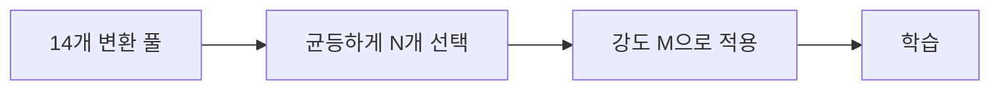
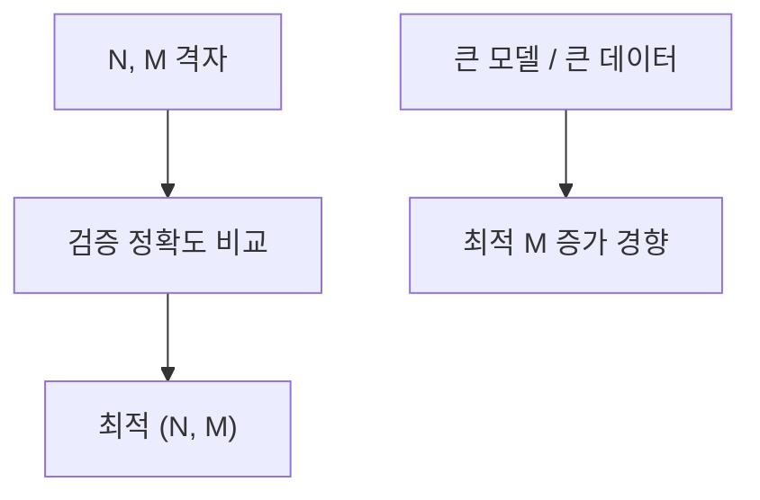

# RandAugment 강도 튜닝

> RandAugment는 **변환 개수 N과 강도 M 두 숫자만 조절**하는 데이터 증강이다. 큰 모델·큰 데이터일수록 큰 M이 좋다는 경향이 있어, 격자 탐색(grid search)으로 N과 M을 몇 번만 시험해 고르는 것이 요령이다.

## 쉽게 말하면
요리 간을 맞출 때 "양념 몇 종류(N)를 얼마나 세게(M)" 두 손잡이만 돌리면 된다. 큰 냄비(큰 모델)에는 더 진하게 간해야 맛이 난다.

## 자세히
(Cubuk 외 2019 RandAugment, arXiv 1909.13719 PDF 본문을 직접 읽음)
- 구조: K=14개 변환(identity, rotate, posterize, sharpness, translate-x/y, autoContrast, solarize, contrast, shear-x/y, equalize, color, brightness) 중 **균등 확률로 N개를 매번 고르고** 모두 같은 강도 M으로 적용한다. 가능한 정책 수는 K^N(N=2이면 196, N=3이면 2,744). 학습형 정책(AutoAugment 등)이 30개 넘는 파라미터와 별도 탐색 단계가 필요한 것과 대비된다.
- 강도 척도: 각 변환은 0~10 정수 척도에서 10이 그 변환의 최대 강도(논문은 예비 실험에서 [0,30] 범위도 시험). N·M이 클수록 정규화 강도가 세다.
- 튜닝 경향(논문 Figure 3, CIFAR-10, Wide-ResNet):
  1. **큰 네트워크일수록 최적 M이 크다** — 단조 증가 경향. AutoAugment식 고정 강도는 모든 구조에 최적이 아니다.
  2. 학습 데이터가 **많을수록 최적 M이 커진다**. "작은 데이터는 더 강한 규제"라는 직관과 달라 보이지만, 데이터 크기와 최적 M이 단조 증가했다(데이터가 작으면 증강으로 얻는 이득이 더 커서 3.0% 대 1.5%이지만 최적 M 자체는 작다).
  3. 그래서 **작은 부분 데이터로 만든 대리 과제(proxy)에서 찾은 정책은 큰 모델·전체 데이터에 최적이 아닐 수 있다**.
- 튜닝 절차(제안): N∈{1,2,3} × M을 몇 개 격자로 놓고 검증 정확도를 비교한다. 논문은 탐색 공간이 매우 작아 격자 탐색이 충분하다고 한다. 시작값으로 N=2를 두고 M을 키우며 과적합이 줄고 정확도가 올라가는 지점을 찾는다.
- 성과: 논문 초록은 ImageNet에서 EfficientNet-B7로 기준 증강 대비 1.0% 향상, 이전 최고 대비 0.6% 향상(2019)을 보고한다.

## 그림으로 보기

## 예시
- torchvision `RandAugment(num_ops=2, magnitude=9)`로 시작해 magnitude를 5·9·13으로 바꿔 검증 점수 비교.
- 교육: 파라미터 2개짜리 "간단한 손잡이"가 복잡한 자동 탐색과 비슷한 성능을 낸다는 사례.

## 헷갈리는 것과 비교
| 개념 | 차이 |
|---|---|
| RandAugment | 학습 없이 N·M 두 개만 조절 |
| AutoAugment | 별도 탐색 단계로 정책 학습 |
| [MixUp α](#mixup-beta-alpha) | 이미지를 섞는 강도 손잡이 |

## 더 읽을거리
- [RandAugment (arXiv 1909.13719)](https://arxiv.org/abs/1909.13719) — N·M 정의와 크기별 최적 강도 실험(PDF 본문 읽음).
