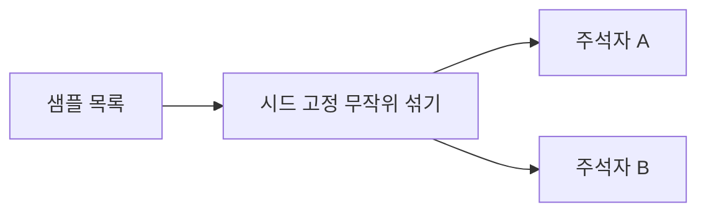
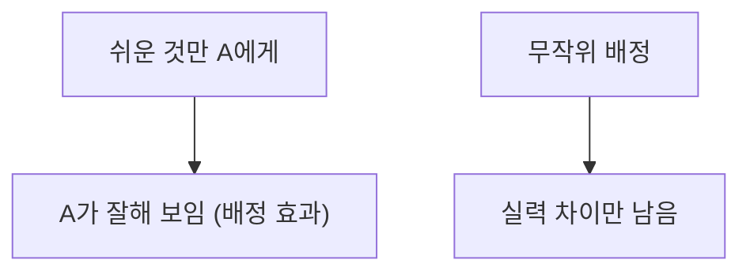

# 항목 무작위 배정

> 항목 무작위 배정은 라벨링할 샘플을 주석자에게 나눌 때 순서나 난이도에 따라 한 사람에게 몰리지 않도록 무작위로 배정하는 것이다. 주석자 비교·품질 통계·일치도가 공정해진다.

## 쉽게 말하면
반 학생들에게 시험지를 나눌 때 쉬운 시험지만 한 학생에게 주면 그 학생이 잘 풀어 보여도 실력이 아니라 배정 덕이다. 섞어서 나눠야 점수를 비교할 수 있다.

## 자세히
- **직접 시뮬레이션(샘플 1만 개, 절반은 쉬움(정확도 0.95), 절반은 어려움(0.75), 두 주석자 실력은 동일)**:

| 배정 방식 | 주석자 A 정확도 | 주석자 B 정확도 |
| --- | --- | --- |
| 쉬운 것부터 정렬해 앞 절반 A·뒤 절반 B | 0.947 | 0.746 |
| 무작위 배정 | 0.851 | 0.851 |

  실력은 같은데 정렬 배정에서는 B가 0.2 낮아 보인다. 주석자 품질 통계([주석자 품질 통계](#annotator-quality-stats))나 `annotator_quality`가 배정 편향을 실력으로 오해하게 만든다. 무작위 배정은 두 사람의 기대 정확도를 같게 만든다. (가정된 시뮬레이션)
- **근거 연결(Geva 외, arXiv 1908.07898 초록)**: 소수 작업자가 데이터 대부분을 만들면 데이터 다양성이 위협받고 모델이 주석자를 식별할 수 있다. 배정이 특정 주석자에게 몰리면 같은 문제가 생긴다([주석자 공통 편향](#shared-annotator-bias)).
- **방법(해석)**: ① 샘플 ID를 시드 고정 난수로 섞은 뒤 순서대로 배정 ② 층화 배정: 클래스·난이도·소스(문서 종류)별로 섞어 균형 ③ 이중 라벨 대상은 서로 다른 두 사람에게 ④ 한 사람이 한 문서(사용자) 전체를 가지면 문서 안 일관성은 올라가지만 편향도 커질 수 있어 문서 단위 배정과 샘플 단위 배정의 이득을 비교 ⑤ 배정 기록을 남긴다.
- **한계(해석)**: 완전 무작위는 문서 맥락이 필요한 작업에서 비효율적일 수 있다. 맥락이 중요하면 문서 단위로 무작위 배정한다.

## 그림으로 보기

## 예시
- 코드: `random.Random(0).shuffle(ids)` 후 `ids[0::2]`는 A, `ids[1::2]`는 B.
- 교육 활용: 위 시뮬레이션 코드를 돌려 배정 방식에 따른 정확도 차이를 확인한다.

## 헷갈리는 것과 비교
| 개념 | 차이 |
| --- | --- |
| 무작위 배정 | 우연으로 균형 |
| 층화 배정 | 클래스·난이도별로 균형 |
| [주석자 배정 공정성](#assignment-fairness) | 같은 원칙의 일반 개념 |
| [주석자 기여 상한](#annotator-contribution-cap) | 한 사람이 너무 많이 하지 않게 |

## 더 읽을거리
- [Are We Modeling the Task or the Annotator? (arXiv 1908.07898)](https://arxiv.org/abs/1908.07898) — 주석자 편향과 데이터 다양성
