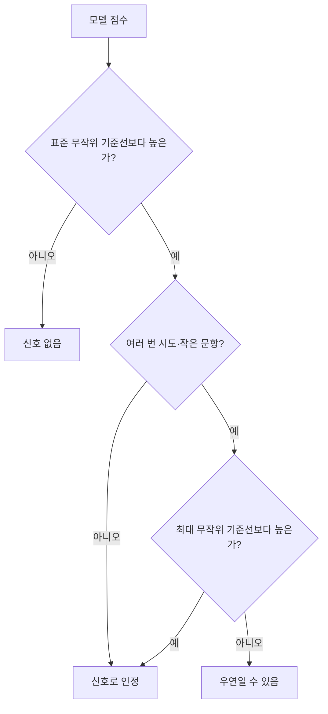
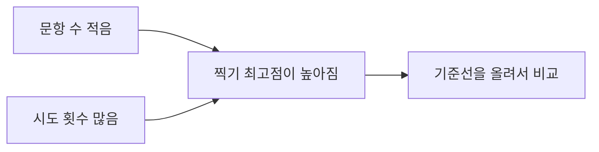

# 무작위 기준선 점검

> 모델 점수가 **그냥 찍어서 나올 수 있는 점수보다 확실히 높은지** 확인하는 일. 작은 모델이나 작은 평가 세트에서는 "찍기 수준"을 조금 넘긴 점수가 실력이 아닐 수 있다.

## 쉽게 말하면
4지선다 시험을 찍어서 평균 25점을 받는다. 그런데 문제가 20개뿐인 시험에서 찍기를 여러 번 해 가장 잘 나온 답안지를 고르면 40점쯤도 나올 수 있다. 어떤 학생이 35점을 받았다고 "실력이 있다"고 하기 어렵다.

## 자세히
- **표준 기준선**: 라벨을 균등하게 찍었을 때의 기대 정확도. 이진이면 50%, 4지선다(MMLU)면 25%. 큰 데이터를 한 번만 평가할 때는 안정적이다.
- **작은 모델의 현실**: MMLU가 나왔을 때 대부분의 모델이 무작위 수준(25%)에 가까웠다. 한 해석 연구는 Chinchilla 1B·7B의 라벨 기반 MMLU 정확도가 25%·26%였다고 보고한다(검색 요약, 본문 미확인). FineWeb은 이런 이유로 "이 크기 모델이 **무작위 기준선 위**의 점수를 내는 벤치마크"만 골랐다(arXiv 2406.17557, 직접 읽음).
- **더 강한 기준선**(Yauney & Mimno, COLM 2024, arXiv 2404.13020, 직접 읽음): 검증셋을 재사용하며 프롬프트를 고르면 "여러 후보 중 최고"를 보고하게 된다. 그래서 무작위 분류기 여러 개의 **최대 정확도의 기대값**(이항분포 최대 순서통계량의 기댓값)을 기준선으로 쓰자고 제안한다. 6개 양자화 모델·BIG-bench Lite 16개 과제에서 표준 기준선을 넘은 few-shot 결과의 **20% 넘게가 이 더 강한 기준선은 넘지 못했다**. 홀드아웃 테스트셋이 있을 때도 이 기준선이 홀드아웃 성능을 더 잘 예측했다.
- **직접 계산(이진 문항, p=0.5, 이항분포 정확 계산)**: 최고 정확도의 기대값은 문항 50개일 때 무작위 분류기 1개 0.50, 20개 0.631, 200개 0.692. 문항 100개는 0.50/0.593/0.636, 1,000개는 0.50/0.530/0.543. 평가 세트가 작고 시도 횟수가 많을수록 "찍기만으로" 높은 점수가 나온다.
- **답 순서만 바꿔도**: 답 보기의 내용을 섞었더니 MMLU 정확도가 시험한 모든 모델에서 떨어졌다(정도는 모델마다 다름). 저자들은 우연히 맞힌 비율도 같이 보자고 제안한다(arXiv 2406.19470, 초록 직접 읽음).
- 점검 순서: ① 과제의 무작위 기준선(클래스 수) 확인 ② 평가 문항 수와 시도한 프롬프트·체크포인트 수로 최대 무작위 기준선 계산 ③ 점수가 그 위로 충분히 높은지 ④ 시드 여러 번에서도 유지되는지.

## 그림으로 보기

## 예시
| 문항 수 | 무작위 1개 | 20개 중 최고 | 200개 중 최고 |
|---|---|---|---|
| 50 | 0.50 | 0.631 | 0.692 |
| 100 | 0.50 | 0.593 | 0.636 |
| 1,000 | 0.50 | 0.530 | 0.543 |
- 업무 장면: 문항 100개짜리 사내 평가에서 프롬프트를 20가지 시험해 가장 좋은 것이 58%라면, 이진 과제에서 찍기 최고점 기대치(약 59%)와 구분되지 않는다.

## 헷갈리는 것과 비교
| 개념 | 차이 |
|---|---|
| 무작위 기준선 점검 | 점수가 찍기 수준 위인지 확인 |
| [시드 잡음 대 효과 크기](#seed-noise-vs-effect) | 두 조건의 차이가 잡음 위인지 확인 |
| [소규모 ablation 벤치마크 선택](#benchmark-selection-small-scale) | 기준선 위 점수를 내는 벤치마크를 고르는 일 |
| 다수 클래스 기준선 | 가장 흔한 클래스만 답할 때 점수. 불균형 데이터에서 따로 확인 |

## 더 읽을거리
- [Stronger Random Baselines for In-Context Learning (arXiv 2404.13020)](https://arxiv.org/abs/2404.13020) — 최대 무작위 기준선과 20% 결과(직접 읽음).
- [Changing Answer Order Can Decrease MMLU Accuracy (arXiv 2406.19470)](https://arxiv.org/abs/2406.19470) — 답 내용 섞기 실험(초록 직접 읽음).
