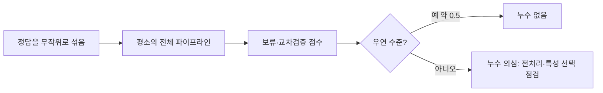
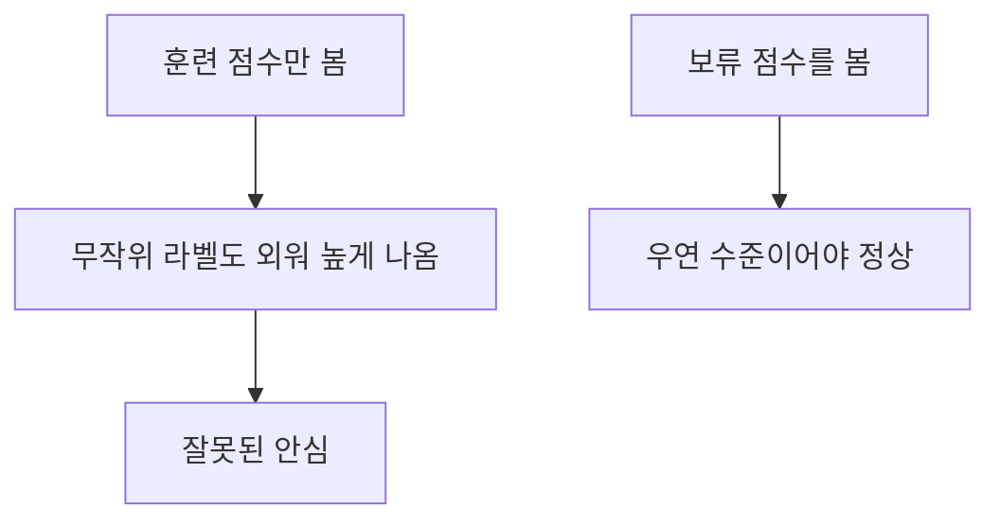

# 무작위 라벨 점검

> 무작위 라벨 점검은 정답(라벨)을 무작위로 섞어 놓고 평소와 똑같은 전처리·학습·검증 과정을 돌려, 점수가 우연 수준(분류라면 2클래스에서 약 0.5)으로 떨어지는지 확인하는 누수 탐지법이다. 섞은 정답인데도 점수가 높게 나오면 파이프라인 어딘가가 정답 정보를 새게 하고 있다는 신호다.

## 쉽게 말하면
시험 채점 시스템을 점검하려고 답안지에 아무 숫자나 적어 넣었는데도 만점이 나온다면 채점 시스템이 정답지를 몰래 보고 있는 것이다. 말이 안 되는 입력에서 좋은 점수가 나오면 검증이 잘못됐다.

## 자세히
- **원리**: 특성과 정답 사이의 관계를 끊으면(정답 섞기) 어떤 정직한 모델도 시험 데이터에서 우연 이상을 낼 수 없다. 점수가 높으면 전처리나 특성 선택이 전체 정답을 이용했거나(누수) 시험 데이터가 학습에 섞였다는 뜻이다.
- **scikit-learn의 `permutation_test_score`(교차검증 문서, 열람)**: 목표값을 `n_permutations`번 섞어 귀무분포를 만들고, 실제 점수가 우연일 확률(p-값)을 구한다. p-값은 섞은 데이터의 교차검증 점수가 실제 점수 이상인 비율로 설명된다. `n_permutations`는 신뢰성을 위해 100보다 크게 권하고 `cv`는 보통 3~10겹이다. p-값이 낮으면 특성과 정답 사이에 진짜 의존이 있고 모델이 이를 썼다는 뜻이고, 높으면 의존이 없거나 모델이 못 썼다(예: 과소적합)는 뜻이다. 약한 구조에도 낮은 p-값이 나올 수 있어 우연보다 낫다는 것만 보여 준다. (n_permutations + 1) × cv개의 모델을 학습하므로 작은 데이터에 실용적이다.
- **누수 점검에 쓰는 방법(해석)**: 이 도구의 본래 목적은 유의성 검정이다. 누수 점검에는 전체 파이프라인(전처리·특성 선택 포함)을 그대로 두고 정답만 섞어 한 번 돌려 본다. 점수가 우연 수준이면 통과, 높으면 누수를 찾는다.
- **참고 사례(scikit-learn Common pitfalls, 열람)**: 샘플 200개·특성 1만 개·무작위 이진 정답에서 특성 선택을 분할 전에 하면 정확도 0.76이 나오고 분할 후 학습 데이터로만 선택하면 0.5 수준이었다. 정답이 무작위인데 0.76이 나왔다는 것이 곧 누수의 증거다.
- **직접 해 본 실험([타깃 인코딩 누수](#target-encoding-leakage)의 순수 파이썬 시험)**: 정답을 무작위로 만든 데이터에서 범주 평균 인코딩의 정답 상관이 단순 방식은 0.69, 교차 적합은 −0.05였다. 정답이 무작위일 때 0.69라는 값 자체가 누수 경보다.
- **주의: 훈련 점수로 보면 안 된다(Zhang 등, arXiv 1611.03530 초록 열람)**: 최신 이미지 분류 신경망은 훈련 데이터의 무작위 라벨도 쉽게 맞춰 외울 수 있다. 유연한 모델은 무작위 라벨에서도 훈련 정확도가 높을 수 있으므로 점검은 반드시 보류 데이터나 교차검증 점수로 봐야 한다.
- **한계(해석)**: 이 점검은 정답과 무관하게 새는 구조적 누수는 잘 찾지만 시험 데이터와 학습 데이터의 중복처럼 정답을 섞어도 그대로 남는 누수는 못 찾는다.

## 그림으로 보기

## 예시
- 특성 선택을 분할 전에 했는지 모르는 노트북이 있으면 정답 열만 `shuffle`해 같은 코드를 돌려 본다. 정확도가 0.7이면 특성 선택이 전체 데이터를 보았을 가능성이 높다.
- 교육 활용: 정답이 무작위인 데이터로 누수와 정상 파이프라인을 비교하는 퀴즈.

## 헷갈리는 것과 비교
| 개념 | 차이 |
| --- | --- |
| [전처리 누수 파이프라인](#preprocessing-leakage-pipeline) | 상위 주제. 무작위 라벨 점검은 그 탐지법 |
| 순열 검정 | 점수의 유의성을 구함. 라벨 섞기를 반복해 귀무분포를 만듦 |
| 훈련 점수 | 무작위 라벨도 외울 수 있어 누수 점검 지표로 부적합 |

## 더 읽을거리
- [scikit-learn: Cross-validation — permutation_test_score](https://scikit-learn.org/stable/modules/cross_validation.html) — 순열 검정과 p-값
- [Understanding deep learning requires rethinking generalization (arXiv 1611.03530)](https://arxiv.org/abs/1611.03530) — 신경망이 무작위 라벨을 외움
