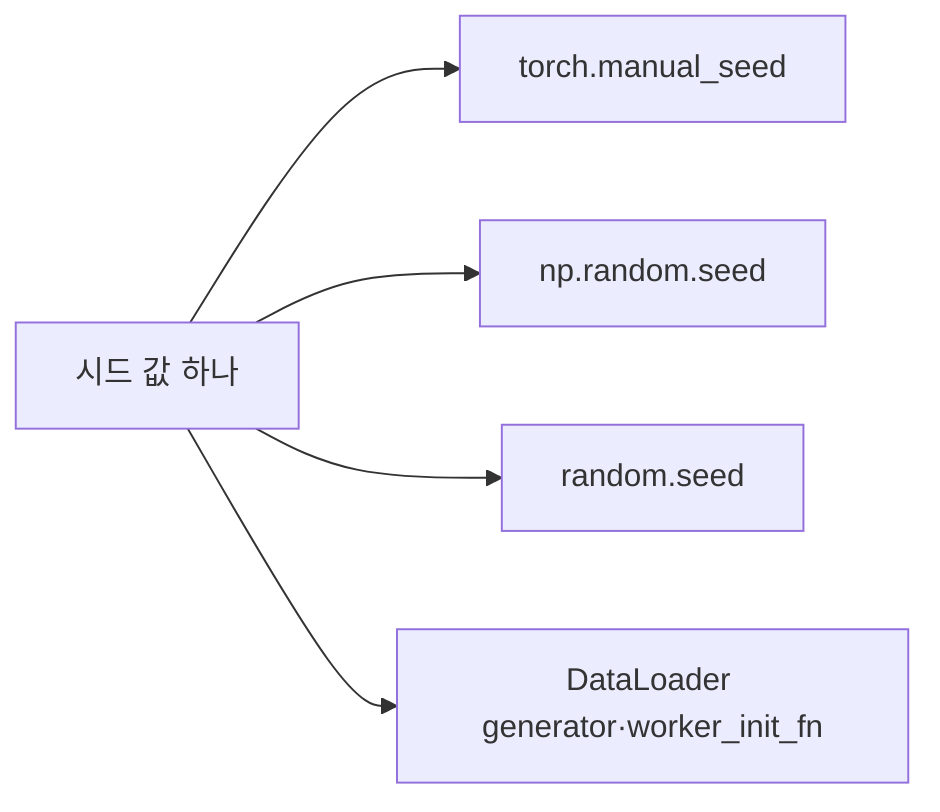
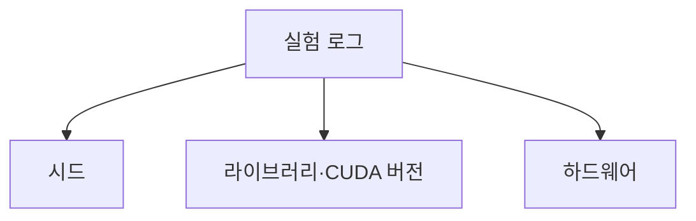

# 랜덤 시드 기록

> 실험에서 사용한 난수 시드를 모든 난수원(PyTorch, NumPy, Python, DataLoader 워커)에 대해 설정하고 기록하는 절차다. 시드 고정은 재현의 필요조건이지 충분조건이 아니다.

## 쉽게 말하면
주사위를 굴려도 "항상 같은 순서로 나오게" 약속해 두는 것이다. 어떤 약속을 했는지 적어 두어야 다른 사람이 같은 결과를 볼 수 있다.

## 자세히
(PyTorch 재현성 문서 2.15판을 직접 열어 확인.)
- **PyTorch**: `torch.manual_seed()`는 CPU와 CUDA의 난수 생성기를 시드한다. `torch.svd_lowrank()` 같은 일부 연산은 내부에서 난수를 쓴다.
- **Python·NumPy**: 사용자 정의 연산자가 Python `random`을 쓰면 별도 시드가 필요하다. NumPy는 `np.random.seed(0)` 예를 보이며 **NumPy Generator 객체를 쓰는 라이브러리는 따로 시드**해야 한다.
- **DataLoader**: `worker_init_fn`과 시드된 `generator`로 재현성을 유지한다(문서 예시는 각 워커 안에서 NumPy와 `random`을 시드).
- **한계**: 시드를 모두 고정해도 GPU 비결정성 때문에 결과가 다를 수 있다([GPU 학습의 비결정성](#nondeterministic-gpu-training)).
- **기록 항목(제안)**: 시드 값(여러 개면 모두), 난수원별 설정 코드, 라이브러리·CUDA 버전, 하드웨어. 실험 로그나 카드에 함께 저장.

## 그림으로 보기



## 예시
```python
def seed_all(s):
    random.seed(s); np.random.seed(s); torch.manual_seed(s)
```
- 교육 활용: 시드 3개로 학습해 정확도 평균과 편차를 보고하는 실습.

## 헷갈리는 것과 비교
| 개념 | 차이 |
|---|---|
| 시드 고정 | 난수 시퀀스를 같게 |
| 결정적 알고리즘 | 연산 순서를 같게 |
| 환경 고정 | 라이브러리·하드웨어를 같게 |

## 더 읽을거리
- [PyTorch Reproducibility](https://docs.pytorch.org/docs/2.15/notes/randomness.html) — 시드 설정.
