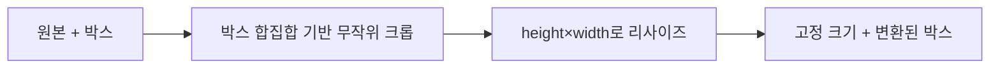
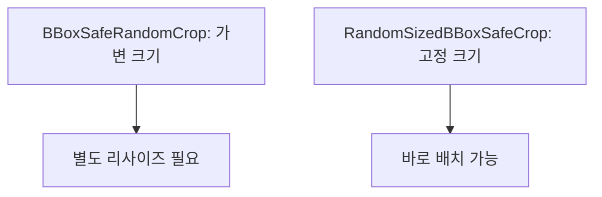

# RandomSizedBBoxSafeCrop

> 박스를 보존하면서 무작위로 자른 뒤, 결과를 **지정한 크기(height×width)로 리사이즈**해 돌려주는 증강이다. 배치에 크기가 다른 이미지가 섞이지 않게 하려는 용도다.

## 쉽게 말하면
단체 사진에서 모든 사람이 나오도록 아무 크기로 오려 낸 뒤, 증명사진처럼 규격 용지(224×224)에 맞춰 늘이거나 줄여 붙인다. 용지 크기가 늘 같으니 앨범 정리는 편하지만 사진이 약간 찌그러질 수 있다.

## 자세히
- 시그니처(Albumentations 2.0.8): `RandomSizedBBoxSafeCrop(height, width, erosion_rate=0.0, interpolation=1, mask_interpolation=0, p=1.0)`. 기본 보간 1은 선형(`cv2.INTER_LINEAR`), 마스크 보간 0은 최근접(`INTER_NEAREST`)이다.
- 동작: 박스 합집합 영역에서 [erosion_rate](#erosion-rate-bbox-crop)에 따라 크롭을 뽑고 `height×width`로 리사이즈. 직접 실험(640×480, 박스 2개)에서 출력 이미지 크기는 항상 (224, 224)였고, 박스 2개가 모두 유지됐다(시드 200개, erosion_rate 0.0·0.4).
- `BBoxSafeRandomCrop`과 차이: 앞은 크롭 크기가 그대로(가변)이고 이쪽은 고정 크기로 맞춘다. 앞선 실험에서 `BBoxSafeRandomCrop`의 크롭이 408×303~631×469처럼 제각각이었으므로 그대로 배치에 쌓을 수 없다 — 이때 이 변환이나 별도 리사이즈가 필요하다.
- 주의(추정): 크롭의 가로세로 비가 목표 비와 다르면 **리사이즈 때 물체가 늘어나거나 눌린다**. 박스 좌표도 같은 비율로 변환되므로 정답은 맞지만 형태 왜곡이 학습에 영향을 줄 수 있다. 비율을 유지하려면 크롭 뒤 패딩이나 `LongestMaxSize` + `PadIfNeeded` 조합을 고려한다.
- 이미지와 마스크 보간을 분리하는 이유: 마스크에 선형 보간을 쓰면 클래스 ID가 섞인다(그래서 기본이 NEAREST).

## 그림으로 보기



## 예시
```python
A.Compose([A.RandomSizedBBoxSafeCrop(height=224, width=224, erosion_rate=0.2)],
  bbox_params=A.BboxParams(format='pascal_voc', label_fields=['l']))
```
- 교육: 탐지 학습용 입력 크기를 맞추는 파이프라인 설명.

## 헷갈리는 것과 비교
| 개념 | 차이 |
|---|---|
| RandomSizedBBoxSafeCrop | 박스 보존 크롭 + 고정 크기 리사이즈 |
| BBoxSafeRandomCrop | 박스 보존 크롭, 크기 가변 |
| RandomResizedCrop | 박스 보존 보장 없음 |

## 더 읽을거리
- [Albumentations 문서](https://albumentations.ai/docs/api-reference/) — 클래스 시그니처·docstring을 설치 버전에서 확인.
- 직접 실행: Albumentations 2.0.8.
