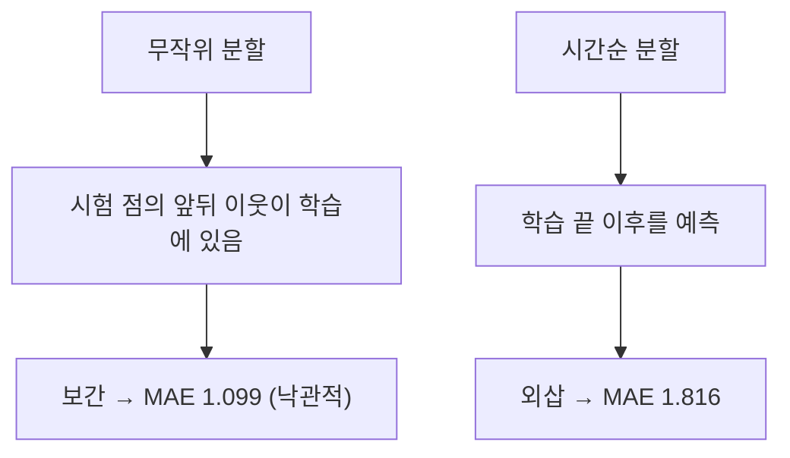

# 무작위 분할 누수

> 시간에 따라 변하는 데이터를 **무작위로 섞어 학습/시험으로 나누면**, 시험 데이터의 이웃(앞뒤 시점)이 학습에 들어가 성능이 부풀려진다. 실제 운영은 항상 미래를 예측하므로 시간순 분할보다 낙관적인 결과가 나온다.

## 쉽게 말하면
내일 날씨를 맞히는 연습을 하는데, 연습 문제집에 "오늘과 모레" 날씨가 이미 풀려 있다면 내일 날씨를 거의 보간(사이 채우기)으로 맞힐 수 있다. 하지만 진짜 내일 예측은 모레를 모르는 상태에서 해야 한다.

## 자세히
(scikit-learn `TimeSeriesSplit` 문서를 앞서 직접 읽었다. 아래 비교는 **이 지도에서 순수 Python으로 직접 실행한 시뮬레이션**이며 장난감 데이터로 원리를 보일 뿐 일반 결과가 아니다.)
- **문서의 서술(sklearn)**: `TimeSeriesSplit`에서 시험 인덱스는 이전보다 항상 커야 하므로 교차 검증기에서 **셔플은 부적절**하다. 각 폴드의 학습 세트는 특정 시점까지의 모든 데이터, 시험 세트는 그 이후다. 이는 미래 정보가 학습에 섞이지 않게 하기 위한 설계다.
- **시뮬레이션 설계(시드 21)**: 시점 0~199의 값을 `y = 0.1·t + 잡음(표준편차 1)`로 생성(상승 추세). 예측 모델은 단순하게 "시험 시점에서 **시간적으로 가장 가까운 학습 데이터 2개의 평균**"으로 둔다. 같은 150개를 학습, 50개를 시험으로 쓰되 분할 방식만 다르다.
  - **무작위 분할**(전체를 섞어 150/50): MAE **1.099**
  - **시간순 분할**(앞 150개 학습, 뒤 50개 시험): MAE **1.816**
- **해석**: 무작위 분할은 시험 시점의 앞뒤 이웃이 학습에 들어 있어 사실상 **보간**이라 오차가 작다(1.099). 시간순 분할은 학습 끝 이후의 미래를 **외삽**해야 하므로 오차가 훨씬 크다(1.816, 약 1.65배). 운영 환경은 후자에 가깝다. 같은 모델인데 분할 방식만 바꿔도 평가가 이만큼 달라진다. 이 차이는 데이터에 추세가 있을 때 두드러진다.
- **주의(해석)**: 모든 데이터가 시계열은 아니다. 시간에 따라 분포가 거의 변하지 않고 행이 독립이라면 무작위 분할도 문제가 적다. 사용자 ID나 문서 ID가 학습/시험에 중복되는 누수도 별도로 있다(그룹 분할 필요). 이 글은 시간 의존 누수만 다뤘다.
- **방어(일반 원칙)**: 시간순 분할([시간 기반 분할 규칙](#time-based-split-rule)), 학습·시험 사이 [gap](#split-gap-buffer), 특징 [shift](#lag-feature-shift), [시점 기준 조인](#point-in-time-join).

## 그림으로 보기



## 예시
```python
import random
random.seed(21)
y = [0.1*t + random.gauss(0, 1) for t in range(200)]
# 무작위 분할: 섞어서 150/50, 시간순 분할: 앞 150 / 뒤 50
```
- 교육 소재: 같은 모델로 두 분할의 점수를 비교하고 어느 쪽을 믿을지 토론.

## 헷갈리는 것과 비교
| 개념 | 차이 |
|---|---|
| 무작위 분할 누수 | 섞어서 나눠 미래 이웃이 학습에 들어감 |
| [시간 기반 분할 규칙](#time-based-split-rule) | 시간순으로 나눠 이를 막는 규칙 |
| [시점 누수](#point-in-time-leakage) | 특징·조인에서 미래 정보가 섞이는 문제 |
| 그룹 누수 | 같은 사용자·문서가 학습과 시험에 중복 |

## 더 읽을거리
- [sklearn TimeSeriesSplit](https://scikit-learn.org/stable/modules/generated/sklearn.model_selection.TimeSeriesSplit) — 시험 인덱스가 커야 하고 셔플은 부적절(직접 읽음).
