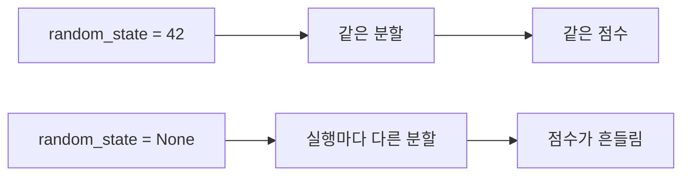
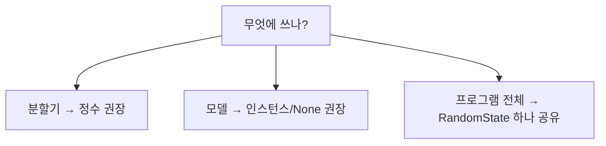

# random_state와 재현성

> `random_state`는 분할·셔플·모델 초기화의 무작위성을 통제하는 인자다. 정수를 주면 매번 같은 결과, `None`이나 `RandomState` 객체를 주면 호출마다 다른 결과가 나온다. 분할을 고정하면 결과를 다시 만들 수 있다.

## 쉽게 말하면
카드를 섞을 때 "섞는 손놀림 번호표(시드)"를 정해 두면 누구나 같은 순서로 카드가 나온다. 번호표가 없으면 섞을 때마다 순서가 다르다. 재현하려면 번호표를 적어 둔다.

## 자세히
(scikit-learn 공식 Common pitfalls 문서를 직접 열어 확인하고, 분할 동작은 직접 실행해 검증.)
- **핵심 규칙**: 정수 → 호출할 때마다 동일. `None`(기본, numpy 전역 난수 사용) 또는 `RandomState` 인스턴스 → 호출마다 다름.
- **직접 실행(scikit-learn 1.9.1)**: 0~9 열 개를 `train_test_split(X, random_state=0)`으로 두 번 나누면 시험 인덱스가 둘 다 `[2 8 4]`, `random_state=1`이면 `[2 9 6]`. `RandomState(0)` 객체 하나를 두 번 넘기면 `[2 8 4]` 다음 `[3 5 1]`(객체의 난수 상태가 소모됨).
- **분할기(splitter)**: 문서 권고는 **정수**. 모델 간 폴드별 비교에도 필수다. `KFold(shuffle=True, random_state=rng 인스턴스)`는 `split`을 부를 때마다 다른 폴드가 나와, 알고리즘 두 개를 폴드별로 비교하면 서로 다른 분할에서 비교하게 된다.
- **추정기(모델)**: 문서는 `RandomState` 인스턴스나 `None`을 권한다. 정수를 주면 교차 검증의 모든 폴드가 같은 난수(예: 같은 특징 부분집합)를 써서 모델 난수에 대한 견고성이 가려진다.
- **복제(clone) 주의**: `GridSearchCV` 같은 메타 추정기는 `clone`을 부른다. 인스턴스는 참조로 복사돼 복제본끼리 난수를 나눠 쓰고, 정수는 정확히 같고 독립적인 복제본을 만든다.
- **프로그램 전체 재현**: 시작에 `rng = np.random.RandomState(0)` 하나를 만들어 `random_state`를 받는 모든 객체에 넘긴다. `np.random.seed(0)`은 피하라고 권한다. 문서 예에서 점수가 항상 0.84로 고정.
- 시드를 바꿔 결과가 크게 흔들리면 분할 운이 좋았던 것이다. 최종 보고 전에 여러 시드 평균·표준편차를 본다(제안). 시드를 바꿔 가며 가장 좋은 점수만 고르면 시험 세트에 과적합이다.

## 그림으로 보기



## 예시
```python
import numpy as np
from sklearn.model_selection import train_test_split
X = np.arange(10).reshape(-1, 1)
train_test_split(X, random_state=0)[1].ravel()   # [2 8 4]
train_test_split(X, random_state=0)[1].ravel()   # [2 8 4]  (같음)
train_test_split(X, random_state=1)[1].ravel()   # [2 9 6]
```
- 논문·보고서에는 시드 값과 라이브러리 버전을 함께 적는다. 버전이 달라지면 같은 시드라도 분할이 바뀔 수 있다(제안).

## 헷갈리는 것과 비교
| 개념 | 차이 |
|---|---|
| 정수 random_state | 호출마다 동일 결과 |
| RandomState 인스턴스 | 객체 상태가 소모돼 호출마다 다름, 전체 재현엔 유용 |
| None | 전역 난수. 재현 불가 |
| `np.random.seed` | 전역 시드. 문서는 피하라고 권고 |

## 더 읽을거리
- [scikit-learn: Common pitfalls and recommended practices](https://scikit-learn.org/stable/common_pitfalls.html) — Controlling randomness 절(열어 확인).
