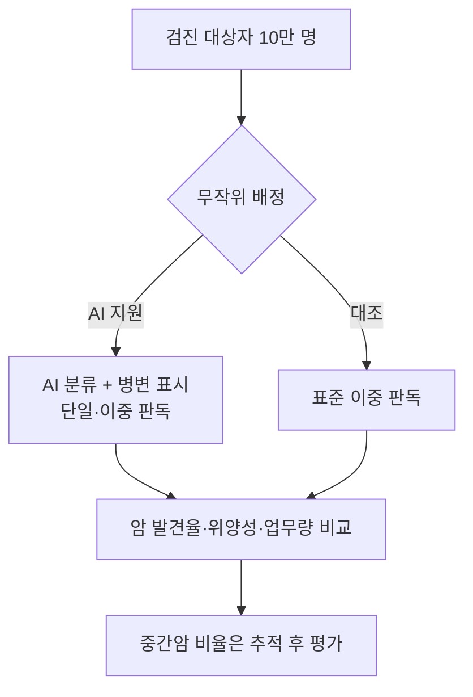

# AI의 RCT

> AI를 쓰는 군과 쓰지 않는 군에 대상자(또는 검사)를 **무작위로 배정**해 결과를 비교하는 시험. AI가 실제 진료 결과를 바꾸는지를 가장 강하게 입증하는 설계다. 정확도 점수를 다루는 후향 연구와 다르다.

## 쉽게 말하면
신약 시험처럼 동전 던지기로 두 집단을 나눠 한쪽에만 AI를 쓰게 한 뒤 암 발견율이나 의사 업무량이 달라지는지 본다. 같은 조건에서 AI 유무만 다르게 만들어 "AI 때문에" 달라졌다고 말할 수 있게 한다.

## 자세히
출처: Applied Radiology 보도(2025-02-11, 열어서 읽음), 검색 요약(Lancet Digital Health 논문 초록 수치). PubMed 페이지는 쿠키 문제로 열리지 않아 저널 원문과 대조하지 못했다.
- **예: MASAI 시험**(스웨덴 국가 유방암 검진, Lund 대학 Kristina Lång 연구팀, Lancet Digital Health 2025). 10만 5천여 명 이상(검색 요약상 105,934명)을 AI 지원 검진(Transpara)과 표준 이중 판독으로 무작위 배정.
  - **암 발견율**: AI군 6.4/1,000 대 대조군 5.0/1,000, **29% 증가**(AI군 53,043명 중 338건, 대조군 52,872명 중 262건이라는 검색 요약). 소규모·림프절 음성 침윤암과 고등급 상피내암 발견이 늘었다.
  - **위양성·재검**: 유의하게 증가하지 않았다고 보도(검색 요약: 재검 비율 1.08, 위양성 1.01, 신뢰구간이 1을 포함).
  - **업무량**: 판독 횟수가 61,248건 대 109,692건으로 **44% 감소**.
  - **한계(검색 요약)**: 이 논문은 사전 정의한 이차 결과 분석이고, 핵심 종점인 **중간암(interval cancer) 비율**은 2년 추적 뒤 평가한다.
  - **설계상의 주의**: 판독자가 AI의 병변 표시와 위험 정보를 보면서 읽어 저자들이 "유익한 편향"이라 부른 효과가 있다.
- **왜 강한 증거인가(일반 설명)**: 무작위 배정이 환자 특성의 차이를 균등하게 나눠 결과 차이를 AI 사용으로 돌릴 수 있게 한다.
- **한계(일반)**: 비용·시간이 크고, 특정 제품·특정 환경의 결과라 다른 환경에 그대로 일반화하기 어렵다. 결과 평가지표(발견율 대 사망률)에 따라 의미가 다르다.
- **규제와의 관계**: 대부분의 AI 기기는 510(k)로 허가되며 RCT 증거는 드물다는 분석이 있다([영상의학 AI 비중](#radiology-ai-share)).

## 그림으로 보기

## 예시
- MASAI: AI 지원 검진이 발견율을 올리면서 판독 업무를 크게 줄였다는 결과.
- 점검: 평가지표가 환자 이익(사망·중간암)인지 대리 지표(발견율)인지, 추적 기간이 충분한지, 대조군이 현재 표준 진료인지 확인.

## 헷갈리는 것과 비교
| 개념 | 차이 |
|---|---|
| AI의 RCT | 무작위 배정으로 효과를 입증 |
| [후향·전향 연구](#retrospective-vs-prospective) | 기존 데이터 분석과 앞으로 모으는 연구, RCT는 전향 중에서도 가장 엄격한 설계 |
| [MRMC 독자 연구](#mrmc-study) | 판독자 성능 비교, 실제 진료 결과는 아님 |
| [워크플로 통합 연구](#workflow-integration-study) | 실제 사용 방식에서의 효과 |

## 더 읽을거리
- [MASAI Trial Demonstrates AI-Assisted Mammography Screening (Applied Radiology, 2025-02-11)](https://appliedradiology.com/articles/masai-trial-demonstrates-ai-assisted-mammography-screening-increases-cancer-detection-decreases-radiologist-workload) — 시험 요약(열어서 확인)
- [PubMed 39904652](https://pubmed.ncbi.nlm.nih.gov/39904652/) — 논문 초록(검색으로만 확인, 열지 못함)
