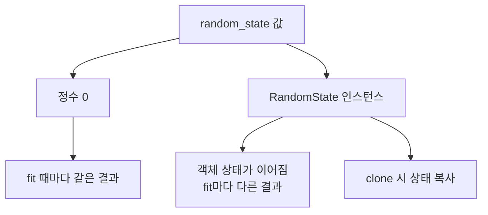

# RandomState 인스턴스 vs 정수

> scikit-learn의 `random_state`에 **정수**를 주면 호출할 때마다 같은 결과가 나오고, **`RandomState` 인스턴스**를 주면 객체의 난수 상태가 호출마다 **이어서 진행**되어 결과가 달라질 수 있다. 목적(재현성 vs 무작위 변동 측정)에 맞게 고른다.

## 쉽게 말하면
정수는 "매번 같은 페이지부터 읽는 주사위표", 인스턴스는 "한 권의 주사위표를 계속 이어 읽는 것"이다. 두 번째 읽을 때는 이어진 다음 줄이므로 다른 숫자가 나온다.

## 자세히
- scikit-learn 공식 문서(Controlling randomness): 정수는 여러 호출에 걸쳐 **같은 결과**를 보장하며 교차검증 분할 등에 쓰기 좋고, 인스턴스는 호출 때마다 다른 결과를 내므로 **무작위성 변동을 견고하게 반영**하고 싶을 때 쓴다. 또한 `clone`은 인스턴스를 복사해 추정기들이 같은 상태에서 시작한다.
- **직접 실행**(scikit-learn 1.9.1, make_classification 600개, RandomForest 20그루):

| 설정 | `cross_val_score` 두 번 실행 | 같은 추정기를 `fit` 두 번 |
|---|---|---|
| `random_state=0` | 5폴드 점수 동일 | 예측 확률 **동일** |
| `RandomState(0)` 인스턴스 | 5폴드 점수 **동일**(clone이 상태를 복사) | 예측 확률 **다름** |

  교차검증은 매 폴드마다 추정기를 `clone`하므로 인스턴스여도 같은 값이 나온다. 차이는 **같은 객체를 직접 반복 fit**할 때 드러난다.
- **선택 기준**: ① 재현 가능한 실험·디버깅·버그 신고 → 정수, ② "여러 번 fit해 무작위 변동을 평균"하려는 경우 → 인스턴스(또는 시드 목록 반복), ③ 전역 `np.random.seed`에 의존하지 않는다.
- 한계: 이 표는 RandomForest·단일 환경에서의 관찰이다. 추정기·버전에 따라 동작이 다를 수 있으니 공식 문서를 우선한다.

## 그림으로 보기


## 예시
```python
m = RandomForestClassifier(20, random_state=np.random.RandomState(0))
p1 = m.fit(X, y).predict_proba(X[:3])
p2 = m.fit(X, y).predict_proba(X[:3])   # p1 != p2
```
- 보고용 실험은 `random_state=0`처럼 정수, 변동 측정은 시드 0~9를 명시적으로 반복.

## 헷갈리는 것과 비교
| 개념 | 차이 |
|---|---|
| 정수 시드 | 호출마다 같은 시작점 |
| RandomState 인스턴스 | 호출마다 상태가 진행 |
| [분할 시드 vs 모델 시드](#split-seed-vs-model-seed) | 어떤 무작위를 고정할지 |
| [사전에 정한 시드](#preregistered-seed) | 시드 목록을 미리 기록 |

## 더 읽을거리
- [scikit-learn: Controlling randomness](https://scikit-learn.org/stable/common_pitfalls.html#controlling-randomness) — 정수·인스턴스 차이 공식 설명.
- [Glossary: random_state](https://scikit-learn.org/stable/glossary.html#term-random_state) — 용어집 정의.
