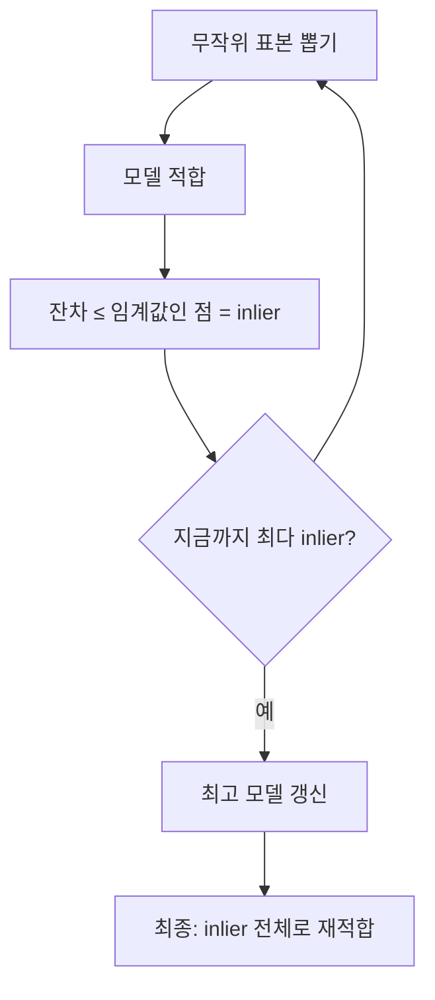

# RANSAC

> RANSAC(RANdom SAmple Consensus)은 무작위 표본으로 모델을 여러 번 맞춰 보고, 가장 많은 데이터가 "동의(inlier)"하는 모델을 고르는 이상치에 강한 회귀 방법이다.

## 쉽게 말하면
직선을 긋는데 점 몇 개가 엉뚱한 곳에 찍혀 있다. 점 두세 개를 무작위로 뽑아 선을 긋고, 그 선 근처에 점이 몇 개인지 세어 가장 많은 점이 모이는 선을 고른다. 이상한 점은 투표에서 자연히 밀린다.

## 자세히
scikit-learn 문서(`RANSACRegressor`, 2026-11 확인):
1. `min_samples`개 무작위 점을 뽑고 `is_data_valid`로 검사
2. 모델을 적합하고 `is_model_valid`로 검사
3. 잔차 절댓값이 `residual_threshold` 이하인 점을 inlier로 분류
4. inlier가 가장 많은 모델 채택(동점이면 점수) → 최종적으로 **그 inlier 전체로 다시 적합**
- 비결정적이며 `max_trials`에 따라 확률적으로 좋은 결과를 낸다. 조기 종료 `stop_n_inliers`, `stop_score`.
- 문서의 조언: "When in doubt, use RANSAC." y 방향의 큰 이상치(가장 흔한 상황)에 최선이고 Theil-Sen보다 빠르며 표본 수에 잘 확장된다. 고차원에선 어렵다.
- 임계값 `residual_threshold`를 잘못 잡으면 정상 점까지 버릴 수 있어 튜닝이 필요(일반 관행).

## 그림으로 보기

## 예시
센서 데이터에 가끔 튀는 값이 섞인 온도 보정 회귀: `RANSACRegressor(residual_threshold=1.0, max_trials=100, random_state=0).fit(X, y)`.

## 헷갈리는 것과 비교
| 개념 | 차이 |
|---|---|
| RANSAC | 이상치를 버리고 inlier만으로 적합, 비결정적 |
| [Huber 손실](#huber-loss) | 이상치를 버리지 않고 영향만 줄임 |
| [강건 회귀](#robust-regression) | 이들을 포함하는 큰 범주 |
| [이상치 처리](#outlier-handling) | 데이터 전처리 관점 |

## 더 읽을거리
- [scikit-learn Linear Models: Robustness regression](https://scikit-learn.org/stable/modules/linear_model.html#robustness-regression-outliers-and-modeling-errors) — RANSAC 절차와 선택 기준.
