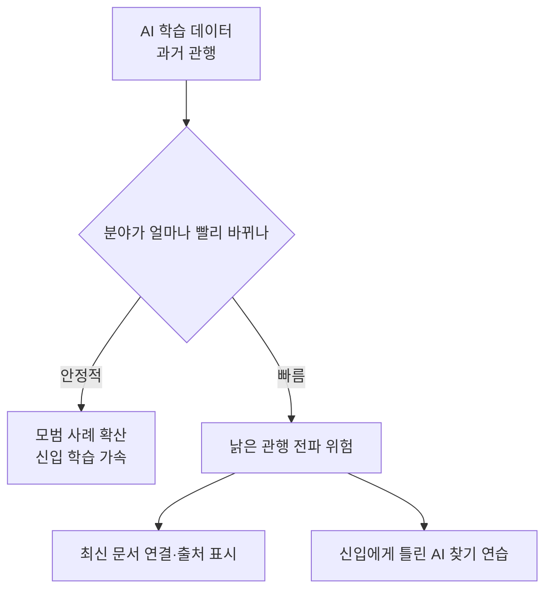

# 빠르게 바뀌는 분야의 한계

> AI 보조가 신입을 빨리 키운다는 연구 결과는 제품과 지식이 비교적 안정된 환경에서 나왔다. 규정·제품·업계 관행이 빠르게 바뀌는 분야에서는 AI가 과거 데이터에 담긴 낡은 관행을 신입에게 퍼뜨릴 수 있어 효과가 뒤집힐 가능성이 있다.

## 쉽게 말하면
작년 지도를 보고 길을 안내하는 네비게이션을 생각해 보자. 도로가 안 바뀌는 동네에서는 아주 좋다. 도시 개발로 길이 계속 바뀌는 동네에서는 신입 운전자에게 "이 길로 가라"고 자신 있게 틀린 안내를 한다. 신입은 선배와 달리 틀린 걸 알아채기 어렵다. AI 보조가 도움이 되는지는 "그 분야의 정답이 얼마나 오래 유지되는가"에 달려 있다.

## 자세히
출처: Brynjolfsson, Li, Raymond "Generative AI at Work" NBER 31161 결론부(PDF 직접 읽음), 드리프트 개념은 Evidently AI 가이드(검색 결과로만 확인, 직접 열진 않음).
- **논문이 스스로 밝힌 한계**: "우리 연구 환경은 비교적 안정된 제품과 기술 지원 질문들"이다. 제품이나 환경이 빠르게 바뀌는 곳에서는 AI 추천의 상대적 가치가 달라질 수 있다. 두 방향이 모두 가능하다. ① 바뀌는 모범 사례를 잘 종합할 수 있다. ② 과거 학습 데이터에 있던 낡은 관행을 퍼뜨려 **오히려 학습을 방해**할 수 있다. 어느 쪽인지 이 논문은 검증하지 않았다.
- **왜 신입이 더 취약한가(이 글의 추론)**: 숙련자는 AI의 낡은 제안을 걸러 낼 경험이 있지만 신입은 그렇지 않고, 연구에서 신입일수록 추천을 더 의존해 이득을 봤다(근속 1개월 미만이 가장 큰 이득). 같은 의존이 낡은 정보에는 위험이 된다.
- **ML 용어로**: 입력 분포가 변하는 **데이터 드리프트**, 입력과 정답의 관계가 변하는 **개념 드리프트**. Evidently는 둘이 함께 나타나기도 하고 개념 드리프트가 데이터 드리프트 없이 나타날 수도 있다고 설명한다. 정답 라벨이 있어야 개념 드리프트를 확인하기 쉽다(검색 요약).
- **업무 예**: 세법·규제 개정, SaaS 제품 신기능, 가격표·정책이 자주 바뀌는 고객 지원, 최신 보안 취약점. 이런 분야에서는 AI 학습 데이터 시점 이후의 변화를 모른다.
- **완화책(제안)**: 검색 기반으로 최신 문서를 끌어오기(RAG), 추천에 출처·날짜 표시, 담당자가 정답 지식을 주기로 갱신, 신입 교육에서 "AI 답이 낡았을 때"를 일부러 연습, 정답과의 불일치율 모니터링.
- **연구의 다른 가정**: 상담 주제가 상담사에게 무작위 배정된다고 논문이 가정한 대목이 있다. 이것이 깨지는 환경에서는 비교가 달라진다.

## 그림으로 보기

## 예시
- 연말정산 안내 AI: 매년 세법이 바뀌므로 작년 답변을 그대로 따라 하면 틀린다 → 답변에 기준 연도·조문 링크를 표시.
- 신제품 출시 직후 지원센터: 출시 첫 주는 AI 추천을 참고용으로만 쓰고 담당자 공지를 우선한다.

## 헷갈리는 것과 비교
| 개념 | 차이 |
|---|---|
| 데이터 드리프트 | 입력 분포가 바뀜 |
| 개념 드리프트 | 입력과 정답의 관계가 바뀜 |
| [경험 곡선 단축](#experience-curve-ai) | 안정된 환경에서 관측된 효과 |
| [AI 보조 하의 신입 교육](#training-with-ai-assistant) | 추천을 따르며 배우는 효과 |

## 더 읽을거리
- [NBER Working Paper 31161](https://www.nber.org/system/files/working_papers/w31161/w31161.pdf) — 결론의 한계 논의(직접 읽음)
- [What is concept drift in ML (Evidently AI)](https://www.evidentlyai.com/ml-in-production/concept-drift) — 드리프트 정의(검색 결과로만 확인)
- [What is data drift in ML (Evidently AI)](https://www.evidentlyai.com/ml-in-production/data-drift) — 데이터 드리프트
