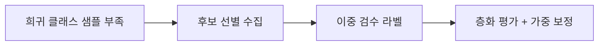
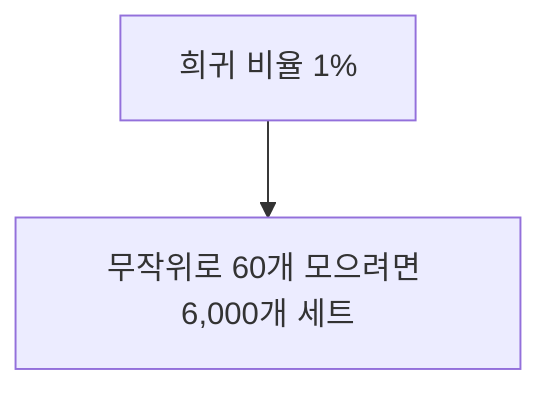

# 희귀 클래스 추가 수집

> 희귀 클래스 추가 수집은 샘플이 너무 적어 층화 분할·클래스별 평가가 불가능한 클래스를 목적을 갖고 더 모아, 그 클래스에서 믿을 만한 지표를 낼 수 있게 만드는 일이다.

## 쉽게 말하면
특이한 사례가 하루에 한 건씩 생기는 병의 진단 정확도를 재려면 그 환자를 일부러 더 모아야 한다. 일반 환자 만 명 중에 몇 명뿐이면 평가 자체가 불가능하다.

## 자세히
- **필요한 샘플 수(Wikipedia, Sample size determination의 공식 n = z²·p(1−p)/E²를 직접 계산)**: 클래스의 재현율(또는 정확도)을 95% 신뢰로 ±E 안에서 추정하려면 아래 개수가 필요하다.

| 예상 재현율 p | ±15%p | ±10%p | ±5%p |
| --- | --- | --- | --- |
| 0.5(최악) | 43 | 97 | 385 |
| 0.8 | 28 | 62 | 246 |
| 0.9 | 16 | 35 | 139 |

  재현율 0.8 정도의 희귀 클래스를 ±10%p로 평가하려면 그 클래스 평가 샘플이 약 62개 필요하다.
- **일반 표본에서 모으려면(직접 계산)**: 희귀 클래스 비율이 5%, 1%, 0.5%일 때 평가용 희귀 샘플 60개를 얻으려면 무작위 평가 세트가 각각 약 1,200 / 6,000 / 12,000개여야 한다(100개를 원하면 2,000 / 10,000 / 20,000). 비율이 낮을수록 무작위로는 비효율적이다.
- **수집 방법(해석)**: ① 모델 점수나 키워드로 희귀 클래스 후보를 먼저 뽑아 검수([precision@k 검수 효율](#precision-at-k-review)) ② 출처 다양화(기간·지역·채널) ③ 의도적 수집으로 분포가 달라지므로 평가용 표본은 층화 가중치로 보정해 전체 성능을 계산 ④ 수집한 샘플은 이중 검수([이중 검수](#double-annotation-review)).
- **주의(해석)**: 일부러 모은 희귀 샘플은 실제 분포를 대표하지 않아 "그 클래스에서의 재현율"은 잘 재지만 정밀도(다른 클래스가 섞이는 정도)는 실제 비율 표본이 있어야 알 수 있다. 연결: 분할 조건은 [test_size와 클래스 수 규칙](#stratify-test-size-rule), 합치는 선택은 [희귀 클래스 병합](#merge-rare-classes).

## 그림으로 보기

## 예시
- 사기 의심 클래스가 전체의 1%라면 무작위 평가 6,000건 대신, 의심 점수 상위에서 뽑아 100건을 확보하고 검수한다.
- 교육 활용: 클래스 비율과 목표 오차를 바꿔 필요한 수집량 표를 만든다.

## 헷갈리는 것과 비교
| 개념 | 차이 |
| --- | --- |
| 추가 수집 | 샘플을 늘려 해결 |
| [희귀 클래스 병합](#merge-rare-classes) | 클래스 수를 줄여 해결 |
| [희귀 클래스 학습 전용 처리](#train-only-rare-class) | 평가를 포기하고 학습에만 사용 |
| [품질 표본 추출 계획](#quality-sampling-plan) | 일반 표본 설계 |

## 더 읽을거리
- [Sample size determination (Wikipedia)](https://en.wikipedia.org/wiki/Sample_size_determination) — 비율 추정 표본 크기
